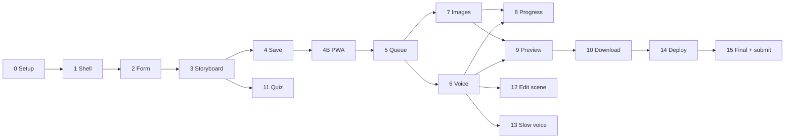

# BUILD_PLAN.md: Lessonreel, feature by feature

|                                        |                                                                                                                                                                          |
| -------------------------------------- | ------------------------------------------------------------------------------------------------------------------------------------------------------------------------ |
| Hackathon                              | #BuildHybridAI 2026 ([`HACKATHON.md`](HACKATHON.md))                                                                                                                     |
| Process                                | [`DEVELOPMENT_PROTOCOL.md`](DEVELOPMENT_PROTOCOL.md): build → explain → test → **Benjamin tests** → break it → fix → review → guide → **approve** → commit → push → next |
| What each feature must do              | [`docs/04-functional-spec.md`](docs/04-functional-spec.md) (F-n, BR-n, AC-n)                                                                                             |
| How it's built technically             | [`TDD.md`](TDD.md)                                                                                                                                                       |
| What each feature does, in plain words | [`FEATURE_GUIDE.md`](FEATURE_GUIDE.md)                                                                                                                                   |
| Last updated                           | 2026-11-19                                                                                                                                                               |

## Project overview

Lessonreel turns a teacher's lesson notes into a short narrated explainer video. Gemini Nano on the device writes the storyboard, even offline. Voice and images come from the cloud through a queue that runs by itself when the internet returns. The teacher previews and downloads one video file. Full product description: [`docs/01-product-requirements.md`](docs/01-product-requirements.md).

## Important: code that already exists

A first version of most of the code was written in one go on Nov 18–19, before this protocol was adopted. **None of it has been tested or approved by Benjamin yet.** Rule for stages marked 🟡: Claude Code first explains what's there, runs it, gives Benjamin a testing guide, fixes problems, and only then completes the missing parts. Nothing counts as done until Benjamin approves it and the push is verified.

Status key: ⬜ not started · 🟡 code exists, not tested by Benjamin · 🔵 in progress · ✅ approved + pushed

## Stage overview

| Stage | Feature                                                | Spec IDs                           | Depends on | Status | Target    |
| ----- | ------------------------------------------------------ | ---------------------------------- | ---------- | ------ | --------- |
| 0     | Setup, GitHub backup, Firebase project                 | §7–§9 of HACKATHON.md              | n/a        | 🟡     | Nov 19    |
| 1     | App shell + connection and Nano status                 | S-0, F3.2, F3.3                    | 0          | 🟡     | Nov 20    |
| 2     | Lesson form + validation                               | S-1, F1, BR-1, E-2                 | 1          | 🟡     | Nov 20    |
| 3     | Storyboard: on-device with cloud fallback              | S-2, F2.1–F2.4, F3, F7.1, E-1, E-3 | 2          | 🟡     | Nov 20    |
| 4     | Save and reload the lesson                             | F11.2, D-1                         | 3          | 🟡     | Nov 21    |
| 4B    | Installable offline app (PWA) + brand icon             | F12, UF-6, UF-7, S-0b, ADR-012     | 4          | ⬜     | Nov 21    |
| 5     | Plan jobs + offline queue                              | F6.1–F6.3, F7.2, BR-8, D-3         | 4          | 🟡     | Nov 21    |
| 6     | Narration (translate + voice)                          | F4.1–F4.3, ADR-007                 | 5          | 🟡     | Nov 21    |
| 7     | Scene images                                           | F5                                 | 5          | 🟡     | Nov 22    |
| 8     | Per-scene progress + retry failed                      | S-3, F6.4–F6.6, E-5                | 6, 7       | ⬜     | Nov 22    |
| 9     | Preview player                                         | S-4, F8                            | 6, 7       | 🟡     | Nov 22    |
| 10    | Download the video                                     | S-5, F9, E-6                       | 9          | 🟡     | Nov 23    |
| 11    | Quiz panel + copy                                      | F2.5                               | 3          | ⬜     | Nov 23    |
| 12    | Edit a scene before voice (Should)                     | F2.6, UF-4                         | 5, 6       | ⬜     | Nov 24    |
| 13    | Slow narration toggle (Should)                         | F4.4                               | 6          | ⬜     | Nov 24    |
| 14    | Deploy + App Check enforcement + judge path            | N4, N5, N7                         | 1–10       | ⬜     | Nov 25    |
| 15    | Final end-to-end test, polish, evidence, video, submit | §11 of HACKATHON.md                | all        | ⬜     | Nov 26–29 |

**Feature freeze: Nov 26.** Stages 12–13 are cut first if time runs short. Order follows "riskiest first": Stage 3 (Nano JSON), Stage 6 (TTS model/languages) and Stage 10 (export in real Chrome) are the big unknowns.

---

## Stage details

Every stage ends with the same **exit gate** (not repeated below):

> Technical checks pass (`pnpm run ci`, app runs, no console errors) · stage test cases in [`docs/09-test-cases.md`](docs/09-test-cases.md) run and recorded · Benjamin tested the happy path **and** the break tests · problems fixed · self-review done (functionality, security, reliability, UX, hackathon readiness) · `FEATURE_GUIDE.md` updated · Benjamin approved · commit + **push verified**.

### Stage 0: Setup, GitHub backup, Firebase project 🟡

- **What it does:** Gets Benjamin's Windows machine ready, puts the project on GitHub, and creates the Firebase project.
- **What Benjamin can do after:** run `pnpm dev`, open the app on `localhost:5173`, see the code on github.com.
- **Steps:** HACKATHON.md §7 (tools, one at a time) → §9.1 (fix commit authors, create repo, push) → §8 (Firebase console).
- **Test:** `pnpm run ci` passes (14 tests). `git status` says up to date with origin. Repo visible on GitHub. `.env.local` is ignored (`git check-ignore apps\web\.env.local`).
- **Break tests:** run `git status` after creating `.env.local` and confirm it is **not** listed.
- **Done when:** exit gate + Firebase web config in `.env.local` + App Check debug token registered.

### Stage 1: App shell + connection and Nano status 🟡

- **What it does:** The header (S-0): app name, Online/Offline pill, Nano status, "Prepare offline model" button that downloads Gemini Nano with a progress %.
- **Missing today:** check Nano status **on page load** without downloading (F3.3).
- **What Benjamin can do:** see if he's online; see if his Chrome can run AI offline; download the model once.
- **Data/services:** browser `online`/`offline` events; Firebase AI Logic `initializeDeviceModel` (needs a click).
- **Test:** turn Wi-Fi off/on and watch the pill change. Click Prepare: % rises to "ready" (or "not available here" on unsupported machines).
- **Break tests:** click Prepare twice quickly; click it while offline; reload during download.

### Stage 2: Lesson form + validation 🟡

- **What it does:** S-1 form: notes, audience, scenes (3–8), second language.
- **Missing today:** character counter (F1.5), "Try sample notes" (F1.6), phone layout where the form row stacks, privacy line under the notes box.
- **What Benjamin can do:** fill in a lesson and see clear messages when something is wrong.
- **Test:** valid notes → button works. Sample notes fills the box.
- **Break tests:** empty notes; only spaces; 12,001+ characters; emoji and symbols (`<script>`, `& " '`); scenes = 0, 99, -3, blank; double-click Make; phone width 390 px.

### Stage 3: Storyboard, on-device with cloud fallback 🟡

- **What it does:** turns notes into scenes + quiz using Gemini Nano (offline) or the cloud model, validates the result, repairs it once if broken, shows the On-device/Cloud badge and time taken.
- **What Benjamin can do:** see a storyboard appear with Wi-Fi **off**.
- **Data/services:** Firebase AI Logic (`PREFER_ON_DEVICE`), App Check, Zod schema in `packages/core`.
- **Open questions to close (TDD §24):** #1 Nano on this laptop, #2 cloud model available, #8 `responseConstraint` honoured.
- **Test (riskiest stage):** run **5 real lesson notes** with Wi-Fi off; record time and whether JSON was valid in `evidence/`. Then the same with Nano disabled → Cloud badge.
- **Break tests:** very short notes ("Water boils."); notes in French; notes with a list of 30 bullets; offline on a machine without Nano (E-1 message, notes kept).

### Stage 4: Save and reload the lesson 🟡

- **What it does:** saves the storyboard in the browser (IndexedDB) so a refresh doesn't lose it.
- **Missing today:** S-6 "My lessons" list is a Could (not planned unless time allows).
- **Test:** make a storyboard, refresh → it's still there.
- **Break tests:** refresh while generating; open in a second tab; clear site data → app still loads with an empty state.

### Stage 4B: Installable offline app (PWA) + brand icon ⬜

- **What it does:** the app's own files are saved on the device so Lessonreel opens with no internet, even after Chrome was closed. Adds the Lessonreel icon, "Works offline ✓" pill and install banner.
- **Why:** found in the design audit. Without it, "offline" only works while the tab stays open.
- **Build:** `vite-plugin-pwa` (ADR-012), manifest (name, icons from [11 §3](docs/11-brand-guidelines.md#3-visual-identity)), precache app shell + font, **never cache Firebase/Gemini calls**, update prompt ([13 §10](docs/13-ux-writing.md#10-onboarding-install-and-offline)).
- **Test:** TC-4B.1–4B.5 in [09](docs/09-test-cases.md). Open once online → close Chrome → Wi-Fi off → open from icon → app + last lesson load.
- **Break tests:** deploy a new version → "new version" message; clear site data → reload online re-caches; check Network tab that AI calls aren't served from cache.

### Stage 5: Plan jobs + offline queue 🟡

- **What it does:** after a storyboard, plans one image job per scene and one voice job per scene per language, saved in Firestore's offline cache; runs them automatically when online, 2 at a time.
- **Test:** create a storyboard offline → "Queued … 0/n". Refresh → still queued. Go online → count rises without clicking anything.
- **Break tests:** go offline mid-way; close the tab mid-way and reopen; check in Firestore console that only job metadata (no lesson text) is stored; confirm another browser can't read the jobs (rules).

### Stage 6: Narration (translate + voice) 🟡

- **What it does:** for each scene: translate (if not English) → Gemini TTS → WAV saved on the device.
- **First task:** confirm the current TTS model name and that each language code works; record results in `evidence/tts-languages.txt`.
- **Test:** play a French or Swahili clip; it must be spoken in that language.
- **Break tests:** a narration with numbers/symbols; a language marked preview (Swahili); go offline mid-generation.

### Stage 7: Scene images 🟡

- **What it does:** one illustration per scene from the cloud; skipped with a placeholder if no image model is set.
- **First task:** confirm the current image model name for Firebase AI Logic; check free-tier limits (quota form by Nov 25 if needed).
- **Test:** images appear for each scene, no text in the images.
- **Break tests:** unset `VITE_IMAGE_MODEL` → placeholders, no crash.

### Stage 8: Per-scene progress + retry failed ⬜

- **What it does:** S-3 shows each scene's image/voice status (○ … ✓ ✕) and a "Retry failed scenes" button.
- **Test:** watch rows update live. Force a failure (e.g. a bad model name) → ✕ after 3 tries → Retry works after fixing it.
- **Break tests:** click Retry repeatedly; retry while offline.

### Stage 9: Preview player 🟡

- **What it does:** plays the scenes in the page with image, caption and voice.
- **Test:** full preview plays in order with sound; scenes without audio use their duration.
- **Break tests:** click Preview twice; change language mid-preview; preview on a phone.

### Stage 10: Download the video 🟡

- **What it does:** renders one MP4 (or WebM) file in the browser with progress %.
- **Test:** download a 5-scene video; play it in VLC and send it to WhatsApp; check audio/caption sync.
- **Break tests:** click Download while jobs are still running (must be disabled); switch tabs during rendering; a 2-minute video.

### Stage 11: Quiz panel + copy ⬜

- **What it does:** shows the 3 quiz questions with the right answer marked and a "Copy quiz" button.
- **Test:** copy and paste into WhatsApp/Notes; formatting is readable.
- **Break tests:** a storyboard with no quiz; click Copy repeatedly.

### Stage 12: Edit a scene before voice (Should) ⬜

- **What it does:** edit narration/on-screen text; that scene's voice jobs reset.
- **Break tests:** empty text; 401+ characters; edit after voice was made.

### Stage 13: Slow narration toggle (Should) ⬜

- **What it does:** a checkbox for slower, clearer narration for younger learners.
- **Test:** compare a normal and slow clip.

### Stage 14: Deploy + App Check enforcement + judge path ⬜

- **What it does:** live on Firebase Hosting, App Check enforced, works for judges without Nano.
- **Test:** open the `*.web.app` link in incognito on a second computer and on the phone; full journey with the Cloud badge.
- **Break tests:** block reCAPTCHA (ad blocker) → understandable message.

### Stage 15: Final end-to-end, polish, evidence, video, submit ⬜

- Phase 9 of the protocol: test as first-time user, returning user, user who makes mistakes, slow connection (Chrome DevTools → Network → Slow 3G), phone, and judge.
- Collect `evidence/` screenshots, finish README, record the demo ([`docs/10-demo-plan.md`](docs/10-demo-plan.md)), run HACKATHON.md §9.5 and §11, **submit Nov 29**.

---

## Testing on your phone (Phase 4)

On-device AI won't run on a phone (Gemini Nano for web needs desktop Chrome), so phones always use the **cloud path**. That's still worth testing: it's what many teachers and judges will see.

| Option                                     | How                                                                                                                                                                                | Notes                                                                                                                    |
| ------------------------------------------ | ---------------------------------------------------------------------------------------------------------------------------------------------------------------------------------- | ------------------------------------------------------------------------------------------------------------------------ |
| **A. Firebase preview link (recommended)** | `pnpm build` then `firebase hosting:channel:deploy test` → open the printed `https://…web.app` link on the phone                                                                   | HTTPS, works anywhere, App Check works with the production key                                                           |
| B. Same Wi-Fi, dev server                  | `pnpm dev:lan` → run `ipconfig` and find the IPv4 address (e.g. `192.168.1.23`) → on the phone open `http://192.168.1.23:5173` → allow Node.js through Windows Firewall when asked | Plain http: add the IP to Firebase Auth's authorized domains; App Check/reCAPTCHA may block it. Use option A if it fails |

Check on the phone: text readable without zooming, buttons easy to tap (≥ 44 px), form fields don't get hidden by the keyboard, nothing scrolls sideways, video stage fits, portrait and landscape.

## Change log

- 2026-11-19: Design pack (docs/11–15) added. New Stage 4B (PWA) from the design audit; Stage 2 now includes the token/font/wording fixes.
- 2026-11-19: TDD.md added. Stale `running` job recovery fixed early (was planned for Stage 8).
- 2026-11-19: Plan created. Existing code mapped to stages as 🟡. Fixed `crypto.randomUUID` crash on plain-http phone testing; added `pnpm dev:lan`.
