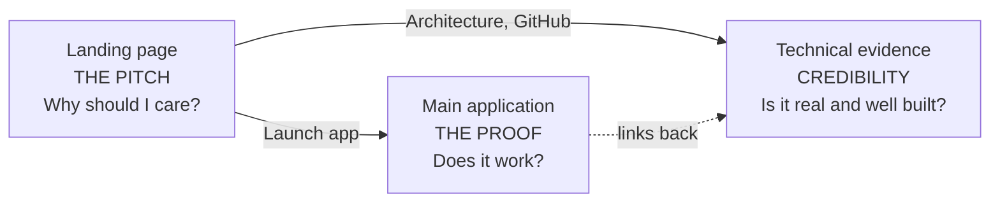
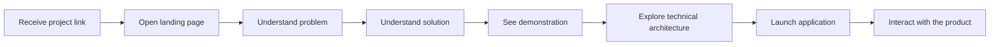
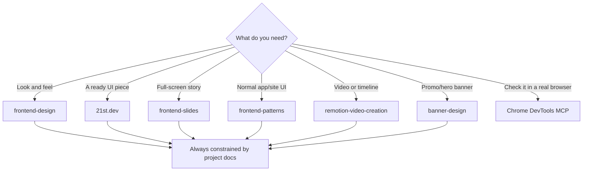

# HACKATHON_LANDING_PAGE_AND_FRONTEND_TOOLING.md

> **The landing page is the pitch. The main application is the proof. Technical evidence establishes credibility. The right skills and tools help us build and validate each experience professionally.**

|              |                                                                                                                                                                                                                                                                                                                                  |
| ------------ | -------------------------------------------------------------------------------------------------------------------------------------------------------------------------------------------------------------------------------------------------------------------------------------------------------------------------------- |
| Purpose      | A practical reference for presenting, building and testing the public-facing side of a hackathon project, and for choosing frontend skills and tools. Part I is general guidance; **Part II applies it to Lessonreel**                                                                                                           |
| Status       | Documentation only. **Nothing in this file has been installed.** Installing any skill/MCP needs Benjamin's approval ([§H](#h-installation-and-security-policy))                                                                                                                                                                  |
| Last updated | 2026-11-19                                                                                                                                                                                                                                                                                                                       |
| Related      | [`HACKATHON.md`](HACKATHON.md) · [`docs/10-demo-plan.md`](docs/10-demo-plan.md) · [`docs/11-brand-guidelines.md`](docs/11-brand-guidelines.md) · [`docs/12-design-system.md`](docs/12-design-system.md) · [`docs/13-ux-writing.md`](docs/13-ux-writing.md) · [`docs/15-design-qa.md`](docs/15-design-qa.md) · [`TDD.md`](TDD.md) |

**Labels:** **[FACT]** checked in an official source on 2026-11-19 · **[UNVERIFIED]** from the supplied notes, not confirmed · **[RECOMMENDATION]** our advice · **[ASSUMPTION]** working guess.

## Contents

**Part I: General guidance**

- [A. Product presentation architecture](#a-product-presentation-architecture)
- [B. Landing page structure](#b-landing-page-structure)
- [C. The judge experience](#c-the-judge-experience)
- [D. Frontend design and development tools](#d-frontend-design-and-development-tools)
- [E. Skill and tool selection guide](#e-skill-and-tool-selection-guide)
- [F. Recommended development workflow](#f-recommended-development-workflow)
- [G. Prompt library](#g-prompt-library)
- [H. Installation and security policy](#h-installation-and-security-policy)

**Part II: Lessonreel**

- [I. Project-specific application](#i-project-specific-application)
- [Verification report](#verification-report)

---

# Part I: General guidance

## A. Product presentation architecture

A hackathon project has three public layers. Each has a different job.



### A.1 Landing page: the pitch

Designed to **convince a visitor to explore the product**. It communicates:

- what we built,
- what problem it solves and who it's for,
- why the problem matters,
- how the solution works,
- what makes it different,
- why the technology is interesting,
- what results or impact it delivers (only real ones), and
- how judges can try it.

### A.2 Main application: the proof

Where judges and users **interact with the working product**. Typical areas, _only where the project actually has them_: dashboard, core functionality, analytics, portfolio, AI features, Web3 features, settings.

### A.3 Technical evidence: credibility

Shows the work is real and well engineered:

- system architecture diagram,
- APIs and integrations,
- AI models (and where they run),
- smart contracts and blockchain infrastructure (Web3 projects),
- database design,
- automation and AI agents,
- key technical decisions,
- a GitHub repository with a clear README, and
- a live demonstration or video.

### A.4 Landing page vs marketing website

|        | Landing page                           | Marketing website                                                 |
| ------ | -------------------------------------- | ----------------------------------------------------------------- |
| Shape  | Usually **one focused page**           | A **collection of pages** (features, pricing, blog, about, docs…) |
| Goal   | One primary action (e.g. "Launch app") | Many audiences and purposes                                       |
| Effort | Hours                                  | Days to weeks                                                     |

**For a hackathon MVP, a focused landing page is usually better** [RECOMMENDATION]: judges have minutes, not hours; every extra page is time taken from the product; and one clear action ("Launch app") is easier to follow than navigation menus. Build a marketing site only after the product proves itself.

## B. Landing page structure

Guideline: a judge should **understand the project's value within roughly 30–60 seconds** of opening the page. This is a presentation target, not a guaranteed outcome: test it on someone who hasn't seen the project.

| #   | Section                              | Purpose                    | Communicates                                | Content / visuals                                                            | Audience                       | Leads to     |
| --- | ------------------------------------ | -------------------------- | ------------------------------------------- | ---------------------------------------------------------------------------- | ------------------------------ | ------------ |
| 1   | Navigation & branding                | Orient instantly           | Product name, what it is                    | Logo, 2–4 anchor links, **Launch app** button (always visible)               | Everyone                       | Hero         |
| 2   | Hero                                 | Win the first 5 seconds    | One-line value proposition + primary action | Headline, subline, Launch app + Watch demo, product screenshot or short loop | Judges, first-time visitors    | Problem      |
| 3   | Problem                              | Make the pain real         | Who suffers, how, why it matters            | One person + one moment; 1–2 real facts with sources                         | Judges (impact criterion)      | Solution     |
| 4   | Solution                             | Show the answer            | What the product does, in one sentence      | Before/after, 3 short points                                                 | Judges                         | Demo         |
| 5   | Product demonstration                | Prove it works             | The core journey                            | Embedded video (≤ 3 min), GIF, or annotated screenshots                      | Judges                         | Features     |
| 6   | Key features                         | Detail the value           | 3–5 features that exist **today**           | Icon/visual + one sentence each                                              | Users, judges                  | How it works |
| 7   | How it works                         | Make it understandable     | Steps from input to outcome                 | 3–4 numbered steps                                                           | Non-technical judges           | Architecture |
| 8   | Architecture & technical explanation | Earn technical credibility | Components, data flow, why these choices    | Diagram, short captions, decisions                                           | Technical judges, AI screeners | Tech stack   |
| 9   | Technology stack                     | Show sponsor/tech use      | What's used and **what each actually does** | Grouped list with roles, not a logo wall                                     | Sponsor judges                 | Results      |
| 10  | Results & impact                     | Show outcomes              | Real measurements, tests, user feedback     | Numbers with context, quotes (real only)                                     | Judges                         | GitHub       |
| 11  | GitHub / technical resources         | Let experts verify         | Repo, docs, licence, evidence               | Repo card, links to README/TDD/evidence                                      | Technical judges               | Final CTA    |
| 12  | Final call to action                 | Convert interest           | "Try it now"                                | Launch app button + one sentence                                             | Everyone                       | Footer       |
| 13  | Footer                               | Close cleanly              | Team, licence, hackathon, contact           | Small text, links                                                            | Everyone                       | n/a          |

Keep claims honest: no invented metrics, no "coming soon" features presented as working.

## C. The judge experience



| Stage                | The judge should understand…                                     |
| -------------------- | ---------------------------------------------------------------- |
| Receive link         | "This is a real, hosted project" (link works, HTTPS, loads fast) |
| Open landing page    | What it is and who it's for, from the hero alone                 |
| Understand problem   | Why this matters to a specific group of people                   |
| Understand solution  | What the product does differently                                |
| See demonstration    | That the core journey works end to end                           |
| Explore architecture | How it's built and how sponsor tech is genuinely used            |
| Launch application   | Exactly where to click; no detours                               |
| Interact             | They can complete the main task themselves                       |

**Usability requirements:**

- clear navigation;
- an obvious **Launch app** button;
- every link works;
- the demo is accessible (captions, keyboard);
- no misleading claims and **no fake functionality**;
- no unnecessary registration barriers (demo account or no login);
- limitations explained clearly; and
- the application entry is reliable (tested in incognito, on a phone, on another network).

> The landing page sells the product. The application proves it.

## D. Frontend design and development tools

Four kinds of help, not interchangeable:

- **Skills** give the agent reusable expertise and workflows.
- **MCP servers** connect the agent to external tools and capabilities.
- **Component libraries** provide reusable UI pieces.
- **Project documentation** says what _this_ project requires, and always wins.

### D.A 21st.dev (UI components and inspiration)

|                           |                                                                                                                                                                                                               |
| ------------------------- | ------------------------------------------------------------------------------------------------------------------------------------------------------------------------------------------------------------- |
| What it is                | A catalogue of community UI components plus an MCP server ("21st MCP", formerly Magic MCP) that lets an agent search, install and generate components **[FACT]** ([21st.dev/mcp.md](https://21st.dev/mcp.md)) |
| Good for                  | Hero sections, navigation, cards, bento grids, pricing sections, dashboards, forms, buttons, footers                                                                                                          |
| Not for                   | Backend logic, database architecture, business logic                                                                                                                                                          |
| Stack fit                 | Components are **React** (the catalogue advertises 12,000+ React components) **[FACT]**. Projects without React must adapt the markup/CSS by hand                                                             |
| Keeping design consistent | Treat components as **starting points**: restyle with the project's design tokens, rename classes, remove unused variants, run design QA. Never mix several component styles on one page                      |

**Installation reference (from the notes):** `npx @21st-dev/cli@latest init --client claude`

- **[FACT]** The official setup is `npx @21st-dev/cli@latest init --client <cursor|claude|codex|vscode|devin>`; it prints, or with `--write` writes, your client's config, and you create an **API key** at 21st.dev/mcp ([source](https://21st.dev/mcp.md)).
- **[FACT]** For Claude, `--client claude` writes `.mcp.json` **in your project** ([21st.dev blog](https://21st.dev/blog/introducing-agents-cli)). ⚠️ That file can contain your API key: keep keys out of Git (add `.mcp.json` to `.gitignore` or reference an environment variable).
- The `--client` value must match the coding agent you actually use; check `npx @21st-dev/cli@latest --help` before running.

**Prompt: find and adapt components**

```
Read HACKATHON.md, docs/11-brand-guidelines.md and docs/12-design-system.md first.
Search 21st.dev for 3 candidate <hero/feature-card/footer> components that fit our
"classroom notebook" direction. For each: show the source, explain why it fits, and
list what must change to use our tokens (colours, font, radius, spacing).
Do not install anything or invent product features. Wait for my choice.
```

### D.B Chrome DevTools MCP (browser inspection and testing)

|                  |                                                                                                                                                                                                                                                                                                                                                                                                               |
| ---------------- | ------------------------------------------------------------------------------------------------------------------------------------------------------------------------------------------------------------------------------------------------------------------------------------------------------------------------------------------------------------------------------------------------------------- |
| What it does     | Lets the coding agent control and inspect a real Chrome: **console** messages with source-mapped stack traces, **network** request analysis, **screenshots**, **performance** traces and insights, automated **interactions** via Puppeteer **[FACT]** ([repo](https://github.com/ChromeDevTools/chrome-devtools-mcp)). Responsive/device emulation: see the repo's Tool Reference **[UNVERIFIED in README]** |
| Role in workflow | Build UI → open in browser → inspect → test → identify issues → fix → retest                                                                                                                                                                                                                                                                                                                                  |
| Requirements     | Node.js LTS, npm, current stable Chrome **[FACT]**                                                                                                                                                                                                                                                                                                                                                            |

**Installation references (from the notes). Pick ONE approach:**

| Approach                         | Command(s)                                                                                                                      | Status                                                                                                                                                                                                                   |
| -------------------------------- | ------------------------------------------------------------------------------------------------------------------------------- | ------------------------------------------------------------------------------------------------------------------------------------------------------------------------------------------------------------------------ |
| Plugin (MCP server + its skills) | `/plugin marketplace add ChromeDevTools/chrome-devtools-mcp` then `/plugin install chrome-devtools-mcp@chrome-devtools-plugins` | **[FACT]** documented in the official README                                                                                                                                                                             |
| CLI MCP server only              | `claude mcp add chrome-devtools --scope user npx chrome-devtools-mcp@latest`                                                    | **[UNVERIFIED]**: the README gives no `claude mcp add` line, only a generic config using `npx -y chrome-devtools-mcp@latest`. Check `claude mcp add --help` (Claude Code usually expects `--` before the server command) |

The plugin and the CLI server are **different installs of the same server**: don't install both, or you'll get duplicate tools.

**Verify:** run `/mcp` in Claude Code → `chrome-devtools` listed and connected → ask the agent to open `http://localhost:5173` and take a screenshot.

**Security [FACT, from the README]:**

- It exposes browser content to the agent, which can inspect and modify data. Don't use it with a Chrome profile that's logged in to personal accounts; use a separate profile.
- Performance tools may send trace URLs to Google's CrUX API: add `--no-performance-crux` to turn this off.
- Usage statistics are on by default: opt out with `--no-usage-statistics` (or env `CHROME_DEVTOOLS_MCP_NO_USAGE_STATISTICS`).
- It checks npm for updates: disable with `CHROME_DEVTOOLS_MCP_NO_UPDATE_CHECKS`.

### D.C frontend-slides (slide-like storytelling)

|                 |                                                                                                                                                                                                                                                                                                                                                                                                                                                                                                           |
| --------------- | --------------------------------------------------------------------------------------------------------------------------------------------------------------------------------------------------------------------------------------------------------------------------------------------------------------------------------------------------------------------------------------------------------------------------------------------------------------------------------------------------------- |
| Purpose         | Presentation-style, full-screen, slide-by-slide web experiences                                                                                                                                                                                                                                                                                                                                                                                                                                           |
| Suitable        | Full-screen product storytelling, pitch presentations, animated feature explanations, interactive reports, onboarding tutorials, presentation-style landing pages                                                                                                                                                                                                                                                                                                                                         |
| Unsuitable      | Normal dashboards, standard nav bars, forms and login screens, ordinary product cards, standard CRUD apps                                                                                                                                                                                                                                                                                                                                                                                                 |
| Difference      | Storytelling = one idea per screen, sequenced, often keyboard/scroll-driven. Normal websites = free navigation, scannable sections, task-oriented UI                                                                                                                                                                                                                                                                                                                                                      |
| Source (notes)  | `https://github.com/affaan-m/ECC/tree/main/.agents/skills/frontend-slides`                                                                                                                                                                                                                                                                                                                                                                                                                                |
| Install (notes) | `npx skills add https://github.com/affaan-m/ECC --skill frontend-slides`                                                                                                                                                                                                                                                                                                                                                                                                                                  |
| Verification    | **[FACT]** the ECC repo exists (MIT) and its README lists `skills/frontend-slides/` (HTML slide decks, PPTX-to-web). **[UNVERIFIED]**: the exact folder in the notes (`.agents/skills/…`) and the `npx skills add` command; the README instead documents a guided setup, a Claude Code plugin (`/plugin marketplace add https://github.com/affaan-m/ECC`, `/plugin install ecc@ecc`) and `./install.sh --target claude --skills …`. Folder contents could not be fetched (GitHub blocked automated reads) |

### D.D frontend-patterns (normal website patterns)

|          |                                                                                                                                                                                                              |
| -------- | ------------------------------------------------------------------------------------------------------------------------------------------------------------------------------------------------------------ |
| Purpose  | Conventional frontend patterns and interactions: navigation, forms, cards, state, data loading. Preferable to frontend-slides for **any normal app or site**                                                 |
| Source   | No repository or command in the supplied notes. **[FACT]** the ECC README lists a `skills/frontend-patterns/` skill described as **React and Next.js patterns**. No install command is given here on purpose |
| Fit note | Most useful for React/Next.js projects                                                                                                                                                                       |

### D.E remotion-video-creation (video and timeline visuals)

|                        |                                                                                                                                                                                                                         |
| ---------------------- | ----------------------------------------------------------------------------------------------------------------------------------------------------------------------------------------------------------------------- |
| Purpose                | Programmatic **video**: timeline-based visuals rather than ordinary website interactions                                                                                                                                |
| Suitable               | Cinematic hero videos, product demos, scroll-controlled video sequences, 3D product showcases, animated explanations, feature demos, animated charts, captions, background videos, mobile app demos                     |
| Use CSS/JS instead for | Hover effects, button animations, navbar animations, simple transitions, loading animations, normal scroll reveals                                                                                                      |
| Combination            | **Remotion** makes the video/timeline visuals → **CSS/JS** handles normal interface interactions → **scroll integration** links scrolling to a video timeline only when it adds meaning                                 |
| Source (notes)         | `https://github.com/affaan-m/ECC/tree/main/skills/remotion-video-creation`                                                                                                                                              |
| Install (notes)        | `npx skills add https://github.com/affaan-m/ECC --skill remotion-video-creation`                                                                                                                                        |
| Verification           | **[UNVERIFIED]**: not visible in the parts of the ECC README that could be read; folder couldn't be fetched. Remotion itself is a React-based video framework [ASSUMPTION: confirm licence terms before commercial use] |

### D.F banner-design (attention-focused visuals)

|                 |                                                                                                                                                                                                                                                                                                                                                                                                                                                                                                       |
| --------------- | ----------------------------------------------------------------------------------------------------------------------------------------------------------------------------------------------------------------------------------------------------------------------------------------------------------------------------------------------------------------------------------------------------------------------------------------------------------------------------------------------------- |
| Purpose         | Banners that attract attention, communicate an offer, and encourage an action                                                                                                                                                                                                                                                                                                                                                                                                                         |
| Principles      | **Attention** (stop the scroll) → **Emotion** (make it matter) → **Focus** (one message) → **Understanding** (instantly clear) → **Action** (one obvious next step)                                                                                                                                                                                                                                                                                                                                   |
| Suitable        | Hero banners, promotional, product, feature, CTA, event and announcement banners, blog headers                                                                                                                                                                                                                                                                                                                                                                                                        |
| Source (notes)  | `https://github.com/nextlevelbuilder/ui-ux-pro-max-skill/tree/main/.claude/skills/banner-design`                                                                                                                                                                                                                                                                                                                                                                                                      |
| Install (notes) | `npx skills add https://github.com/nextlevelbuilder/ui-ux-pro-max-skill --skill banner-design`                                                                                                                                                                                                                                                                                                                                                                                                        |
| Verification    | **[FACT]** the repo exists (MIT, "design intelligence for building professional UI/UX"). **[UNVERIFIED]** the banner-design skill: the open-source README doesn't list it and mentions banners only under a separate **Premium** version. Documented installs are the plugin (`/plugin marketplace add nextlevelbuilder/ui-ux-pro-max-skill`, `/plugin install ui-ux-pro-max@ui-ux-pro-max-skill`) or CLI (`npx ui-ux-pro-max-cli init --ai claude`), which **needs Python 3** for its search scripts |

### D.G frontend-design (design direction)

|                             |                                                                                                                                                                                                                                                                                                                                            |
| --------------------------- | ------------------------------------------------------------------------------------------------------------------------------------------------------------------------------------------------------------------------------------------------------------------------------------------------------------------------------------------ |
| Purpose                     | A reusable **design-direction** skill: visual identity, colours, typography, layout, spacing, hero design, animation, interactions, responsive design, UX psychology, UI copy. It explicitly pushes away from generic "AI-looking" interfaces                                                                                              |
| When                        | **Early**, when creating or redesigning an interface, before components are chosen                                                                                                                                                                                                                                                         |
| Design vs engineering       | It guides _how it should look and feel_; implementation still follows the project's architecture, tests and design system                                                                                                                                                                                                                  |
| Source                      | **[FACT]** Anthropic's official skill: `anthropics/skills` → `skills/frontend-design/SKILL.md` (Apache-2.0); also published in `anthropics/claude-code` and `anthropics/claude-plugins-official`                                                                                                                                           |
| Install (verify before use) | Claude Code plugin route per the anthropics/skills README: `/plugin marketplace add anthropics/skills` then `/plugin install example-skills@anthropic-agent-skills` **[FACT per third-party summary of the README; re-check]**. Community catalogues also list `npx skills add anthropics/skills --skill frontend-design` **[UNVERIFIED]** |
| In this workspace           | Available as `anthropic-skills:frontend-design` (claude.ai). Claude Code needs its own install                                                                                                                                                                                                                                             |

## E. Skill and tool selection guide

| Skill/tool              | Primary responsibility         | Best use                           | Not intended for                |
| ----------------------- | ------------------------------ | ---------------------------------- | ------------------------------- |
| frontend-design         | Overall visual direction       | Designing the website experience   | Backend architecture            |
| 21st.dev                | UI components and inspiration  | Finding and adapting UI components | Business logic                  |
| frontend-slides         | Slide-like storytelling        | Full-screen presentations          | Ordinary dashboards             |
| frontend-patterns       | Normal frontend patterns       | Standard application interfaces    | Video production                |
| remotion-video-creation | Video/timeline visuals         | Cinematic demonstrations           | Simple hover effects            |
| banner-design           | Attention-focused visuals      | Banners and promotional sections   | Entire application architecture |
| Chrome DevTools MCP     | Browser inspection and testing | QA, debugging and performance      | Designing the UI                |



## F. Recommended development workflow

1. Understand the project and hackathon requirements.
2. Define the product's main functionality.
3. Identify landing page vs application responsibilities.
4. Map the judge and user journeys.
5. Establish the visual design direction.
6. Create the landing page structure.
7. **Build the actual application.**
8. Integrate appropriate components and visual assets.
9. Use animation tools only where justified.
10. Inspect the live interface with browser tools.
11. Test responsive layouts.
12. Fix visual and functional problems.
13. Test the full judge journey.
14. Verify the live demo and technical evidence.

> ⚠️ **The landing page must never take priority over the core product.** A beautiful pitch for an app that doesn't work loses on every criterion that matters.

## G. Prompt library

Every prompt starts by pointing the agent at the project docs and forbids invented functionality.

**G1. Design a hackathon landing page**

```
Read HACKATHON.md, docs/01-product-requirements.md, docs/10-demo-plan.md, docs/11–13 and
HACKATHON_LANDING_PAGE_AND_FRONTEND_TOOLING.md §B. Propose a one-page landing page using only
features that exist today (check FEATURE_GUIDE.md and BUILD_PLAN.md status). For each section
give the exact copy (from docs/13 voice rules) and the visual. Mark anything not yet built as
"not on the page". Don't write code yet; wait for approval.
```

**G2. Improve a hero section**

```
Using docs/11 (brand) and docs/12 (tokens), critique the current hero: headline clarity,
5-second test, primary action, visual weight. Give 3 alternative headline + subline pairs in our
plain voice (no hype words). Keep one primary button: "Launch app". Don't add features.
```

**G3. Find suitable 21st.dev components**: see [D.A prompt](#da-21stdev-ui-components-and-inspiration).

**G4. Build a consistent design system**

```
Read docs/12-design-system.md. Audit apps/web/src/style.css: list every raw hex, off-scale
spacing, radius or font size, and map each to the correct token. Propose the refactor as a diff
summary; keep visual output identical except the 🔧 items in docs/12. Wait for approval.
```

**G5. Presentation-style storytelling (frontend-slides)**

```
Only if approved: create a 6-slide full-screen story (problem → moment → solution → demo →
how it works → try it) using our tokens and docs/13 wording. Real screenshots only.
No new product claims. Keyboard arrows + visible slide count. Respect reduced motion.
```

**G6. Cinematic product demonstration (Remotion)**

```
Only if approved: plan a ≤ 20-second Remotion clip of the real UI recording: offline toggle →
On-device badge → queue filling → finished video. Captions on. Use our brand colours and font.
List assets needed from real screen recordings. Don't fabricate UI states.
```

**G7. High-impact banner**

```
Design a Devpost thumbnail / hero banner using docs/11 §4 rules: paper background, lock-up,
tagline "Lesson notes to explainer video, even with no internet.", one real screenshot showing
the On-device badge. Apply attention → emotion → focus → understanding → action. No sponsor
logos implying sponsorship.
```

**G8. Test with Chrome DevTools MCP**

```
Open http://localhost:5173 in the chrome-devtools MCP (separate profile). Run UF-1 from
docs/02: paste the sample notes, make a storyboard, then emulate offline and back online.
Report console errors, failed network requests, and screenshots of each view. Don't change code
until you've shown me the findings.
```

**G9. Check mobile, tablet and desktop layouts**

```
Using chrome-devtools, capture S-0…S-5 at 320, 390, 768, 1280 and 1920 px wide. Check each
against docs/03 §6 and docs/15 §4 (overflow, stacking, tap targets, 16:9 stage). Save
screenshots to evidence/design-qa/ and list failures with the doc rule they break.
```

**G10. Inspect browser errors and network requests**

```
With chrome-devtools, reload the app and list: console errors/warnings with source lines,
requests that failed or took > 2 s, any Firebase AI Logic request served from the service-worker
cache (must be none: F12.5), and App Check errors. Explain causes using DEBUGGING.md Part 4.
```

**G11. Review the full judge journey**

```
Act as a judge with 3 minutes and no Gemini Nano. Start from the hosted link in a fresh
profile. Follow docs/10 §8 judge instructions exactly. Score each step of the judge journey
(§C) as clear / unclear / broken, list misleading claims or dead links, and check limitations
are stated. Don't invent fixes for features that don't exist; propose changes for approval.
```

## H. Installation and security policy

**Creating this document does not authorise installing anything.** Before installing any skill or MCP server:

1. Verify the marketplace / official page.
2. Inspect the source repository.
3. Read `SKILL.md`.
4. Inspect companion files and **scripts** (anything that runs code).
5. Check compatibility (agent, OS = Windows/PowerShell, Node/Python needs, React-only?).
6. Explain risky permissions or behaviour (file writes, network calls, telemetry, API keys).
7. **Get Benjamin's approval.**

Never run an unknown install script without approval. Never claim something is installed without checking (`/mcp`, `/plugin`, or the skills folder).

### Registry

| Name                    | Category                         | Source                                              | Install command                                                                                                                                               | Target agent | Installed                                               | Verified source                                     | Dependencies                 | Security notes                                                                                               |
| ----------------------- | -------------------------------- | --------------------------------------------------- | ------------------------------------------------------------------------------------------------------------------------------------------------------------- | ------------ | ------------------------------------------------------- | --------------------------------------------------- | ---------------------------- | ------------------------------------------------------------------------------------------------------------ |
| Chrome DevTools MCP     | MCP server (+ skills via plugin) | github.com/ChromeDevTools/chrome-devtools-mcp       | Plugin: `/plugin marketplace add ChromeDevTools/chrome-devtools-mcp` → `/plugin install chrome-devtools-mcp@chrome-devtools-plugins` (CLI variant unverified) | Claude Code  | ❌                                                      | ✅ README                                           | Node LTS, npm, Chrome stable | Exposes browser data; separate profile; `--no-usage-statistics`, `--no-performance-crux`                     |
| 21st MCP (21st.dev)     | MCP server + component catalogue | 21st.dev/mcp                                        | `npx @21st-dev/cli@latest init --client claude`                                                                                                               | Claude Code  | ❌                                                      | ✅ official docs                                    | Node, **API key**            | Writes `.mcp.json` in the project: keep the key out of Git; components are third-party code (check licences) |
| frontend-design         | Skill (design direction)         | github.com/anthropics/skills                        | Plugin route per repo README (re-check)                                                                                                                       | Claude Code  | ❌ in Claude Code (✅ available in claude.ai workspace) | ✅ official repo (via catalogues)                   | none                         | Instructions only; low risk                                                                                  |
| frontend-slides         | Skill                            | github.com/affaan-m/ECC                             | Notes: `npx skills add https://github.com/affaan-m/ECC --skill frontend-slides`                                                                               | Claude Code  | ❌                                                      | 🟡 repo ✅, skill listed; path + command unverified | Unknown                      | Large repo (300+ skills, install scripts): install **only this skill**, read scripts first                   |
| frontend-patterns       | Skill                            | ECC (`skills/frontend-patterns/`)                   | none given                                                                                                                                                    | Claude Code  | ❌                                                      | 🟡 listed in README                                 | Unknown                      | React/Next.js focus                                                                                          |
| remotion-video-creation | Skill                            | ECC (per notes)                                     | Notes: `npx skills add https://github.com/affaan-m/ECC --skill remotion-video-creation`                                                                       | Claude Code  | ❌                                                      | ❌ not confirmed                                    | Remotion (React), Node       | Check Remotion licence; renders use CPU heavily                                                              |
| banner-design           | Skill                            | ui-ux-pro-max-skill (per notes)                     | Notes: `npx skills add https://github.com/nextlevelbuilder/ui-ux-pro-max-skill --skill banner-design`                                                         | Claude Code  | ❌                                                      | ❌ not in open-source README (Premium mention)      | Python 3 (for repo's CLI)    | Runs Python scripts: read them first                                                                         |
| Firebase Agent Skills   | Skills                           | firebase.google.com/docs/ai-assistance/agent-skills | per Firebase docs                                                                                                                                             | Claude Code  | ❌                                                      | ✅ linked from hackathon Resources                  | per docs                     | Official; recommended for this project                                                                       |

---

# Part II: Lessonreel

## I. Project-specific application

Confirmed project facts come from [`HACKATHON.md`](HACKATHON.md), [`TDD.md`](TDD.md) and `docs/`. Everything else below is **[RECOMMENDATION]** awaiting approval.

### I.1 Do we need a landing page?

| Question                                 | Answer                                                                                                                                                                                                                                                                      |
| ---------------------------------------- | --------------------------------------------------------------------------------------------------------------------------------------------------------------------------------------------------------------------------------------------------------------------------- |
| Is a landing page required by the rules? | **No.** Required: description, public repo, ≤ 3-min video; hosted URL strongly encouraged **[FACT]**                                                                                                                                                                        |
| Would it help?                           | **Yes, a small one.** Judges (and possible automated AI screening) land on the hosted URL. A short pitch above or before the app answers the "5 judge questions" ([10 §2](docs/10-demo-plan.md#2-what-the-judges-must-take-away)) before they touch anything                |
| Separate marketing website?              | **No.** Wrong use of time for an MVP due Nov 29                                                                                                                                                                                                                             |
| Recommended shape                        | **One page at `/`** with a sticky **Launch app** button → the app at **`/app/`** (Vite multi-page). The PWA's `start_url` = `/app/` so installed users skip the pitch. Built with the same tokens/font (docs/12), wording rules (docs/13) and accessibility rules (docs/14) |
| When                                     | **After the core works**: content Nov 26 (freeze day), polish Nov 27. If time is short, the README + Devpost text are the pitch and `/` simply is the app                                                                                                                   |

### I.2 Lessonreel landing page outline (only real features)

| #   | Section        | Lessonreel content                                                                                                                                                         |
| --- | -------------- | -------------------------------------------------------------------------------------------------------------------------------------------------------------------------- |
| 1   | Nav            | Lock-up · "How it works" · "Under the hood" · GitHub · **Launch app**                                                                                                      |
| 2   | Hero           | "Lesson notes to explainer video, even with no internet." · Launch app · Watch the 3-min demo · screenshot with the **On-device** badge                                    |
| 3   | Problem        | Ada at 9pm, power cut, data bundle: one paragraph ([10 §5](docs/10-demo-plan.md#5-video-script-250)); interview quote once collected                                       |
| 4   | Solution       | One sentence + "plans offline · finishes online · one video file"                                                                                                          |
| 5   | Demo           | Embedded YouTube video (same as Devpost)                                                                                                                                   |
| 6   | Features       | Storyboard on this device · voice in English + French/Spanish/Hindi/Swahili · a picture per scene · quiz · download (list only what passes approval)                       |
| 7   | How it works   | 1 Paste notes → 2 Nano writes the storyboard (offline) → 3 voice & pictures queue → 4 preview & download                                                                   |
| 8   | Under the hood | The README architecture diagram + 3 decisions (PREFER_ON_DEVICE, Firestore offline queue, App Check)                                                                       |
| 9   | Built with     | Firebase AI Logic (on-device + cloud), Gemini Nano, Gemini TTS, Firestore, App Check, Hosting: each with **what it does**; text only, no Google logos implying sponsorship |
| 10  | Results        | Real numbers from `evidence/` (e.g. storyboard seconds on-device, valid-JSON rate, test count). Omit if not measured                                                       |
| 11  | Resources      | GitHub repo, README, TDD, evidence folder                                                                                                                                  |
| 12  | Final CTA      | "Try it with the sample notes" → Launch app                                                                                                                                |
| 13  | Footer         | Built by Benjamin Ugochukwu for #BuildHybridAI 2026 · Apache-2.0 · limitations link                                                                                        |

### I.3 What the main application contains

The single-page app S-0 → S-5 ([02 §6](docs/02-ux-design.md#6-screen-inventory)): status bar, create lesson, storyboard, voice & pictures, preview, download + quiz. **No dashboard, analytics, Web3 or settings areas.**

### I.4 Judge experience for Lessonreel

Link → landing hero (5 s) → problem/solution (30 s) → video or straight to **Launch app** → **Try sample notes** → Make storyboard (Cloud badge on most judge machines) → voice & pictures arrive → Preview → Download. Optional offline path via the Nano flag ([10 §8](docs/10-demo-plan.md#8-judge-testing-instructions-devpost-field)). No login anywhere.

### I.5 Relevance of each skill/tool

| Skill/tool                | Relevant?                                                | Why                                                                                                                                                                                                                  |
| ------------------------- | -------------------------------------------------------- | -------------------------------------------------------------------------------------------------------------------------------------------------------------------------------------------------------------------- |
| **Chrome DevTools MCP**   | ✅ **Recommended** (install in Stage 0/1 after approval) | Our riskiest behaviour is browser-side: offline emulation, service-worker caching (F12.5), console/App Check errors, network calls, responsive screenshots for docs/15. Directly supports DEBUGGING.md and design QA |
| **frontend-design**       | ✅ Recommended                                           | Already shaped docs/11–12; use for the landing page hero and Stage 15 polish                                                                                                                                         |
| **Firebase Agent Skills** | ✅ Recommended                                           | Core tech; reduces SDK mistakes                                                                                                                                                                                      |
| 21st.dev                  | 🟡 Inspiration only                                      | Catalogue is React; Lessonreel is plain TypeScript (ADR-008). Copying React components would add a framework or require hand-porting. Use for layout ideas, not code                                                 |
| frontend-slides           | ❌ Not needed                                            | Our landing page is a normal scrolling page; the pitch video already tells the story                                                                                                                                 |
| frontend-patterns         | ❌ Not needed                                            | React/Next.js focus; our patterns live in docs/07                                                                                                                                                                    |
| remotion-video-creation   | 🟡 Optional, late                                        | Could make a short animated architecture segment for the demo video; screen recording + captions is enough. Unverified source                                                                                        |
| banner-design             | 🟡 Optional                                              | Only the Devpost thumbnail/hero banner; docs/11 §4 already specifies it. Unverified source                                                                                                                           |

### I.6 MVP priority

1. Core app stages 0–10 + 4B (PWA) + 14 (deploy). **The proof comes first.**
2. Chrome DevTools MCP for testing throughout (after approval).
3. Demo video (docs/10).
4. Landing page at `/` (Nov 26–27) **only if 1–3 are on track**.
5. Optional visuals (banner, Remotion) last, if at all.

### I.7 Decisions needing approval

1. Install **Chrome DevTools MCP** (plugin route) in Claude Code? (separate Chrome profile, telemetry flags off)
2. Build the **one-page landing at `/`** with the app at `/app/`? (adds a BUILD_PLAN stage around Nov 26)
3. Install **frontend-design** and **Firebase Agent Skills** in Claude Code?
4. Skip 21st.dev code, frontend-slides, frontend-patterns; keep Remotion and banner-design as optional/unverified?

---

## Verification report

| Item                                                                                                                                                                                    | Result                                                                                                                                                                                                                                                                                                       |
| --------------------------------------------------------------------------------------------------------------------------------------------------------------------------------------- | ------------------------------------------------------------------------------------------------------------------------------------------------------------------------------------------------------------------------------------------------------------------------------------------------------------ |
| File exists at repo root                                                                                                                                                                | ✅ `HACKATHON_LANDING_PAGE_AND_FRONTEND_TOOLING.md`                                                                                                                                                                                                                                                          |
| All source subjects covered (presentation architecture, landing structure, judge experience, 7 tools, selection table, workflow, prompts, install/security policy, project application) | ✅                                                                                                                                                                                                                                                                                                           |
| Verified against official sources (2026-11-19)                                                                                                                                          | Chrome DevTools MCP plugin commands, requirements, security flags · 21st CLI `init --client`, API key, `.mcp.json` behaviour · ECC repo existence, `frontend-slides` and `frontend-patterns` listed · ui-ux-pro-max repo existence, plugin/CLI install, Python need · frontend-design in `anthropics/skills` |
| **Could not verify**                                                                                                                                                                    | `claude mcp add chrome-devtools …` exact syntax · ECC `npx skills add` commands and `.agents/skills/frontend-slides` path · `remotion-video-creation` skill existence · `banner-design` skill in the open-source repo · exact frontend-design plugin command (from a third-party summary)                    |
| Why not                                                                                                                                                                                 | GitHub blocks automated reads of these folders from this environment, and the repos aren't attached to this session                                                                                                                                                                                          |
| Nothing installed                                                                                                                                                                       | ✅ No skill, plugin or MCP server was installed                                                                                                                                                                                                                                                              |
