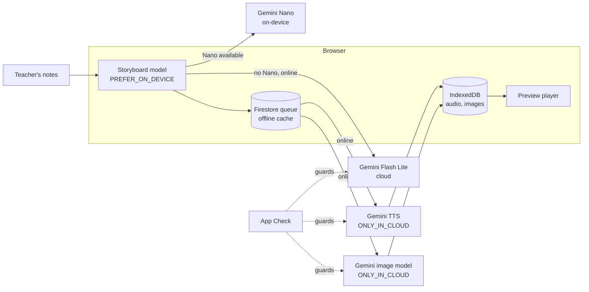
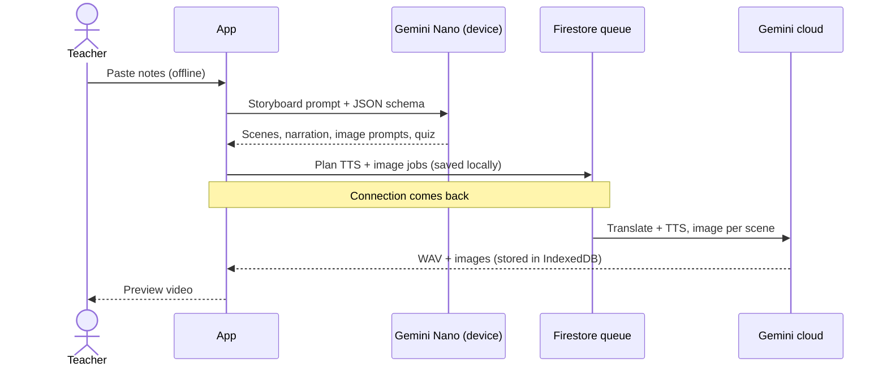
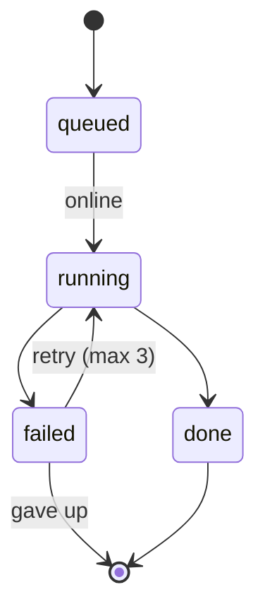

# Lessonreel

**Turn your lesson notes into a narrated explainer video, even with no internet.**

[](https://github.com/OWNER/lessonreel/actions/workflows/ci.yml)


🎬 **Demo video:** _coming_ · 🌐 **Live app:** _coming_ · 🏁 Built for [#BuildHybridAI 2026](https://firebasehybridaihackathon.devpost.com/)

---

## Contents

- [The problem](#the-problem)
- [What it does](#what-it-does)
- [Try it](#try-it)
- [How it works](#how-it-works)
- [Guarantees](#guarantees)
- [Evidence](#evidence)
- [Documentation](#documentation)
- [Tech stack](#tech-stack)
- [Run it yourself](#run-it-yourself)
- [Testing](#testing)
- [Project layout](#project-layout)
- [Known limitations](#known-limitations)
- [Build log](#build-log)
- [Credits](#credits)

## The problem

A short explainer video helps students far more than a page of notes. But making one takes hours, and almost every AI video tool needs a constant, fast connection and a paid plan.

That rules out a lot of teachers. A teacher in Enugu preparing tomorrow's lesson during a power cut, on a phone hotspot that costs real money, can't sit through a cloud tool that stalls every time the signal drops.

## What it does

1. You paste your lesson notes and say who it's for.
2. **On your device**, Gemini Nano writes the script, splits it into scenes, plans an image for each one and adds a 3-question quiz. No internet needed.
3. Voiceover and images need the cloud, so they **wait in a queue**. When you're back online, they run on their own.
4. You preview the finished video and download it as one file, with narration in English plus one more language (French, Spanish, Hindi or Swahili).

Every step shows where it ran: **On-device**, **Cloud** or **Queued**.

## Try it

1. Open the live app in Chrome on desktop (139+).
2. Click **Prepare offline model** once. Chrome downloads Gemini Nano.
3. Turn off Wi-Fi. Paste notes, click **Make storyboard**. Watch the On-device badge.
4. Turn Wi-Fi back on. The queue drains and **Preview video** lights up.

No Nano on your machine? It still works online. The storyboard just comes from the cloud instead, and the badge says so.

## How it works

### Architecture



### One lesson, start to finish



### Cloud job states



## Guarantees

| Guarantee                                       | How                                                                      |
| ----------------------------------------------- | ------------------------------------------------------------------------ |
| Notes stay on the device when Nano is available | Storyboard uses `PREFER_ON_DEVICE`; `inferenceSource` is shown on screen |
| Nothing is lost when the connection drops       | Jobs live in Firestore's persistent local cache; assets in IndexedDB     |
| Only the real app can call the cloud models     | Firebase App Check (reCAPTCHA Enterprise) on every AI call               |
| No API key in the client                        | Firebase AI Logic proxies Gemini; the key never ships                    |
| Bad model output doesn't break the app          | Zod-validated storyboard + one automatic repair pass                     |
| A retired model is a config change              | Model names come from env (`VITE_*_MODEL`)                               |

## Evidence

_To be added during the build:_ screenshots and console logs of `inferenceSource: "on_device"` with Wi-Fi off, the queue draining on reconnect, and Lighthouse/App Check screenshots. See [`evidence/`](evidence/).

## Documentation

| Doc                                                        | What it covers                                                                              |
| ---------------------------------------------------------- | ------------------------------------------------------------------------------------------- |
| [01 Product requirements](docs/01-product-requirements.md) | Problem, users, goals, scope                                                                |
| [02 UX design](docs/02-ux-design.md)                       | Personas, journeys, user flows, screen inventory, error flows                               |
| [03 UI spec](docs/03-screen-design.md)                     | Screens, every control's behaviour, wireframes, responsive rules                            |
| [04 Functional spec](docs/04-functional-spec.md)           | Requirements, business rules, validation, errors, acceptance criteria                       |
| [05 Data flow](docs/05-data-flow.md)                       | DFD level 0/1, data dictionary, privacy                                                     |
| [07 Frontend guide](docs/07-frontend.md)                   | Module map, state, events, UI rules, how to add a view                                      |
| [08 AI architecture](docs/08-ai-architecture.md)           | Models, prompts, token budget, evaluation, fallbacks                                        |
| [09 Test cases](docs/09-test-cases.md)                     | Normal, edge, invalid, failure, mobile and accessibility cases                              |
| [10 Demo plan](docs/10-demo-plan.md)                       | Video script, judge instructions, Devpost description draft                                 |
| [11 Brand guidelines](docs/11-brand-guidelines.md)         | Voice, logo, colours, typography                                                            |
| [12 Design system](docs/12-design-system.md)               | Tokens and components                                                                       |
| [13 UX writing](docs/13-ux-writing.md)                     | Every interface string                                                                      |
| [14 Accessibility](docs/14-accessibility.md)               | WCAG 2.2 AA requirements and tests                                                          |
| [15 Design QA](docs/15-design-qa.md)                       | Design acceptance checklist                                                                 |
| [TDD.md](TDD.md)                                           | Technical design: architecture, stack, data, APIs, security, testing, deployment, decisions |

## Tech stack

- Firebase AI Logic (hybrid inference), Gemini Nano in Chrome, Gemini Flash Lite, Gemini TTS, Gemini image generation
- Firebase App Check, Anonymous Auth, Firestore (offline persistence), Hosting
- TypeScript, Vite, Zod, idb-keyval, Vitest, ESLint, Prettier, pnpm workspaces, GitHub Actions

## Run it yourself

```bash
pnpm install
cp apps/web/.env.example apps/web/.env.local   # fill in your Firebase web config
pnpm dev            # or: pnpm dev:lan to open it from a phone on the same Wi-Fi
```

Firebase setup: create a project → enable **Firebase AI Logic** (Gemini Developer API) → register a Web app → enable **App Check** with reCAPTCHA Enterprise (register your debug token for localhost) → enable **Anonymous** sign-in → create **Firestore** and deploy `firestore.rules`.

Chrome: version 139+, enable `chrome://flags/#prompt-api-for-gemini-nano-multimodal-input`, restart.

Deploy: `pnpm build && firebase deploy`.

## Testing

```bash
pnpm run ci   # lint, format check, typecheck, unit tests, build
```

`packages/core` holds the storyboard schema, prompt builders, language list and queue logic, all covered by unit tests.

## Project layout

```
apps/web/            Vite app: UI, Firebase wiring, hybrid + cloud AI calls, queue runner, player
packages/core/       Pure logic: storyboard schema, prompts, languages, queue (unit-tested)
docs/                Product, UX, screens, functional spec, data flow (see docs/README.md)
evidence/            Screenshots and logs proving on-device vs cloud behaviour
TDD.md               Technical design document (central technical reference)
HACKATHON.md         Hackathon brief, rules, setup steps, Git/security rules (for Claude Code)
BUILD_PLAN.md        Ordered build stages and how each is tested
FEATURE_GUIDE.md     Plain-language guide to each approved feature
DEVELOPMENT_PROTOCOL.md  Feature-by-feature build and QA process
DEBUGGING.md         Bug report template and troubleshooting map
HACKATHON_LANDING_PAGE_AND_FRONTEND_TOOLING.md  Landing page, judge journey, frontend tools and skills policy
CLAUDE.md            Loads HACKATHON.md + AGENTS.md into Claude Code
AGENTS.md            Coding rules, verified SDK facts, status log
```

## Known limitations

- On-device generation needs Chrome desktop with Gemini Nano downloaded (several GB of disk and a capable GPU/CPU). Lower-end machines use the cloud path, which needs internet.
- Gemini TTS doesn't support Yoruba, Igbo, Hausa or Nigerian Pidgin yet, so they aren't offered.
- Video export runs in the browser with MediaRecorder: MP4 where Chrome supports it, otherwise WebM. It records in real time, so a 60-second video takes about 60 seconds to render.

## Build log

- **2026-11-18:** Idea locked. Monorepo scaffolded, core logic + tests, hybrid storyboard, cloud TTS/translate/image, offline queue, preview player.
- **2026-11-19:** Architecture doc. In-browser video export (canvas + Web Audio + MediaRecorder). Decided to build everything new, no reused code.

## Credits

Built from scratch by Benjamin Ugochukwu for #BuildHybridAI 2026, during the submission period. Licensed under Apache-2.0.
