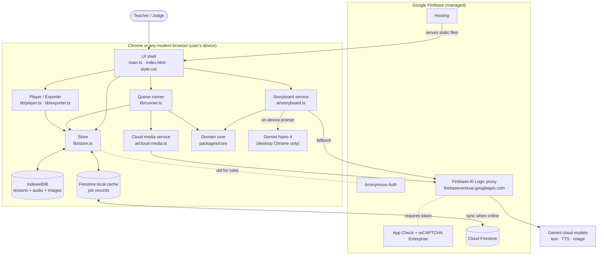
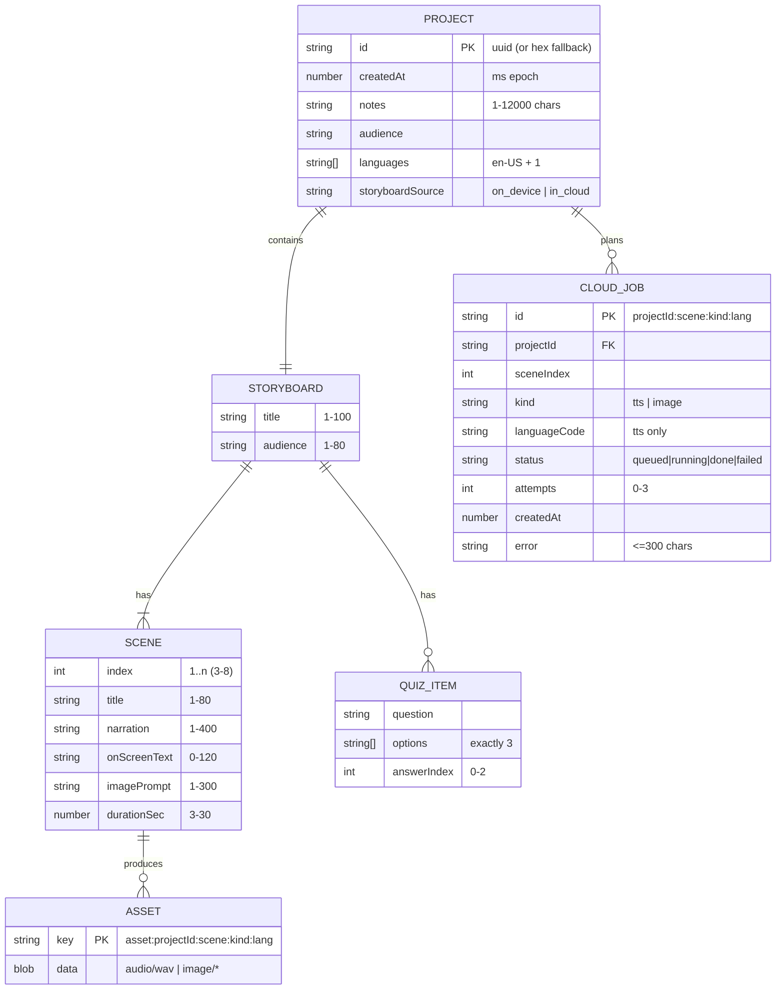
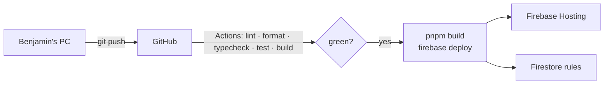

# TDD.md: Technical Design Document, Lessonreel

> TDD here means **Technical Design Document**, not Test-Driven Development.

## 1. Document overview and status

|                   |                                                                                                                                         |
| ----------------- | --------------------------------------------------------------------------------------------------------------------------------------- |
| Project           | Lessonreel: turn lesson notes into a narrated explainer video, even with no internet                                                    |
| Hackathon         | #BuildHybridAI 2026 (Google / Firebase on Devpost), deadline Nov 30 2026, 2:00 PM PT (11:00 PM Lagos)                                   |
| Status            | **v1.0, approved by Benjamin 2026-11-19** ("approved anything that would work")                                                         |
| Owner             | Benjamin Ugochukwu. Claude acted as architect, tech lead, frontend/backend/database/integration architect, DevOps and security reviewer |
| Role of this file | The **central technical reference**. Check it before any important technical decision; update it when the implementation changes        |
| Replaces          | `docs/06-software-architecture.md` (now a pointer to this file)                                                                         |
| Last updated      | 2026-11-19                                                                                                                              |

### How this document relates to the others

| Question                              | Document                                                             | (Names used in the TDD protocol) |
| ------------------------------------- | -------------------------------------------------------------------- | -------------------------------- |
| What must we satisfy?                 | [`HACKATHON.md`](HACKATHON.md)                                       | HACKATHON.md                     |
| What is it, how do I run it?          | [`README.md`](README.md)                                             | README.md                        |
| What are we building and why?         | [`docs/01-product-requirements.md`](docs/01-product-requirements.md) | PRD                              |
| What does the user do, which screens? | [`docs/02-ux-design.md`](docs/02-ux-design.md)                       | USER_EXPERIENCE.md               |
| How should it look and behave?        | [`docs/03-screen-design.md`](docs/03-screen-design.md)               | DESIGN_SYSTEM.md                 |
| Exactly how must it behave?           | [`docs/04-functional-spec.md`](docs/04-functional-spec.md)           | SRS                              |
| Where does data go?                   | [`docs/05-data-flow.md`](docs/05-data-flow.md)                       | DFD                              |
| How is the web app organised?         | [`docs/07-frontend.md`](docs/07-frontend.md)                         | FRONTEND.md                      |
| How does the AI work?                 | [`docs/08-ai-architecture.md`](docs/08-ai-architecture.md)           | AI_ARCHITECTURE.md               |
| What do we test?                      | [`docs/09-test-cases.md`](docs/09-test-cases.md)                     | TEST_CASES.md                    |
| How do we demo and submit?            | [`docs/10-demo-plan.md`](docs/10-demo-plan.md)                       | DEMO_PLAN.md                     |
| **How do engineers build it?**        | **TDD.md (this file)**                                               | TDD.md                           |
| What do we build first?               | [`BUILD_PLAN.md`](BUILD_PLAN.md)                                     | BUILD_PLAN.md                    |
| What has actually been built?         | [`FEATURE_GUIDE.md`](FEATURE_GUIDE.md)                               | FEATURE_GUIDE.md                 |
| Something broke                       | [`DEBUGGING.md`](DEBUGGING.md)                                       | n/a                              |

### Evidence labels used in this document

| Label                    | Meaning                                                                         |
| ------------------------ | ------------------------------------------------------------------------------- |
| **[CONFIRMED]**          | Verified in official rules/docs, the installed SDK, or by running the code (CI) |
| **[ASSUMED]**            | Reasonable working assumption, not yet verified                                 |
| **[NEEDS CONFIRMATION]** | Missing or uncertain; must be checked before relying on it                      |
| **[RECOMMENDATION]**     | Our chosen design decision                                                      |

### Implementation status at a glance

| Area                                                                         | Code exists | CI passes          | Run against real Firebase     | Tested by Benjamin |
| ---------------------------------------------------------------------------- | ----------- | ------------------ | ----------------------------- | ------------------ |
| Core rules (schema, prompts, queue, languages)                               | ✅          | ✅ 14 unit tests   | n/a                           | ⬜                 |
| Hybrid storyboard                                                            | ✅          | ✅ typecheck/build | ⬜                            | ⬜                 |
| Cloud translate / TTS / image                                                | ✅          | ✅                 | ⬜                            | ⬜                 |
| Firestore offline queue + runner                                             | ✅          | ✅                 | ⬜                            | ⬜                 |
| Preview player                                                               | ✅          | ✅                 | ⬜                            | ⬜                 |
| Video export                                                                 | ✅          | ✅                 | ⬜ (not run in a browser yet) | ⬜                 |
| Per-scene progress, retry, quiz panel, edit scene, slow toggle, sample notes | ⬜          | n/a                | n/a                           | ⬜                 |

**Nothing is "done" until Benjamin approves it** ([`BUILD_PLAN.md`](BUILD_PLAN.md) exit gate).

---

## 2. Project summary and understanding

|                           |                                                                                                                                                                                                                                                                    |
| ------------------------- | ------------------------------------------------------------------------------------------------------------------------------------------------------------------------------------------------------------------------------------------------------------------ |
| Problem                   | Teachers in low-connectivity settings can't turn lesson notes into explainer videos: current tools need constant internet, time and money. **[ASSUMED]**, to validate with 3 teachers ([01 §9](docs/01-product-requirements.md#9-validation-plan-playbook-step-3)) |
| Users                     | Secondary school teachers (primary), NGO trainers, private tutors; hackathon judges must never be blocked ([02 §2](docs/02-ux-design.md#2-personas))                                                                                                               |
| Solution                  | Gemini Nano writes the storyboard **on the device, offline**. Voice and images need the cloud, so they **queue** and finish automatically when the internet returns. The teacher previews and downloads one video file                                             |
| Value                     | Works with no data; free; no account; narration in English + one more language; quiz included                                                                                                                                                                      |
| Why it fits the hackathon | The on-device / cloud split exists for a real reason: offline planning vs. capabilities Nano doesn't have (speech, images). That's the "clear reason to be hybrid" the judges look for                                                                             |
| Main user journey         | Paste notes → storyboard (on-device) → voice + images (cloud, queued) → preview → download ([UF-1](docs/02-ux-design.md#uf-1-create-a-video-main-flow))                                                                                                            |

---

## 3. Scope and non-goals

| In scope (MVP)                                                                  | Out of scope (this release)                                                         |
| ------------------------------------------------------------------------------- | ----------------------------------------------------------------------------------- |
| Web app for desktop Chrome (on-device path) and any modern browser (cloud path) | Native iOS/Android apps (Android is a "Could")                                      |
| Storyboard + quiz from notes                                                    | Accounts, passwords, sharing, teams                                                 |
| Narration in en + one of fr/es/hi/sw                                            | Yoruba, Igbo, Hausa, Pidgin narration (**[CONFIRMED]** not supported by Gemini TTS) |
| One image per scene                                                             | Video clips, animation beyond a slow zoom                                           |
| Offline queue that resumes by itself                                            | Background sync after the tab is closed (service worker)                            |
| Preview + download one video                                                    | Timeline editing, auto-posting to YouTube/WhatsApp                                  |
| Anonymous identity per browser                                                  | Cross-device sync of lessons                                                        |

---

## 4. Requirements and constraints

Full requirements, business rules (BR-n) and acceptance criteria (AC-n) live in [`docs/04-functional-spec.md`](docs/04-functional-spec.md). Summary:

### Functional requirements

| ID  | Requirement                                                             | Priority                                              |
| --- | ----------------------------------------------------------------------- | ----------------------------------------------------- |
| F1  | Enter notes, audience, scene count (3–8), second language               | Must                                                  |
| F2  | Generate script, scenes, image prompts, quiz; validate; repair once     | Must (F2.5 quiz panel, F2.6 edit scene: Should)       |
| F3  | On-device first, cloud fallback; Nano download on click; status on load | Must                                                  |
| F4  | Narration: translate, then TTS, per scene per language                  | Must (F4.4 slow: Should)                              |
| F5  | One image per scene                                                     | Must                                                  |
| F6  | Durable job queue, auto-run online, 2 at a time, 3 attempts             | Must (F6.4 per-scene view, F6.6 retry button: Should) |
| F7  | On-device / Cloud / Queued badges                                       | Must                                                  |
| F8  | Preview player                                                          | Must                                                  |
| F9  | Export one MP4/WebM file                                                | Must                                                  |
| F10 | Android app                                                             | Could                                                 |
| F11 | My lessons list (F11.2 reopen latest: Must)                             | Could                                                 |

### Non-functional requirements

| ID  | Requirement                                  | Target                                                              |
| --- | -------------------------------------------- | ------------------------------------------------------------------- |
| N1  | Storyboard time on-device                    | < 60 s for 5 scenes on a mid-range laptop **[ASSUMED]**, to measure |
| N2  | No work lost on disconnect or reload         | 100% of queued jobs survive                                         |
| N3  | No secrets in client or repo                 | Zero                                                                |
| N4  | Only the real app can call cloud models      | App Check enforced                                                  |
| N5  | Works for judges without Nano                | Cloud fallback for every on-device step                             |
| N6  | English UI                                   | Required by rules                                                   |
| N7  | Free for users and judges, live until Dec 16 | Firebase free tier + Hosting                                        |
| N8  | Accessible                                   | Keyboard usable, visible focus, 44 px targets, contrast AA          |

### Hard constraints **[CONFIRMED]** (official rules)

1. Gen AI app built with **Firebase AI Logic**, imported and **called at runtime**.
2. Web/Chrome platform uses **Gemini Nano 4** via Firebase AI Logic.
3. **App Check** required (debug tokens accepted for judging).
4. **Newly created** during the submission period (we started Nov 18; **no reused project code**).
5. Public repo with OSS license in About; ≤ 3-min public YouTube video in English; hosted URL strongly encouraged; free judge access until Dec 16.
6. No production keys/secrets/PII in repo, form or test notes. No commits evaluated after the deadline.
7. Solo beginner, ~11 days, free tier. **[CONFIRMED]** (our situation)

---

## 5. Architecture overview

**[RECOMMENDATION] A static, offline-first web app with no custom backend.** The browser runs all application logic. Firebase managed services do the jobs a backend normally would: hosting, identity, a synced database, abuse protection, and a secure proxy to Gemini.

| Pattern                    | Where                                                             | Why                                                   |
| -------------------------- | ----------------------------------------------------------------- | ----------------------------------------------------- |
| Client-side monolith       | `apps/web` is one deployable static app                           | Smallest thing that works for one beginner in 11 days |
| Clean architecture (light) | `packages/core` holds pure rules, no browser/Firebase imports     | Unit-testable; reusable by a future Android app       |
| Offline-first              | All state saved locally first, synced later                       | The product promise                                   |
| Queue / event-driven       | Cloud work = jobs, drained on the browser `online` event          | Separates "plan" (offline) from "execute" (online)    |
| Hybrid inference           | `PREFER_ON_DEVICE` for text; `ONLY_IN_CLOUD` for audio and images | Use the device when it can, the cloud when it must    |

### Alternatives considered

| Alternative                                            | Why not                                                                                                                                                              |
| ------------------------------------------------------ | -------------------------------------------------------------------------------------------------------------------------------------------------------------------- |
| Own backend (Node/Express on Cloud Run) to call Gemini | Adds hosting, cost, secrets and a failure point. Firebase AI Logic already proxies Gemini with App Check. Also breaks the offline story (server unreachable offline) |
| Cloud Functions to run the queue server-side           | Jobs would run even with the tab closed (nice), but needs the Blaze billing plan and duplicates what the browser can do. Revisit after the hackathon                 |
| Cloud-only (no Nano)                                   | Fails the hackathon requirement and the product promise                                                                                                              |
| Nano-only (`ONLY_ON_DEVICE`)                           | Judges and many users have no Nano: app would fail Stage One "runs consistently"                                                                                     |
| React/Next.js frontend                                 | One screen, few states; framework adds weight and learning load without changing the outcome                                                                         |
| ffmpeg.wasm for export                                 | ~30 MB download, needs cross-origin isolation headers; MediaRecorder is built in                                                                                     |

---

## 6. Architecture diagram



**In plain words:** the teacher only ever talks to the web page. The page asks Gemini Nano (on the laptop) for the storyboard, or Firebase AI Logic (in the cloud) if Nano isn't there. The storyboard, audio and images are kept in the browser's own storage (IndexedDB). A small to-do list of cloud jobs is kept in Firestore, which works offline and syncs later. When online, the queue runner works through that list using Firebase AI Logic. App Check makes sure only our real page can use the AI; Anonymous Auth gives each browser an ID so the to-do list is private.

---

## 7. Technology stack and rationale

| Technology                                  | Purpose                          | Where used                        | Why chosen                                   | Alternatives                                   | Limitations                                                                      | Status                                                     |
| ------------------------------------------- | -------------------------------- | --------------------------------- | -------------------------------------------- | ---------------------------------------------- | -------------------------------------------------------------------------------- | ---------------------------------------------------------- |
| TypeScript 5 (strict)                       | Language                         | Everywhere                        | Type safety around SDK calls                 | JavaScript                                     | Build step                                                                       | ✅ installed                                               |
| Vite 6                                      | Dev server, bundler              | `apps/web`                        | Fast, simple, static output                  | Webpack, Next.js                               | n/a                                                                              | ✅                                                         |
| Vanilla DOM                                 | UI                               | `main.ts`                         | One screen; no framework to learn            | React, Preact                                  | Manual DOM updates (ADR-008)                                                     | ✅                                                         |
| Firebase JS SDK 13.4                        | Firebase client                  | `firebase.ts`                     | Required platform                            | n/a                                            | ~235 KB gzipped                                                                  | ✅ **[CONFIRMED]** installed                               |
| Firebase AI Logic (`firebase/ai`)           | On-device + cloud Gemini         | `ai/*.ts`                         | **Required** by rules; hybrid modes built in | Direct Gemini API (not allowed: key in client) | v1beta API; on-device limits                                                     | ✅                                                         |
| Gemini Nano 4 (Chrome Prompt API)           | Offline storyboard               | via AI Logic                      | Required for Web; offline + free             | n/a                                            | Desktop Chrome 139+, flag, disk/GPU; ~9,216 tokens; text/image in, text out only | **[CONFIRMED]** SDK; ⬜ hardware test                      |
| Gemini cloud text (`gemini-3.5-flash-lite`) | Fallback storyboard, translation | `storyboard.ts`, `cloud-media.ts` | Cheap/fast; named in organizer's resources   | Flash, Pro                                     | Free-tier limits                                                                 | **[NEEDS CONFIRMATION]** model availability in our project |
| Gemini TTS (`gemini-3.8-flash-tts`)         | Narration                        | `cloud-media.ts`                  | Nano can't speak; good multilingual voices   | Cloud Text-to-Speech                           | Language list; `3.1-flash-tts-preview` retired Nov 17                            | **[CONFIRMED]** in Firebase docs; ⬜ live test             |
| Gemini image model                          | Scene images                     | `cloud-media.ts`                  | One SDK for everything                       | Imagen                                         | May need quota account                                                           | **[NEEDS CONFIRMATION]** model name → `VITE_IMAGE_MODEL`   |
| App Check + reCAPTCHA Enterprise            | Abuse protection                 | `firebase.ts`                     | **Required**                                 | reCAPTCHA v3                                   | Ad blockers can block it                                                         | ✅ code; ⬜ console                                        |
| Firebase Anonymous Auth                     | Per-browser identity             | `firebase.ts`                     | No sign-up; enables rules                    | Email/Google sign-in                           | Data tied to one browser                                                         | ✅ code; ⬜ console                                        |
| Cloud Firestore (persistent local cache)    | Job queue                        | `store.ts`                        | Offline writes + sync for free               | IndexedDB-only queue                           | 1 MB doc limit (so no blobs)                                                     | ✅ code; ⬜ console                                        |
| IndexedDB (`idb-keyval` 6)                  | Lessons, audio, images           | `store.ts`                        | Large blobs, offline, free                   | Cache API, Firebase Storage                    | Per-browser; quota varies                                                        | ✅                                                         |
| Zod 3                                       | Validate AI output               | `packages/core`                   | Small models break JSON                      | Hand-written checks                            | n/a                                                                              | ✅                                                         |
| Canvas + Web Audio + MediaRecorder          | Video export                     | `exporter.ts`                     | Built into browsers, no server               | ffmpeg.wasm                                    | Real-time render; MP4 support varies                                             | ✅ code; ⬜ browser test                                   |
| Vitest 2 / ESLint 9 / Prettier 3            | Tests / lint / format            | repo                              | Fast, standard                               | Jest                                           | n/a                                                                              | ✅                                                         |
| pnpm 10 workspaces                          | Monorepo deps                    | repo                              | Shared `core` package                        | npm workspaces                                 | One more tool to install                                                         | ✅ (on Benjamin's PC: ⬜)                                  |
| GitHub + Actions                            | Backup, CI                       | `.github/workflows/ci.yml`        | Required public repo; CI badge               | GitLab                                         | n/a                                                                              | ✅ file; ⬜ pushed                                         |
| Firebase Hosting                            | Live URL                         | `firebase.json`                   | Free HTTPS, same project                     | Vercel, Netlify                                | n/a                                                                              | ⬜ deploy                                                  |

---

## 8. System components

| ID  | Component                                              | Does                                                                               | Receives           | Returns                 | Talks to             | When it fails                                                          |
| --- | ------------------------------------------------------ | ---------------------------------------------------------------------------------- | ------------------ | ----------------------- | -------------------- | ---------------------------------------------------------------------- |
| C1  | UI shell (`main.ts`, `index.html`, `style.css`)        | Renders S-0…S-5, wires buttons, shows badges/status                                | User input, events | DOM updates             | C2, C3, C5, C6, C7   | Shows user-facing message (04 §6); never loses notes                   |
| C2  | Firebase bootstrap (`firebase.ts`)                     | Starts Firebase: **App Check first**, Firestore cache, AI Logic, anonymous sign-in | Env config         | `{app, ai, db, uid}`    | Firebase             | E-4 "can't start"; offline sign-in failure → `uid=null`, retried later |
| C3  | Storyboard service (`ai/storyboard.ts`)                | Builds hybrid model, Nano warm-up, generate → validate → repair once               | Notes + options    | Storyboard, source, ms  | Nano / AI Logic, C8  | E-1, E-3                                                               |
| C4  | Cloud media service (`ai/cloud-media.ts`)              | Translate, TTS, image                                                              | Scene + language   | Text / WAV / image blob | AI Logic             | Throws → job marked failed                                             |
| C5  | Queue runner (`lib/runner.ts`)                         | Picks runnable jobs (2), runs them, records status                                 | Lesson, jobs       | Progress events         | C4, C6, C8           | Stops when offline; failures retried up to 3                           |
| C6  | Store (`lib/store.ts`)                                 | Lessons/assets in IndexedDB; jobs in Firestore                                     | Records/blobs      | Records/blobs           | IndexedDB, Firestore | E-9 storage full; Firestore errors surface in console                  |
| C7  | Player / exporter (`lib/player.ts`, `lib/exporter.ts`) | Preview; render one file                                                           | Lesson + assets    | Playback / Blob         | C6                   | Missing asset → placeholder; E-6                                       |
| C8  | Domain core (`packages/core`)                          | Schema, prompts, languages, queue rules                                            | Plain data         | Plain data              | none                 | Throws typed errors (`StoryboardParseError`, `NotesTooLongError`)      |

**No duplicated logic:** all limits and rules (BR-1…BR-12) live only in `packages/core`. The web app imports them.

---

## 9. Frontend architecture

| Topic             | Design                                                                                                                                                                                                      |
| ----------------- | ----------------------------------------------------------------------------------------------------------------------------------------------------------------------------------------------------------- |
| Structure         | One HTML page; views S-0…S-5 are sections that fill in as the user progresses ([02 §5](docs/02-ux-design.md#5-navigation-structure))                                                                        |
| State             | In-memory: `fb` (services), `current` (lesson). Durable: IndexedDB (lessons, assets) + Firestore cache (jobs). Reload restores the latest lesson ([F11.2](docs/04-functional-spec.md#f11-my-lessons-could)) |
| Rendering         | Small render functions (`renderBoard`, `renderNet`, `badge`) writing to fixed containers. **All model text is HTML-escaped** before insertion                                                               |
| Events            | Button clicks; `window` `online`/`offline`; queue progress callbacks                                                                                                                                        |
| Styling           | Tokens in `style.css` = [03 §3](docs/03-screen-design.md#3-visual-design-system). Breakpoint 900 px                                                                                                         |
| Accessibility     | Labels on every input, `aria-live` status, visible focus (fixed to 16:1), 44 px targets                                                                                                                     |
| Config            | `src/config.ts` reads `VITE_*` env vars (Firebase config + model names)                                                                                                                                     |
| Planned additions | Nano check on load, sample notes, counter, per-scene progress, retry, quiz panel, edit scene, slow toggle ([BUILD_PLAN](BUILD_PLAN.md))                                                                     |

## 10. Backend architecture

**Not applicable: no custom backend ([ADR-001](#adr-001-no-custom-backend)).** Server-side responsibilities are covered by managed Firebase services:

| Usual backend job                   | Who does it in Lessonreel                                         |
| ----------------------------------- | ----------------------------------------------------------------- |
| Serve the app                       | Firebase Hosting                                                  |
| Hold the AI API key, call the model | Firebase AI Logic (key never reaches the browser) **[CONFIRMED]** |
| Reject requests from fake clients   | App Check                                                         |
| Identify users                      | Firebase Anonymous Auth                                           |
| Store and authorize data            | Firestore + security rules (`firestore.rules`)                    |
| Background processing               | Browser queue runner (only while the tab is open)                 |

---

## 11. Database and data architecture

Data movement is detailed in [`docs/05-data-flow.md`](docs/05-data-flow.md). This section is the storage design.

### Where data lives

| Data                                        | Store                                | Key                                    | Size           | Leaves device?                                                                             |
| ------------------------------------------- | ------------------------------------ | -------------------------------------- | -------------- | ------------------------------------------------------------------------------------------ |
| Lesson (notes, options, storyboard, source) | IndexedDB                            | `project:{uuid}`                       | ~5–20 KB       | Notes go to cloud only if Nano is unavailable; narration goes to cloud for translation/TTS |
| Audio                                       | IndexedDB                            | `asset:{projectId}:{scene}:tts:{lang}` | ~0.5–1 MB each | No (made in cloud, stored locally)                                                         |
| Image                                       | IndexedDB                            | `asset:{projectId}:{scene}:image:-`    | ~0.3–1 MB each | No (made in cloud, stored locally)                                                         |
| Job record                                  | Firestore `users/{uid}/jobs/{jobId}` | `{projectId}:{scene}:{kind}:{lang\|-}` | < 1 KB         | Yes, **metadata only** (BR-10)                                                             |

### Schema



Source of truth for shapes: `packages/core/src/storyboard.ts` (Zod) and `packages/core/src/queue.ts` (`CloudJob`).

| Topic                | Design                                                                                                                                 |
| -------------------- | -------------------------------------------------------------------------------------------------------------------------------------- |
| Ownership            | Lessons/assets: the browser. Jobs: the anonymous uid                                                                                   |
| Indexes              | Firestore query `where("projectId","==",…)` on a per-user subcollection uses the automatic single-field index **[ASSUMED]** sufficient |
| Validation           | Zod on every model response; BR-1 on input                                                                                             |
| Duplicates           | Deterministic job ids: re-planning overwrites (BR-8)                                                                                   |
| Retention / deletion | Until the user clears site data; delete UI is a "Could" (S-6). Job docs have no TTL in MVP                                             |
| Privacy              | No personal data collected; no lesson content in Firestore                                                                             |

---

## 12. API specifications

Lessonreel exposes **no HTTP endpoints of its own**. Its "API" is (a) typed internal functions between components and (b) Firebase SDK calls. No REST endpoints are invented here.

### 12.1 Internal contracts

| Function                                                                                    | Input                                            | Output                                                                                       | Errors                                                                                           |
| ------------------------------------------------------------------------------------------- | ------------------------------------------------ | -------------------------------------------------------------------------------------------- | ------------------------------------------------------------------------------------------------ |
| `generateStoryboard(ai, req)` (`ai/storyboard.ts`)                                          | `{notes, audience, targetScenes?, includeQuiz?}` | `{board, source, ms, repaired}`                                                              | `NotesTooLongError`, `Error("Add your lesson notes first.")`, `StoryboardParseError`, SDK errors |
| `warmUpDeviceModel(ai, onProgress)`                                                         | callback(pct)                                    | `void`                                                                                       | SDK error if Nano unsupported                                                                    |
| `translateNarration(ai, text, lang)`                                                        | text, BCP-47                                     | translated text                                                                              | SDK errors                                                                                       |
| `synthesizeNarration(ai, scene, lang, audience, slow?)`                                     | scene, BCP-47                                    | `Blob` (audio/wav)                                                                           | "No audio returned…", SDK errors                                                                 |
| `generateSceneImage(ai, scene)`                                                             | scene                                            | `Blob \| null`                                                                               | SDK errors                                                                                       |
| `drainQueue(ai, db, uid, project, events)`                                                  | lesson                                           | `void` (progress via events); requeues stale `running` jobs first; no-op if already draining | none thrown; job errors recorded                                                                 |
| `exportVideo(project, lang, onProgress)`                                                    | lesson, BCP-47                                   | `{blob, mimeType, extension, durationSec}`                                                   | "This browser can't record video…"                                                               |
| `parseStoryboard(raw)` (core)                                                               | string                                           | `Storyboard`                                                                                 | `StoryboardParseError`                                                                           |
| `planJobs(projectId, n, langs)` / `nextRunnable(jobs, limit)` / `staleRunning(jobs)` (core) | plain data                                       | `CloudJob[]`                                                                                 | none                                                                                             |

### 12.2 Firebase AI Logic calls (external)

All go through the SDK to `firebasevertexai.googleapis.com` (API version `v1beta`) **[CONFIRMED in installed SDK]**, with the App Check token attached automatically.

| Call       | Mode               | Model (env var)                | Request                                                                                                                                        | Response                                                    | Errors / limits                                                |
| ---------- | ------------------ | ------------------------------ | ---------------------------------------------------------------------------------------------------------------------------------------------- | ----------------------------------------------------------- | -------------------------------------------------------------- |
| Storyboard | `PREFER_ON_DEVICE` | Nano / `VITE_CLOUD_TEXT_MODEL` | System prompt + user prompt; JSON schema via `promptOptions.responseConstraint` (device) and `responseMimeType` + `responseJsonSchema` (cloud) | Text (JSON) + `inferenceSource`                             | Nano unavailable offline → error; quota 429; App Check 401/403 |
| Translate  | `ONLY_IN_CLOUD`    | `VITE_CLOUD_TEXT_MODEL`        | Narration + target code                                                                                                                        | Text                                                        | quota, network                                                 |
| TTS        | `ONLY_IN_CLOUD`    | `VITE_TTS_MODEL`               | `responseModalities:[AUDIO]`, `speechConfig{voiceConfig.prebuiltVoiceConfig.voiceName:"Kore", languageCode}`                                   | Base64 WAV (24 kHz, 16-bit, mono) in `inlineDataParts()[0]` | unsupported language, quota                                    |
| Image      | `ONLY_IN_CLOUD`    | `VITE_IMAGE_MODEL`             | `responseModalities:[TEXT, IMAGE]` + prompt                                                                                                    | Base64 image in `inlineDataParts()`                         | model name **[NEEDS CONFIRMATION]**; may need quota account    |

### 12.3 Firestore

| Operation             | Path                                  | Rule                      |
| --------------------- | ------------------------------------- | ------------------------- |
| Create/overwrite job  | `users/{uid}/jobs/{jobId}` (`setDoc`) | `request.auth.uid == uid` |
| List jobs of a lesson | same collection, `where projectId ==` | same                      |
| Update job status     | `updateDoc`                           | same                      |

---

## 13. External services and sponsor integrations

Sponsor = Google / Firebase only ([`HACKATHON.md` §2](HACKATHON.md#2-the-hackathon)).

| Service                              | Why we need it     | How we connect                             | What we send            | What we get                             | Credentials                                      | If unavailable                                     |
| ------------------------------------ | ------------------ | ------------------------------------------ | ----------------------- | --------------------------------------- | ------------------------------------------------ | -------------------------------------------------- |
| **Firebase AI Logic** (required)     | All AI             | `firebase/ai` SDK                          | Prompts, narration text | Storyboard, translations, audio, images | None in client; Firebase holds the Gemini key    | Storyboard: on-device still works; jobs wait/retry |
| **Gemini Nano 4** (required for Web) | Offline storyboard | Via AI Logic hybrid                        | Prompt (local)          | JSON (local)                            | None                                             | Falls back to cloud; offline → E-1                 |
| **App Check** (required)             | Block fake clients | `firebase/app-check`, reCAPTCHA Enterprise | Attestation             | Short-lived token                       | Site key (public) in env; debug token local only | AI calls rejected → E-8                            |
| Firebase Auth (anonymous)            | Per-user rules     | `firebase/auth`                            | n/a                     | uid                                     | none                                             | Offline first load: no uid; jobs planned later     |
| Cloud Firestore                      | Job queue sync     | `firebase/firestore`                       | Job metadata            | Job metadata                            | none                                             | Local cache keeps working; syncs later             |
| Firebase Hosting                     | Live URL           | `firebase deploy`                          | Static files            | HTTPS site                              | CLI login (local)                                | Demo from localhost + video                        |

Every claim the Devpost description makes about these integrations must be visible in code and the demo ([§16](#16-security-and-privacy), [HACKATHON.md §3](HACKATHON.md#3-rules-we-must-follow)).

---

## 14. Main system workflows and sequence diagrams

### 14.1 Offline create → online finish (the main journey)

```mermaid
sequenceDiagram
  actor T as Teacher
  participant UI as C1 UI
  participant SB as C3 Storyboard
  participant N as Gemini Nano
  participant S as C6 Store
  participant R as C5 Runner
  participant CM as C4 Cloud media
  participant AIL as AI Logic + Gemini
  T->>UI: Paste notes, click Make (offline)
  UI->>SB: generateStoryboard()
  SB->>N: prompt + JSON schema
  N-->>SB: JSON
  SB->>SB: parseStoryboard (repair once if invalid)
  SB-->>UI: board, source=on_device, ms
  UI->>S: saveProject (IndexedDB)
  UI->>S: enqueueJobs (Firestore local cache)
  Note over UI: S-2 badge On-device · S-3 Queued 0/n
  T-->>UI: Connection returns
  UI->>R: online event → drainQueue()
  loop 2 jobs at a time until none runnable
    R->>S: status=running, attempts+1
    R->>CM: translate+TTS or image
    CM->>AIL: request + App Check token
    AIL-->>CM: text / WAV / image
    R->>S: saveAsset (IndexedDB), status=done
  end
  UI-->>T: Preview enabled; Download enabled when all done
```

| Step | User does       | Frontend                          | Request                  | Service              | User sees             | On failure                    |
| ---- | --------------- | --------------------------------- | ------------------------ | -------------------- | --------------------- | ----------------------------- |
| 1    | Clicks Make     | Validates (BR-1), disables button | Prompt                   | Nano or cloud        | "Writing storyboard…" | E-1/E-2/E-3, notes kept       |
| 2    | —               | Saves lesson, plans jobs          | Firestore writes (local) | IndexedDB, Firestore | Storyboard + badge    | Logged; lesson still shown    |
| 3    | Goes online     | Runner starts                     | AI Logic calls           | Gemini               | Progress count        | Job failed → retried ×3 → E-5 |
| 4    | Clicks Preview  | Loads assets                      | none                     | IndexedDB            | Video plays           | Placeholder frames            |
| 5    | Clicks Download | Renders                           | none                     | MediaRecorder        | % then file           | E-6                           |

### 14.2 Judge on a machine without Nano

`PREFER_ON_DEVICE` routes to the cloud model → `inferenceSource = "in_cloud"` → Cloud badge → rest identical. **This path must be flawless** (N5).

### 14.3 Resume after reload

Load latest lesson from IndexedDB → list jobs from Firestore cache → if online, `drainQueue` continues; jobs left `running` by a crash are counted as an attempt and retried ([§17](#17-error-handling-and-reliability)).

---

## 15. Authentication and authorization

| Topic                   | Design                                                                                                                                      |
| ----------------------- | ------------------------------------------------------------------------------------------------------------------------------------------- |
| Identity                | Firebase **Anonymous Auth**: one uid per browser, created silently at start-up                                                              |
| Passwords               | None exist (no password login)                                                                                                              |
| Authorization           | Firestore rules: a user can read/write only `users/{their uid}/jobs/*` ([`firestore.rules`](firestore.rules))                               |
| App-level authorization | **App Check** on Firebase AI Logic: requests without a valid token are rejected **[CONFIRMED]** requirement                                 |
| Token expiry            | Auth and App Check tokens refresh automatically in the SDK (`isTokenAutoRefreshEnabled: true`); if refresh fails, calls fail and jobs retry |
| Roles                   | Teacher = Judge = anonymous user. Developer = Firebase console access. No admin UI                                                          |

---

## 16. Security and privacy

| Threat                                      | Control                                                                                                                                               | Status                           |
| ------------------------------------------- | ----------------------------------------------------------------------------------------------------------------------------------------------------- | -------------------------------- |
| Someone uses our Gemini quota from a script | App Check (reCAPTCHA Enterprise), **enforcement on** before the demo                                                                                  | ✅ code · ⬜ enforce             |
| AI key leaks                                | Key stays in Firebase; never in client or repo **[CONFIRMED]** design of AI Logic                                                                     | ✅                               |
| Firebase web config "exposed"               | It's a public identifier by design; protected by App Check + rules. Still kept in `.env.local`                                                        | ✅                               |
| User A reads User B's jobs                  | Firestore rules per uid                                                                                                                               | ✅ file · ⬜ deploy + test       |
| Lesson content exposed                      | Kept in IndexedDB; only job metadata syncs (BR-10)                                                                                                    | ✅                               |
| Secrets in Git                              | `.gitignore` (`.env*` except `.env.example`), pre-push checks ([HACKATHON.md §9.3](HACKATHON.md#93-keep-secrets-out-of-github))                       | ✅                               |
| App Check debug token leaked                | Never committed; given to judges only via Devpost private testing field if needed                                                                     | Rule                             |
| XSS via model output                        | `escape()` before every `innerHTML` insertion                                                                                                         | ✅ (review new UI code for this) |
| Prompt injection in notes                   | Model has no tools/data access; output schema-validated; worst case = bad storyboard                                                                  | ✅                               |
| Unsafe images                               | Fixed style prompt ("classroom illustration, no text"); Gemini safety filters                                                                         | ✅                               |
| Error messages leaking internals            | Users see plain messages; technical detail only in console                                                                                            | ✅ (E-3, E-4 aligned)            |
| Supply chain                                | Lockfile; CI `--frozen-lockfile`; few dependencies                                                                                                    | ✅                               |
| Rate limiting                               | App Check + Firebase quotas; runner caps concurrency at 2                                                                                             | ✅                               |
| Encryption                                  | HTTPS in transit (Hosting, Google APIs). At rest: Google-managed for Firestore; IndexedDB unencrypted on the user's device (no sensitive data stored) | ✅                               |

**Must be done before the final demo:** App Check enforcement on; Firestore rules deployed and tested with a second browser; `git grep` secret scan clean; hosted site tested in incognito.

**Never in frontend code or GitHub:** service account keys, Gemini API keys, App Check debug tokens, `.env.local`, any personal data.

---

## 17. Error handling and reliability

Developer detail goes to the **console**; users get **plain messages** from [04 §6](docs/04-functional-spec.md#6-error-handling).

| Situation                              | Handling                                                                                                                                               | User sees                 |
| -------------------------------------- | ------------------------------------------------------------------------------------------------------------------------------------------------------ | ------------------------- |
| Invalid input                          | BR-1 check before any model call                                                                                                                       | E-2 inline message        |
| Nano unavailable offline               | Caught; notes kept                                                                                                                                     | E-1                       |
| Bad model JSON                         | One repair; raw output logged                                                                                                                          | E-3                       |
| Network drop mid-job                   | Job marked failed (attempt counted); runner stops; resumes on `online`                                                                                 | Badge → Queued (E-7)      |
| Tab closed mid-job                     | Job left `running`; on start the runner resets stale `running` jobs to `queued` (`staleRunning`, attempt already counted) **[CONFIRMED]** by unit test | Resumes automatically     |
| External API failure / quota / timeout | Job failed → retried up to 3 total; fresh jobs first                                                                                                   | Per-scene ✕ + Retry (E-5) |
| App Check rejected                     | Job fails                                                                                                                                              | E-8 message (gap)         |
| Duplicate submissions                  | Make button disabled while generating; deterministic job ids; one runner per lesson per tab (`draining` guard in `runner.ts`)                          | n/a                       |
| Storage full                           | IndexedDB write fails                                                                                                                                  | E-9 message (gap)         |
| Empty results                          | No assets → placeholder frames / scene duration                                                                                                        | Preview still works       |
| Firebase can't start                   | Make disabled                                                                                                                                          | E-4                       |

States for every async action: **loading** (button disabled + status), **success** (status ok + next step enabled), **empty** (placeholder text), **error** (amber status, one way forward).

---

## 18. Performance considerations

| Concern                            | Approach                                                                                                         |
| ---------------------------------- | ---------------------------------------------------------------------------------------------------------------- |
| Nano context (~9,216 tokens)       | Notes ≤ 12,000 chars; 3–8 scenes; narration ≤ 400 chars                                                          |
| First Nano download (GBs)          | Explicit button with progress; cloud covers the gap                                                              |
| Page load                          | Single page, ~235 KB gzipped JS; system fonts; no images in the shell                                            |
| Cloud latency                      | 2 concurrent jobs; images and voice overlap                                                                      |
| Export time                        | Real time (60 s video ≈ 60 s render); progress shown; keep tab visible                                           |
| Cost per 5-scene, 2-language video | 0–1 storyboard call + 5 translations + 10 TTS + 5 images = **20–21 cloud calls**                                 |
| Free tier                          | Short demo lessons; Quota Sprint 3 by Nov 25 if needed **[NEEDS CONFIRMATION]** actual free limits for TTS/image |
| Scale                              | No server to scale; each user's cost is their own calls. Not optimizing for imaginary traffic                    |

---

## 19. Deployment and infrastructure

| Environment             | Where                                         | Config                                                          | Notes                                                                             |
| ----------------------- | --------------------------------------------- | --------------------------------------------------------------- | --------------------------------------------------------------------------------- |
| Local dev               | `pnpm dev` (localhost:5173) or `pnpm dev:lan` | `apps/web/.env.local`, `VITE_APPCHECK_DEBUG=true`               | Debug token registered in console                                                 |
| Preview / phone testing | `firebase hosting:channel:deploy test`        | Production build                                                | HTTPS link for phones ([BUILD_PLAN](BUILD_PLAN.md#testing-on-your-phone-phase-4)) |
| Production / judging    | Firebase Hosting `*.web.app`                  | `VITE_APPCHECK_DEBUG=false`, real reCAPTCHA key, enforcement on | Must stay up and free until Dec 16                                                |

**Required tools:** Git, Node 20+ (22 LTS), pnpm 10, Firebase CLI, GitHub CLI, Chrome 139+ ([HACKATHON.md §7](HACKATHON.md#7-computer-setup-one-step-at-a-time)).

**Environment variables:** listed in [`apps/web/.env.example`](apps/web/.env.example) (names only, no values in docs).

**Build & deploy:**



**Rollback:** Firebase Hosting keeps release history; roll back from the console (Hosting → release history) or redeploy a previous commit. Code rollback: `git revert` (no force-push without approval).

---

## 20. Testing strategy

| Level                | What                                                                                    | Tool                                       | When                         |
| -------------------- | --------------------------------------------------------------------------------------- | ------------------------------------------ | ---------------------------- |
| Unit                 | Schema, prompt builder, queue rules, stale-job recovery, language list (14 tests today) | Vitest (`packages/core/test`)              | Every change (`pnpm run ci`) |
| Static               | Types, lint, format                                                                     | tsc, ESLint, Prettier                      | Every change + CI            |
| Integration (manual) | AI Logic calls, Firestore rules, App Check, TTS languages                               | Browser + Firebase console                 | Stages 3, 5, 6, 7, 14        |
| End-to-end (manual)  | UF-1 offline→online, judge path, resume after reload                                    | Benjamin, following BUILD_PLAN test guides | Each stage + Stage 15        |
| Break tests          | Empty/huge/odd input, double clicks, offline mid-job, reload mid-job                    | Manual (DEVELOPMENT_PROTOCOL Phase 3)      | Each stage                   |
| Mobile               | Layout, tap targets, cloud path                                                         | Phone via preview channel                  | Stages 2, 9, 10, 14          |
| Accessibility        | Keyboard-only UF-1, contrast table, labels                                              | Manual + DevTools Lighthouse               | Stages 2, 15                 |
| Security             | Secret scan, rules test with second browser, App Check enforcement                      | `git grep`, console                        | Stage 14, before submit      |
| Performance          | N1 timing on 5 real notes; export of a 2-min video                                      | Manual, recorded in `evidence/`            | Stages 3, 10                 |

Requirement → test mapping: [04 §7 acceptance criteria](docs/04-functional-spec.md#7-acceptance-criteria) and [§9 traceability](docs/04-functional-spec.md#9-traceability-matrix).

**Feature acceptance:** `pnpm run ci` green + relevant AC pass + no console errors + Benjamin tests and approves + push verified ([BUILD_PLAN exit gate](BUILD_PLAN.md#stage-details)).

---

## 21. Technical risks and limitations

| Risk                                                      | Likelihood | Impact      | Mitigation                                                                                 |
| --------------------------------------------------------- | ---------- | ----------- | ------------------------------------------------------------------------------------------ |
| Nano produces invalid JSON / is slow on Benjamin's laptop | Medium     | High        | Schema + repair; test 5 notes in Stage 3; tighten prompt                                   |
| Benjamin's laptop can't run Nano at all                   | Medium     | High (demo) | Record the offline demo on a capable machine, or show cloud path + explain; ask in Discord |
| Image model name / free quota                             | Medium     | Medium      | Images optional; quota form by Nov 25                                                      |
| MediaRecorder MP4 support / A/V sync                      | Medium     | High        | Test in Stage 10; WebM fallback; keep tab visible                                          |
| Model retired mid-hackathon (already happened with TTS)   | Low–Med    | Medium      | Model names in env (ADR-006)                                                               |
| Queue only runs with the tab open                         | Certain    | Low         | Documented limitation; resumes on reopen                                                   |
| Stale `running` jobs after a crash                        | n/a        | n/a         | **Fixed 2026-11-19** (`staleRunning` + unit test)                                          |
| Ad blocker blocks reCAPTCHA                               | Low        | Medium      | E-8 message; testing notes for judges                                                      |
| Scope creep (Should/Could features)                       | Medium     | Medium      | Freeze Nov 26; cut Stages 12–13 first                                                      |
| Judges have no Nano                                       | High       | Medium      | Flawless cloud path + video shows on-device                                                |

**Known limitations:** desktop Chrome needed for offline; Nigerian languages not available for narration; export is real-time; lessons are per-browser.

---

## 22. Technical decisions and trade-offs

### ADR-001: No custom backend

- **Decision:** static site + Firebase managed services.
- **Why:** solo beginner, 11 days; AI Logic already secures Gemini; a server would also be unreachable offline.
- **Alternatives:** Express on Cloud Run; Cloud Functions.
- **Trade-off:** queue runs only while the tab is open; export must be client-side.

### ADR-002: `PREFER_ON_DEVICE` for the storyboard

- **Decision:** prefer Nano, fall back to cloud.
- **Why:** judges/users without Nano must still succeed (Stage One).
- **Alternative:** `ONLY_ON_DEVICE`.
- **Trade-off:** without Nano, notes go to the cloud; badge makes it visible.

### ADR-003: Audio and images cloud-only via a queue

- **Decision:** `ONLY_IN_CLOUD` jobs, planned offline, drained online.
- **Why:** Nano can't produce audio/images; queuing makes offline a normal state.
- **Trade-off:** need durable queue + visible states.

### ADR-004: Firestore for jobs, IndexedDB for assets

- **Decision:** split stores linked by deterministic ids.
- **Why:** Firestore gives offline sync for small records; 1 MB doc limit and cost make it wrong for blobs.
- **Alternative:** IndexedDB-only queue (no Firebase product use, no cross-device job view); Firebase Storage (needs network, costs).
- **Trade-off:** two stores to keep consistent.

### ADR-005: Zod validation + one repair pass

- **Why:** small models sometimes break JSON; constrained output may not be honoured everywhere.
- **Trade-off:** slower worst case; far fewer broken screens.

### ADR-006: Model names in config

- **Why:** `gemini-3.1-flash-tts-preview` was retired Nov 17, mid-event.
- **Trade-off:** must keep `.env.example` and HACKATHON.md current. Remote Config later.

### ADR-007: Translate before TTS

- **Why:** TTS reads text as given; one-step translate-and-speak is unreliable.
- **Trade-off:** one extra call per scene per extra language.

### ADR-008: Vanilla TypeScript UI

- **Why:** one screen; less to learn; smaller bundle.
- **Trade-off:** manual DOM; revisit if the UI grows.

### ADR-009: Anonymous Auth

- **Why:** rules need a uid; no sign-up friction for teachers or judges.
- **Trade-off:** data tied to one browser.

### ADR-010: Browser video export with MediaRecorder

- **Why:** no backend, no reused code; ffmpeg.wasm is heavy and needs special headers.
- **Trade-off:** real-time rendering; format depends on browser.

### ADR-011: Everything built new during the submission period

- **Decision:** no code from Inkcut or other projects.
- **Why:** cleanest compliance with "newly created"; nothing to disclose.
- **Trade-off:** export and UI written from scratch.

---

## 23. Implementation dependencies

Order and acceptance per stage: [`BUILD_PLAN.md`](BUILD_PLAN.md).

| Stage            | Needs first | External dependency                                                |
| ---------------- | ----------- | ------------------------------------------------------------------ |
| 0 Setup          | n/a         | Git, Node, pnpm, GitHub, Firebase project                          |
| 1 Shell          | 0           | Chrome 139+ + Nano flag (for on-device status)                     |
| 2 Form           | 1           | n/a                                                                |
| 3 Storyboard     | 2           | AI Logic enabled, App Check debug token, Nano on a capable machine |
| 4 Save           | 3           | n/a                                                                |
| 5 Queue          | 4           | Anonymous Auth, Firestore + rules deployed                         |
| 6 Voice          | 5           | TTS model available in project                                     |
| 7 Images         | 5           | Image model name + quota                                           |
| 8 Progress/retry | 6, 7        | n/a                                                                |
| 9 Preview        | 6, 7        | n/a                                                                |
| 10 Export        | 9           | MediaRecorder support in Chrome                                    |
| 11 Quiz          | 3           | n/a                                                                |
| 12 Edit scene    | 5, 6        | n/a                                                                |
| 13 Slow voice    | 6           | n/a                                                                |
| 14 Deploy        | 1–10        | Hosting, reCAPTCHA Enterprise key, enforcement                     |
| 15 Final         | all         | YouTube, Devpost                                                   |

---

## 24. Open questions and items needing confirmation

| #   | Question                                                                | Affects                     | Owner / how                                                                               |
| --- | ----------------------------------------------------------------------- | --------------------------- | ----------------------------------------------------------------------------------------- |
| 1   | Does Benjamin's laptop run Gemini Nano 4?                               | Offline demo                | Stage 1: `LanguageModel.availability()`                                                   |
| 2   | Is `gemini-3.5-flash-lite` available to our project?                    | Cloud fallback, translation | Stage 3 test call                                                                         |
| 3   | Do all 5 language codes work on `gemini-3.8-flash-tts`?                 | F4                          | Stage 6 → `evidence/tts-languages.txt`                                                    |
| 4   | Current Gemini image model name in Firebase AI Logic + free limits      | F5                          | Docs check, Stage 7                                                                       |
| 5   | Does Chrome on Benjamin's PC record MP4? A/V sync OK for 2 min?         | F9                          | Stage 10                                                                                  |
| 6   | Will judges test the on-device path?                                    | Demo plan                   | Ask in Discord                                                                            |
| 7   | Do teachers confirm the problem?                                        | Impact story                | 3 interviews ([01 §9](docs/01-product-requirements.md#9-validation-plan-playbook-step-3)) |
| 8   | Is `responseConstraint` honoured by Chrome's Prompt API for our schema? | Repair frequency            | Stage 3 logs                                                                              |
| 9   | ~~Should stale `running` jobs reset on start?~~                         | Reliability                 | **Resolved:** yes, implemented with a unit test                                           |

---

## 25. References to official documentation

| Topic                                  | Link                                                                         |
| -------------------------------------- | ---------------------------------------------------------------------------- |
| Hackathon overview / rules / resources | https://firebasehybridaihackathon.devpost.com/ · /rules · /resources         |
| Firebase AI Logic                      | https://firebase.google.com/products/firebase-ai-logic                       |
| Hybrid inference explained             | https://firebase.blog/posts/2025/10/understand-ai-logic-hybrid-inference/    |
| Hybrid docs                            | https://firebase.google.com/docs/ai-logic/hybrid                             |
| Hybrid on Web                          | https://firebase.google.com/docs/ai-logic/hybrid/web/get-started             |
| Hybrid prompting in Chrome             | https://developer.chrome.com/docs/ai/firebase-ai-logic                       |
| Generate speech                        | https://firebase.google.com/docs/ai-logic/generate-speech                    |
| Production checklist                   | https://firebase.google.com/docs/ai-logic/production-checklist               |
| Gemini TTS languages                   | https://docs.cloud.google.com/text-to-speech/docs/gemini-tts                 |
| App Check (web)                        | https://firebase.google.com/docs/app-check/web/recaptcha-enterprise-provider |
| Firestore offline persistence          | https://firebase.google.com/docs/firestore/manage-data/enable-offline        |
| Firestore security rules               | https://firebase.google.com/docs/firestore/security/get-started              |
| Anonymous Auth (web)                   | https://firebase.google.com/docs/auth/web/anonymous-auth                     |
| Firebase Hosting                       | https://firebase.google.com/docs/hosting                                     |
| MediaRecorder (MDN)                    | https://developer.mozilla.org/docs/Web/API/MediaRecorder                     |

---

## Consistency check (Phase 17), 2026-11-19

| Check                                       | Result                                                                                                                     | Action                                                                                          |
| ------------------------------------------- | -------------------------------------------------------------------------------------------------------------------------- | ----------------------------------------------------------------------------------------------- |
| Every user journey (02) supported?          | ✅ UF-1…UF-5 map to C1–C8. UF-4 (edit) and per-scene S-3 are planned, not built                                            | Tracked in BUILD_PLAN 8, 12                                                                     |
| All screens (02 §6) supported by frontend?  | ✅ S-0…S-5; S-6 is Could                                                                                                   | n/a                                                                                             |
| Data flows (05) match storage design?       | ✅ Same stores D-1/D-2/D-3, same keys                                                                                      | n/a                                                                                             |
| Sponsor integrations represented correctly? | ✅ AI Logic, Nano, App Check required; Auth/Firestore/Hosting supporting                                                   | n/a                                                                                             |
| Hackathon compliance?                       | ✅ with open items: App Check enforcement, public repo, video, hosting                                                     | Stage 14–15                                                                                     |
| Contradiction found                         | `docs/06-software-architecture.md` duplicated this content                                                                 | **Fixed:** 06 is now a pointer to TDD.md                                                        |
| Bug found                                   | Stale `running` jobs: old doc said "retried on next drain", but `nextRunnable` skips `running`, so they'd be stuck forever | **Fixed:** `staleRunning()` in core + reset at runner start + unit test; one-runner guard added |
| Missing in docs                             | E-8/E-9 messages, sample notes, privacy line                                                                               | Already in docs gap table                                                                       |
