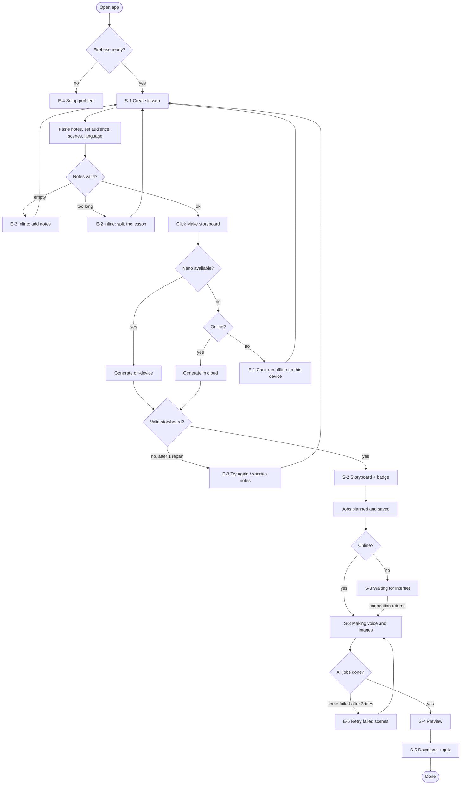
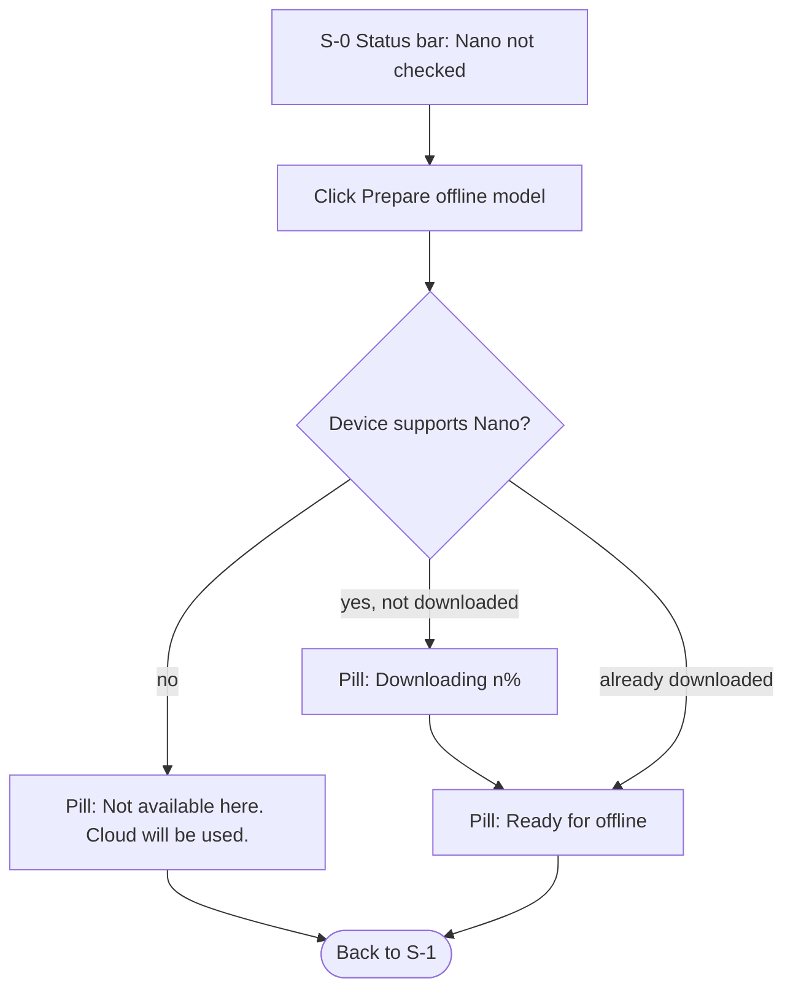
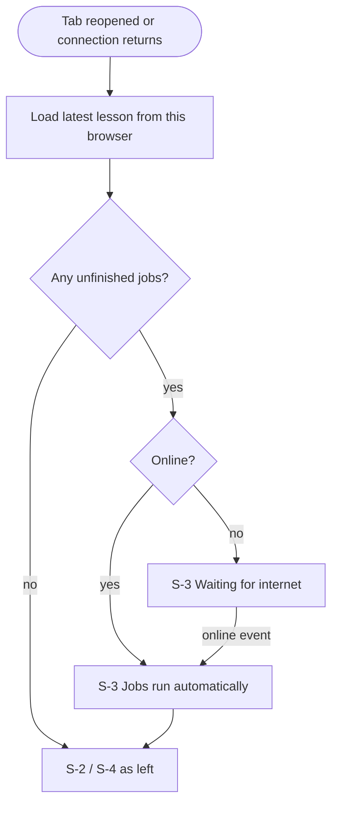
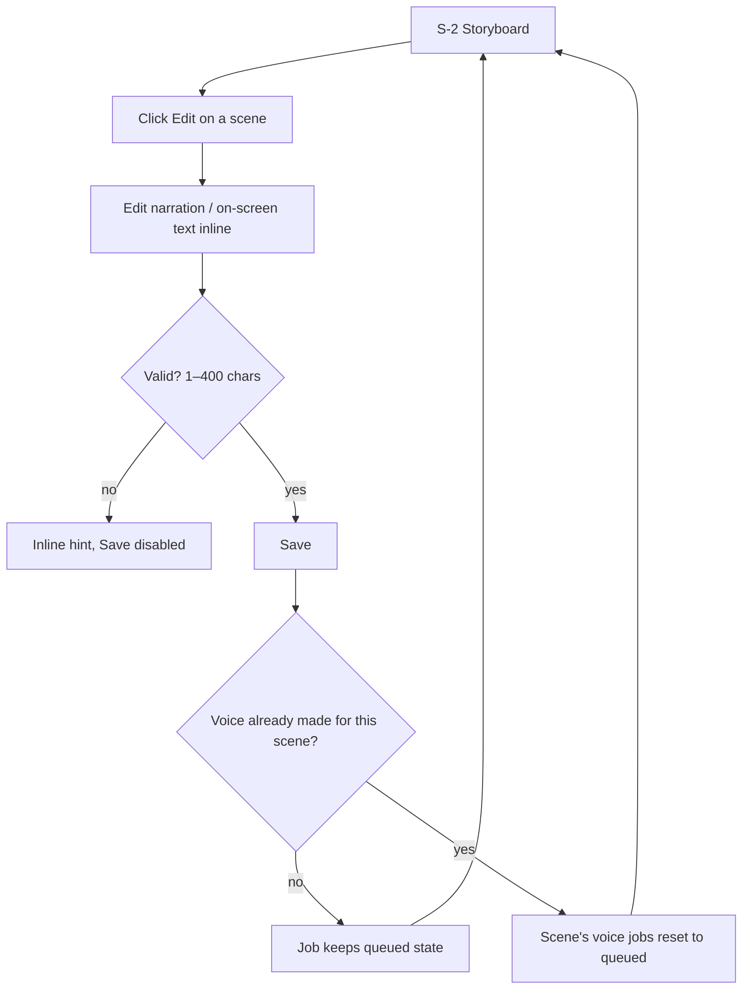
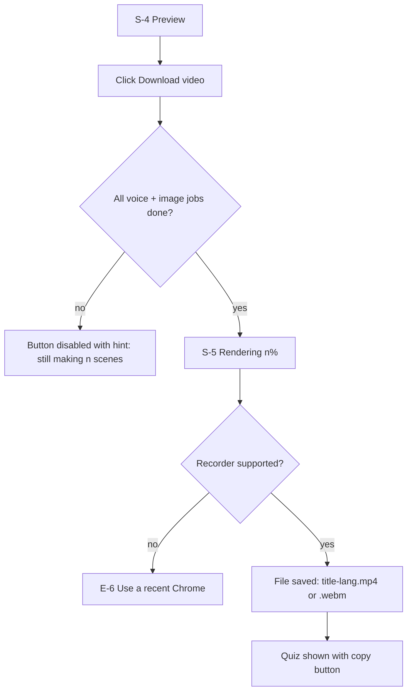
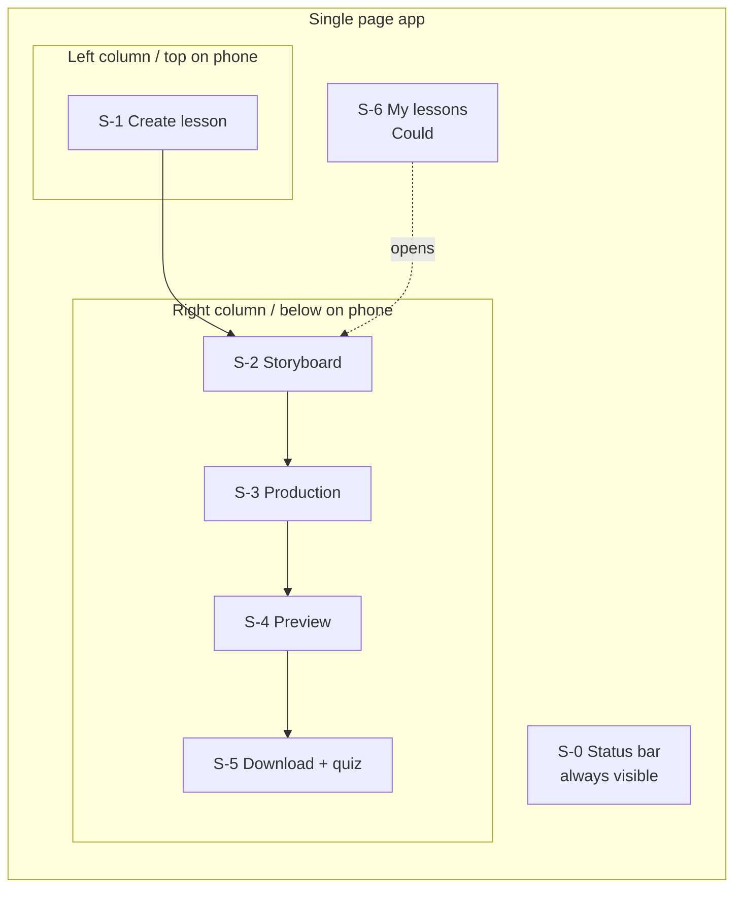

# 02 · UX design and user flows

|              |                                                                                                                         |
| ------------ | ----------------------------------------------------------------------------------------------------------------------- |
| Last updated | 2026-11-19                                                                                                              |
| Owner        | UX Designer                                                                                                             |
| Inputs       | [01 Product requirements](01-product-requirements.md)                                                                   |
| Feeds        | [03 Screen design](03-screen-design.md) · [04 Functional spec](04-functional-spec.md) · Index: [docs/README](README.md) |

## Contents

1. [Design principles](#1-design-principles)
2. [Personas](#2-personas)
3. [User journeys](#3-user-journeys)
4. [User flows](#4-user-flows)
5. [Navigation structure](#5-navigation-structure)
6. [Screen inventory](#6-screen-inventory)
7. [User actions and outcomes](#7-user-actions-and-outcomes)
8. [Error and alternative flows](#8-error-and-alternative-flows)

## 1. Design principles

1. **Offline is normal, not an error.** Never show a red error for "you're offline". Show what still works and what's waiting.
2. **Always say where the AI ran.** On-device, Cloud or Queued, on every AI result (G-5).
3. **One main action per moment.** The next step is always the biggest button.
4. **Never lose the teacher's words.** Notes stay in the box after any failure. Work is saved before anything risky happens.
5. **Plain language.** "Voice and images are waiting for internet", not "3 jobs pending in queue".
6. **Mobile-friendly, desktop-first.** On-device AI needs desktop Chrome, but the layout still works on a phone (cloud path).

## 2. Personas

> Proto-personas built from our problem hypothesis. Confirm or change after the teacher interviews ([01 §9](01-product-requirements.md#9-validation-plan-playbook-step-3)).

### PER-1 Ada, secondary school science teacher

|              |                                                                                                                 |
| ------------ | --------------------------------------------------------------------------------------------------------------- |
| Context      | Teaches JSS2 and SS1 in Enugu. 40+ students per class                                                           |
| Devices      | Mid-range Windows laptop (Chrome), Android phone with a data bundle                                             |
| Connectivity | Grid power cuts most evenings; buys data in small bundles                                                       |
| Goal         | A short video that makes tomorrow's topic click, without spending her evening or her data                       |
| Frustration  | "Every AI tool I try spins forever when the network drops."                                                     |
| Success      | She preps on her laptop at night with no data, then the video finishes on its own at school where there's Wi-Fi |

### PER-2 Wanjiru, NGO field trainer

|              |                                                                                           |
| ------------ | ----------------------------------------------------------------------------------------- |
| Context      | Runs hygiene and farming sessions in rural villages in Kenya                              |
| Devices      | NGO-issued laptop (Chrome)                                                                |
| Connectivity | No signal in the field; office Wi-Fi twice a week                                         |
| Goal         | Short videos in English and Swahili to play on the laptop during sessions                 |
| Frustration  | Translating and recording narration herself takes days                                    |
| Success      | Plans videos in the field, finishes them back at the office, plays them offline next trip |

### PER-3 Tunde, private tutor

|              |                                                                       |
| ------------ | --------------------------------------------------------------------- |
| Context      | Tutors WAEC/JAMB students; sends revision material to WhatsApp groups |
| Devices      | Laptop + phone                                                        |
| Connectivity | Mostly online but pays for every MB                                   |
| Goal         | Turn his revision notes into 1–2 minute clips quickly                 |
| Frustration  | Video tools are paid or add watermarks                                |
| Success      | Exports an MP4 he can post straight to WhatsApp                       |

### PER-4 Hackathon judge

|                 |                                                                                                        |
| --------------- | ------------------------------------------------------------------------------------------------------ |
| Context         | Reviews many submissions in a week                                                                     |
| Devices         | Any laptop; **probably no Gemini Nano**                                                                |
| Goal            | See the product working within 2–3 minutes and understand the hybrid design                            |
| Must not happen | Being blocked by a setup step, a login, or an "unsupported device" wall                                |
| Success         | Pastes sample notes, gets a storyboard (cloud badge), sees voice and images arrive, previews the video |

## 3. User journeys

### J-1 Ada prepares a lesson during a power cut (primary)

| Stage            | Doing                                                                      | Thinking / feeling                               | Touchpoint | Opportunity                                                  |
| ---------------- | -------------------------------------------------------------------------- | ------------------------------------------------ | ---------- | ------------------------------------------------------------ |
| 1. Before        | Notes are ready in a Word doc                                              | "A video would help, but I've no data tonight"   | —          | Make the offline promise obvious on the first screen         |
| 2. Set up (once) | Opens Lessonreel on Wi-Fi earlier that day, clicks "Prepare offline model" | "Will this work later without internet?"         | S-0        | Show download progress and a clear "Ready for offline" state |
| 3. Create        | Power out, no data. Pastes notes, picks "JSS2", French                     | Hopeful, a bit doubtful                          | S-1        | Big single button; offline pill visible but calm             |
| 4. Storyboard    | Sees 5 scenes appear with an **On-device** badge                           | "It actually worked offline" (moment of delight) | S-2        | Show time taken; let her fix a line                          |
| 5. Wait          | Sees "Voice and images are waiting for internet"                           | Reassured, nothing lost                          | S-3        | Show what's waiting, per scene                               |
| 6. Finish        | Next morning at school Wi-Fi, opens the tab; jobs run on their own         | Surprised it continued without her               | S-3        | No button needed to resume                                   |
| 7. Use           | Previews, downloads, shows it in class; uses the quiz                      | Proud                                            | S-4, S-5   | Quiz ready to copy                                           |

### J-2 Judge evaluates the live app (no Nano)

| Stage | Doing                           | Must feel                                                                          | Screen   |
| ----- | ------------------------------- | ---------------------------------------------------------------------------------- | -------- |
| 1     | Opens link                      | "I know what this does" in 5 seconds                                               | S-0/S-1  |
| 2     | Clicks "Try sample notes"       | No typing needed                                                                   | S-1      |
| 3     | Makes storyboard                | Sees **Cloud** badge plus a note: "On a device with Gemini Nano this runs offline" | S-2      |
| 4     | Watches voice and images arrive | Hybrid split is obvious                                                            | S-3      |
| 5     | Previews / downloads            | It's a complete product                                                            | S-4, S-5 |

### J-3 Wanjiru finishes a video at the office (resume)

Plans offline in the field (J-1 steps 3–5), closes the laptop, opens the tab days later on office Wi-Fi. The last lesson reloads and the queue continues ([UF-3](#uf-3-resume-after-reload-or-reconnect)).

## 4. User flows

### UF-1 Create a video (main flow)

### UF-2 Prepare the offline model (one-time)

Note: Chrome only allows the Nano download after a click, so this can't happen silently on load. The status check itself (supported / downloaded) should run on load ([gap](README.md#docs--code-sync)).

### UF-3 Resume after reload or reconnect

### UF-4 Edit a scene before voice is generated (Should)

### UF-5 Export

## 5. Navigation structure

Lessonreel is a **single page**. "Screens" are views that appear in sequence on that page. Nothing needs a back button, because earlier views stay visible above the current one (desktop: two columns, phone: stacked).

**Going back:** the teacher can always change the notes in S-1 and make a new storyboard. A new storyboard creates a new lesson; the previous one stays in the browser (and in S-6 when built).

## 6. Screen inventory

| ID      | View                       | Purpose                               | Main action                      | Status in code                                   |
| ------- | -------------------------- | ------------------------------------- | -------------------------------- | ------------------------------------------------ |
| S-0     | Status bar                 | App name, Online/Offline, Nano state  | Prepare offline model            | ✅ Built (Nano check on load: gap)               |
| S-1     | Create lesson              | Collect notes and options             | Make storyboard                  | ✅ Built (sample notes button, slow toggle: gap) |
| S-2     | Storyboard                 | Show scenes, quiz, where it ran       | Review / edit scene              | ✅ Read-only built; edit is a gap                |
| S-3     | Production                 | Voice + image progress, waiting state | (none, automatic) / Retry failed | 🟡 Totals only; per-scene list is a gap          |
| S-4     | Preview                    | Watch the video in the page           | Preview video                    | ✅ Built                                         |
| S-5     | Download + quiz            | Render file, show quiz                | Download video                   | 🟡 Download built; quiz panel is a gap           |
| S-6     | My lessons                 | Reopen older lessons                  | Open                             | ⬜ Could                                         |
| E-1…E-6 | Error / alternative states | See §8                                | —                                | 🟡 Messages exist for E-1, E-3, E-4              |

## 7. User actions and outcomes

| #   | Where | User action                    | System outcome                                                                        | Next                      |
| --- | ----- | ------------------------------ | ------------------------------------------------------------------------------------- | ------------------------- |
| A1  | S-0   | Click "Prepare offline model"  | Nano check + download with %                                                          | S-0 pill updates          |
| A2  | S-1   | Click "Try sample notes" (gap) | Fills a short sample lesson                                                           | S-1                       |
| A3  | S-1   | Click "Make storyboard"        | Button disabled, status "Writing storyboard…" (or "Offline: writing on this device…") | S-2 or E-1/E-2/E-3        |
| A4  | S-2   | Read storyboard                | Badge On-device/Cloud + seconds taken                                                 | S-3 starts by itself      |
| A5  | S-2   | Edit scene (gap)               | Inline editor; voice jobs for that scene reset                                        | S-2                       |
| A6  | S-3   | Go offline                     | Badge Queued, text "waiting for internet"                                             | S-3                       |
| A7  | S-3   | Come back online               | Jobs run 2 at a time, progress updates                                                | S-4 enabled when ≥ 1 done |
| A8  | S-3   | Click "Retry failed" (gap)     | Failed jobs reset to queued                                                           | S-3                       |
| A9  | S-4   | Click "Preview video"          | Scenes play with voice; button disabled while playing                                 | S-4                       |
| A10 | S-5   | Click "Download video"         | "Rendering video… n%" then file saves                                                 | S-5                       |
| A11 | S-5   | Click "Copy quiz" (gap)        | Quiz copied as plain text, toast "Copied"                                             | S-5                       |
| A12 | S-1   | Change second language         | Applies to the next storyboard                                                        | S-1                       |

## 8. Error and alternative flows

Every error keeps the teacher's notes, explains in plain words, and offers one next step. Exact copy and behaviour are in [04 §6](04-functional-spec.md#6-error-handling).

| ID  | Situation                                    | What the user sees                                                                             | Way forward                                  |
| --- | -------------------------------------------- | ---------------------------------------------------------------------------------------------- | -------------------------------------------- |
| E-1 | Offline and this device can't run Nano       | "This device can't run Gemini Nano offline. Connect to the internet to use the cloud instead." | Connect, then click Make again               |
| E-2 | Notes empty or longer than 12,000 characters | Inline message under the notes box                                                             | Add notes / split the lesson                 |
| E-3 | Model output unusable after one repair       | "We couldn't build a storyboard from these notes. Try again, or shorten them."                 | Retry                                        |
| E-4 | App not configured / Firebase can't start    | "Lessonreel can't start right now." + detail for developers                                    | Reload later                                 |
| E-5 | A voice or image job failed 3 times          | Scene row marked "Failed" + "Retry failed scenes"                                              | Retry; preview still works with placeholders |
| E-6 | Browser can't record video                   | "This browser can't record video. Use a recent Chrome."                                        | Switch browser                               |
| E-7 | Connection drops mid-production              | Calm switch to Queued, no error                                                                | Automatic resume (UF-3)                      |
| E-8 | Tab closed mid-production                    | Nothing lost; resumes on next visit                                                            | UF-3                                         |
