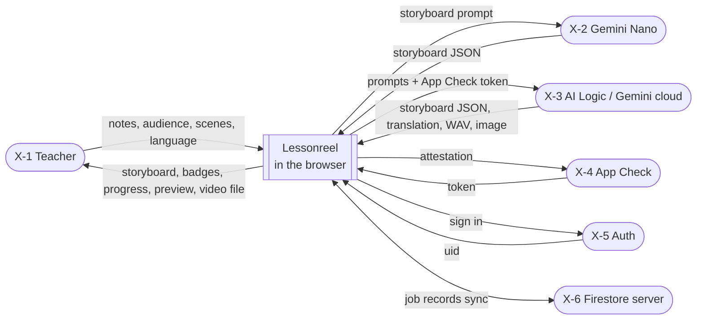
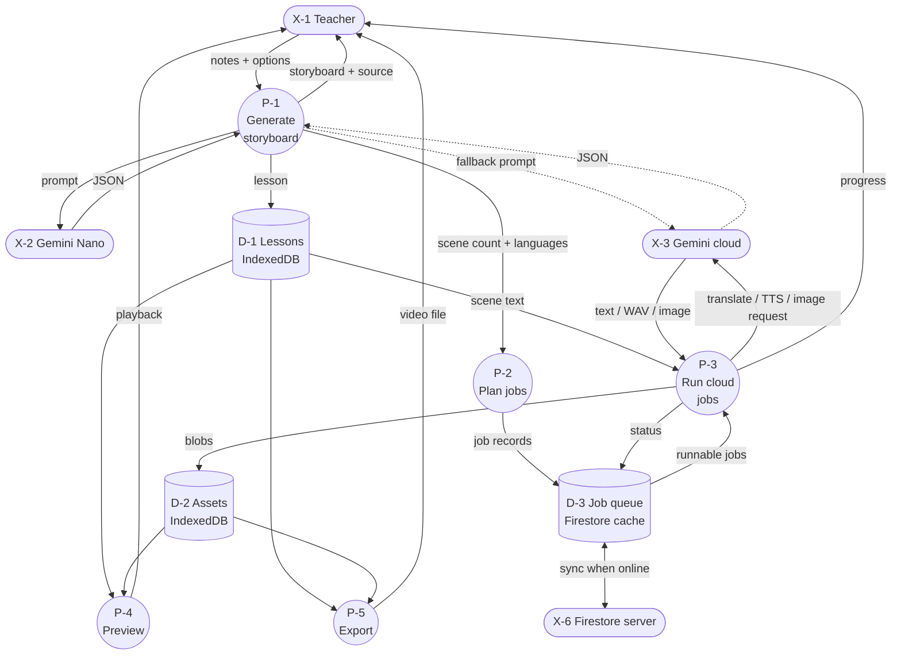

# 05 · Data flow

|              |                                                                                       |
| ------------ | ------------------------------------------------------------------------------------- |
| Last updated | 2026-11-19                                                                            |
| Owner        | Business Analyst + Software Architect                                                 |
| Inputs       | [04 Functional spec](04-functional-spec.md) (F-n, BR-n)                               |
| Feeds        | [TDD](../TDD.md) §11 Database and data architecture · Index: [docs/README](README.md) |

## Contents

1. [External entities, processes and stores](#1-external-entities-processes-and-stores)
2. [Level 0: context diagram](#2-level-0-context-diagram)
3. [Level 1: main processes](#3-level-1-main-processes)
4. [Process details](#4-process-details)
5. [Data dictionary](#5-data-dictionary)
6. [Data questions answered](#6-data-questions-answered)
7. [Privacy and retention](#7-privacy-and-retention)

## 1. External entities, processes and stores

| Type            | ID  | Name                                             | Notes                                                                |
| --------------- | --- | ------------------------------------------------ | -------------------------------------------------------------------- |
| External entity | X-1 | Teacher (user)                                   | Provides notes and choices; receives storyboard, preview, video file |
| External entity | X-2 | Gemini Nano (in Chrome)                          | On-device model; no network                                          |
| External entity | X-3 | Firebase AI Logic → Gemini cloud                 | Text, translation, TTS, image models                                 |
| External entity | X-4 | Firebase App Check + reCAPTCHA                   | Issues tokens that prove requests come from the real app             |
| External entity | X-5 | Firebase Auth                                    | Issues anonymous uid                                                 |
| External entity | X-6 | Cloud Firestore (server)                         | Remote copy of job records                                           |
| Process         | P-1 | Generate storyboard                              | F2, F3                                                               |
| Process         | P-2 | Plan cloud jobs                                  | F6.1                                                                 |
| Process         | P-3 | Run cloud jobs                                   | F4, F5, F6.3–F6.5                                                    |
| Process         | P-4 | Preview                                          | F8                                                                   |
| Process         | P-5 | Export video                                     | F9                                                                   |
| Data store      | D-1 | Lessons (IndexedDB `project:{id}`)               | Notes, options, storyboard, source                                   |
| Data store      | D-2 | Assets (IndexedDB `asset:{…}`)                   | WAV audio, images                                                    |
| Data store      | D-3 | Job queue (Firestore local cache, synced to X-6) | Job metadata only (BR-10)                                            |

## 2. Level 0: context diagram

## 3. Level 1: main processes

## 4. Process details

### P-1 Generate storyboard

|         |                                                                                                                                                                                                                                         |
| ------- | --------------------------------------------------------------------------------------------------------------------------------------------------------------------------------------------------------------------------------------- |
| Inputs  | Notes (X-1), audience, scene count, include quiz                                                                                                                                                                                        |
| Steps   | 1. Validate notes (BR-1). 2. Build prompt (`buildStoryboardPrompt`). 3. Send to Nano if available, else cloud (`PREFER_ON_DEVICE`). 4. Extract JSON and validate (BR-2 to BR-5). 5. If invalid, one repair request. 6. Renumber scenes. |
| Outputs | Storyboard + `inferenceSource` + duration → S-2; lesson record → D-1; scene count + languages → P-2                                                                                                                                     |
| Errors  | E-1, E-2, E-3 (nothing written to D-1 on error)                                                                                                                                                                                         |

### P-2 Plan cloud jobs

|         |                                                                                                     |
| ------- | --------------------------------------------------------------------------------------------------- |
| Inputs  | Lesson id, scene count, languages (English + 1)                                                     |
| Steps   | For each scene: one `image` job + one `tts` job per language (`planJobs`), deterministic ids (BR-8) |
| Outputs | Job records → D-3 (written locally first; synced to X-6 when online)                                |
| Errors  | If not signed in yet (offline first load), jobs are planned on the next sign-in                     |

### P-3 Run cloud jobs

|         |                                                                                                                                                                                                                                                       |
| ------- | ----------------------------------------------------------------------------------------------------------------------------------------------------------------------------------------------------------------------------------------------------- |
| Trigger | Lesson created while online, page load with a lesson, or `online` event                                                                                                                                                                               |
| Inputs  | Runnable jobs from D-3 (`nextRunnable`, max 2), scene text from D-1                                                                                                                                                                                   |
| Steps   | 1. Mark `running`, attempts +1. 2. `tts`: translate if non-English → TTS → WAV. `image`: image model → PNG/JPEG. 3. Save blob to D-2 under the matching asset key. 4. Mark `done` (or `failed` with error). 5. Repeat until none runnable or offline. |
| Outputs | Blobs → D-2; status → D-3; progress → S-3                                                                                                                                                                                                             |
| Errors  | E-5, E-7, E-8, E-9                                                                                                                                                                                                                                    |

### P-4 Preview

|         |                                                                 |
| ------- | --------------------------------------------------------------- |
| Inputs  | Storyboard (D-1), image + audio for the selected language (D-2) |
| Outputs | In-page playback (S-4)                                          |
| Errors  | Missing asset → placeholder frame / scene duration              |

### P-5 Export

|         |                                                                               |
| ------- | ----------------------------------------------------------------------------- |
| Inputs  | Storyboard (D-1), assets (D-2), language                                      |
| Steps   | Decode audio, draw frames on canvas, record canvas + audio with MediaRecorder |
| Outputs | One MP4/WebM file downloaded to the user's device                             |
| Errors  | E-6                                                                           |

## 5. Data dictionary

| Element             | Type                                 | Source                 | Validation                 | Stored in                | Example                                       |
| ------------------- | ------------------------------------ | ---------------------- | -------------------------- | ------------------------ | --------------------------------------------- |
| `notes`             | string                               | X-1 typing/paste       | 1–12,000 chars (BR-1)      | D-1                      | "Photosynthesis: plants use sunlight…"        |
| `audience`          | string                               | X-1                    | trimmed, default           | D-1                      | "JSS2 students"                               |
| `targetScenes`      | int                                  | X-1                    | clamp 3–8                  | not stored (prompt only) | 5                                             |
| `languages`         | string[]                             | X-1 + BR-6             | BR-7 list                  | D-1                      | `["en-US","fr-FR"]`                           |
| `board.title`       | string                               | Model                  | 1–100                      | D-1                      | "How plants make food"                        |
| `scene.narration`   | string                               | Model (editable: F2.6) | 1–400                      | D-1                      | "Plants need three things…"                   |
| `scene.imagePrompt` | string                               | Model                  | 1–300                      | D-1                      | "a green leaf in sunlight, flat illustration" |
| `scene.durationSec` | number                               | Model                  | 3–30                       | D-1                      | 8                                             |
| `quiz[]`            | object[]                             | Model                  | BR-5                       | D-1                      | `{question, options[3], answerIndex}`         |
| `storyboardSource`  | enum                                 | SDK `inferenceSource`  | `on_device` \| `in_cloud`  | D-1                      | `on_device`                                   |
| `job.id`            | string                               | P-2                    | BR-8 format                | D-3                      | `9f1c…:2:tts:fr-FR`                           |
| `job.status`        | enum                                 | P-3                    | queued/running/done/failed | D-3                      | `done`                                        |
| `job.attempts`      | int                                  | P-3                    | 0–3                        | D-3                      | 1                                             |
| Audio asset         | Blob (audio/wav, 24 kHz mono 16-bit) | X-3 TTS                | non-empty                  | D-2                      | `asset:9f1c…:2:tts:fr-FR`                     |
| Image asset         | Blob (image/png or jpeg)             | X-3 image model        | `image/*`                  | D-2                      | `asset:9f1c…:2:image:-`                       |
| `uid`               | string                               | X-5                    | n/a                        | Firebase SDK             | `aB3…`                                        |
| App Check token     | string (short-lived)                 | X-4                    | auto-refresh               | memory only              | n/a                                           |

## 6. Data questions answered

| Question                   | Answer                                                                                                                               |
| -------------------------- | ------------------------------------------------------------------------------------------------------------------------------------ |
| Where does it originate?   | Notes and options from the teacher. Storyboard, translations, audio and images from AI models. uid from Auth. Tokens from App Check. |
| Who provides it?           | Teacher (X-1); Gemini Nano (X-2); Gemini cloud via AI Logic (X-3); Firebase (X-4, X-5).                                              |
| Entered by the user?       | Notes, audience, scene count, language; scene edits (F2.6).                                                                          |
| From an external API?      | Yes: AI Logic (all cloud AI), App Check, Auth, Firestore sync.                                                                       |
| Retrieved from a database? | Lessons and assets from IndexedDB on load; job states from the Firestore cache.                                                      |
| Where is it stored?        | Lessons and assets: IndexedDB on the device (D-1, D-2). Jobs: Firestore local cache + server (D-3).                                  |
| Who can access it?         | Only this browser for D-1/D-2. Only the same uid for D-3 (Firestore rules). No one else, no admin.                                   |
| What if it's invalid?      | Notes: E-2. Model output: one repair, then E-3. Edited narration: save disabled.                                                     |
| What if the request fails? | Storyboard: E-1/E-3, notes kept. Jobs: marked failed, retried up to 3 times (E-5), resumed after reconnect (E-7). Export: E-6.       |

## 7. Privacy and retention

| Data                      | Leaves the device?                                                                   | Retention                                            |
| ------------------------- | ------------------------------------------------------------------------------------ | ---------------------------------------------------- |
| Notes                     | Only when the storyboard runs in the cloud (no Nano) or for translation of narration | Until the browser data is cleared (delete UI: Could) |
| Storyboard, audio, images | No (audio/images are created in the cloud but stored only locally)                   | Same as above                                        |
| Job records               | Yes, to Firestore, without lesson content                                            | Same uid; no automatic deletion in MVP               |
| Personal data             | None collected (no name, email or phone)                                             | n/a                                                  |

The app should state this in one line under the notes box: "Your notes stay on this device when Gemini Nano is available."
