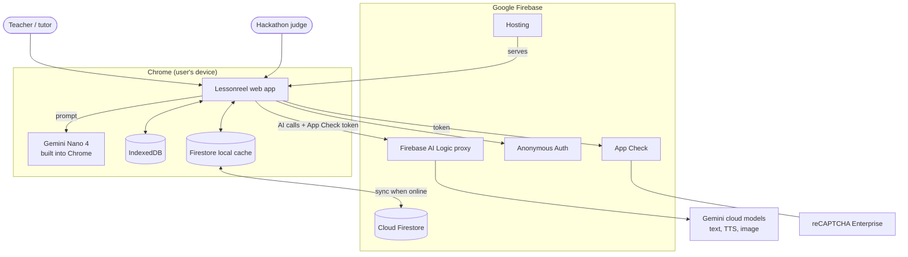
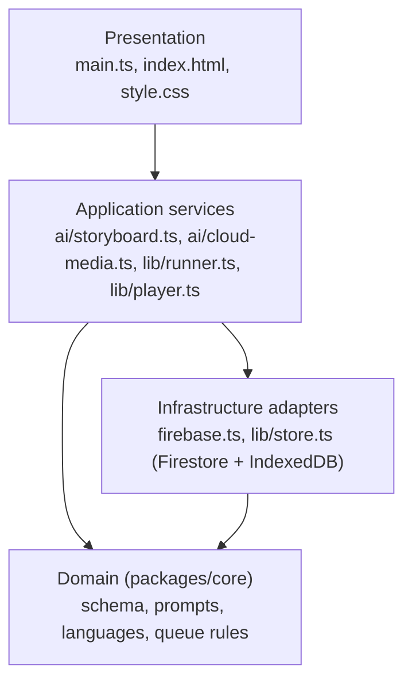
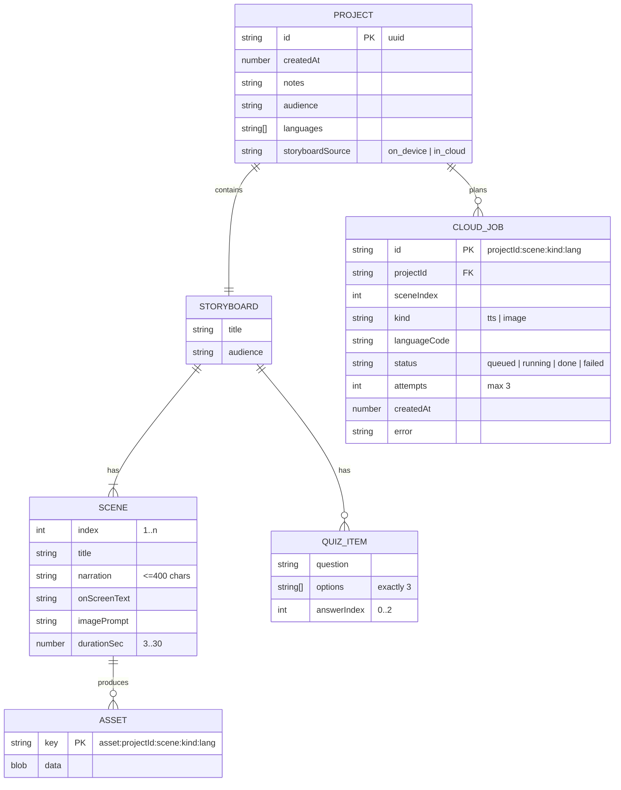
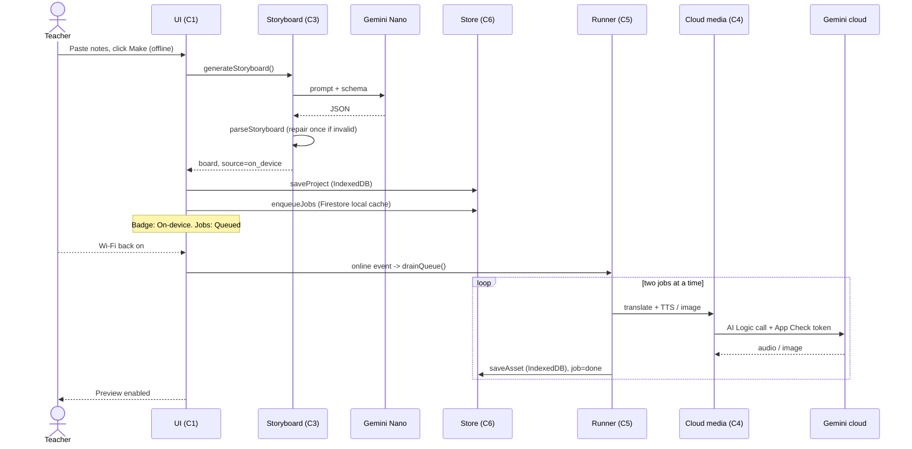
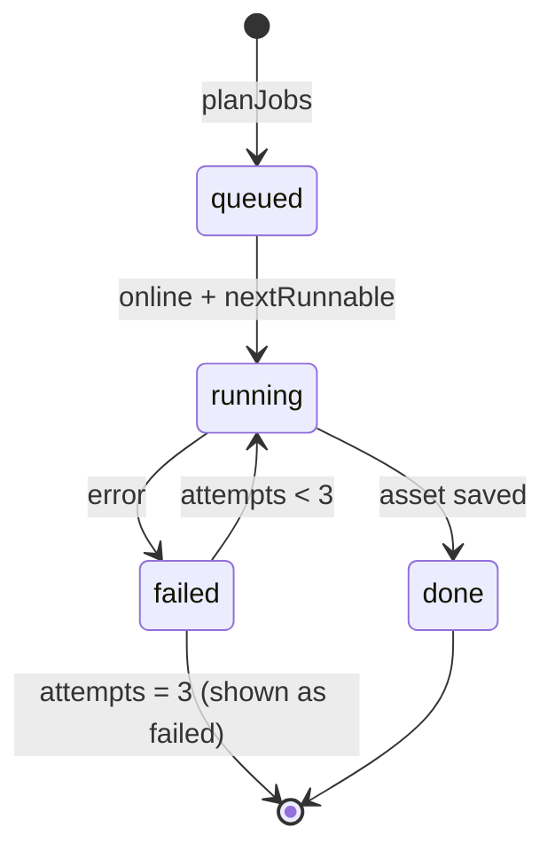
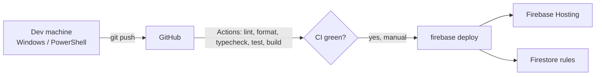

# 06 · Software architecture (SAD)

|         |                                                                                                                              |
| ------- | ---------------------------------------------------------------------------------------------------------------------------- |
| Status  | Draft v1, 2026-11-19                                                                                                         |
| Owner   | Benjamin Ugochukwu (architect, tech lead, developer)                                                                         |
| Scope   | MVP for #BuildHybridAI 2026 (deadline 2026-11-30, 2:00 PM PT)                                                                |
| Inputs  | [01 PRD](01-product-requirements.md) · [04 Functional spec](04-functional-spec.md) · [05 Data flow](05-data-flow.md)         |
| Related | [02 UX](02-ux-design.md) · [03 Screens](03-screen-design.md) · [`AGENTS.md`](../AGENTS.md) · Index: [docs/README](README.md) |

---

## Contents

1. [Purpose and requirements](#1-purpose-and-requirements)
2. [Architectural drivers](#2-architectural-drivers)
3. [System context](#3-system-context)
4. [Architecture style](#4-architecture-style)
5. [Components](#5-components)
6. [Technology stack](#6-technology-stack)
7. [Data architecture](#7-data-architecture)
8. [Interfaces between components](#8-interfaces-between-components)
9. [Key flows](#9-key-flows)
10. [Security architecture](#10-security-architecture)
11. [Infrastructure and deployment](#11-infrastructure-and-deployment)
12. [Performance, scale and cost](#12-performance-scale-and-cost)
13. [Failure modes and resilience](#13-failure-modes-and-resilience)
14. [Folder structure](#14-folder-structure)
15. [Engineering standards](#15-engineering-standards)
16. [Architecture Decision Records](#16-architecture-decision-records)
17. [Risks and open questions](#17-risks-and-open-questions)
18. [Future evolution](#18-future-evolution)

---

## 1. Purpose and requirements

**Product:** Turn lesson notes into a narrated explainer video, even with no internet.

**Users:** Teachers, tutors and NGO trainers with unreliable internet, unreliable power or expensive data.

### Functional requirements

Summary only. Full detail, business rules and acceptance criteria: [04 Functional spec](04-functional-spec.md).

| ID  | Requirement                                                           | MVP                    |
| --- | --------------------------------------------------------------------- | ---------------------- |
| F1  | Paste notes, choose audience and scene count                          | ✅                     |
| F2  | Generate script, scenes, image prompts and a 3-question quiz          | ✅                     |
| F3  | F2 works with no internet when Gemini Nano is available               | ✅                     |
| F4  | Narrate each scene in English plus one more language                  | ✅                     |
| F5  | Generate one image per scene                                          | ✅                     |
| F6  | Queue F4/F5 while offline and run them automatically when back online | ✅                     |
| F7  | Show where each step ran: On-device, Cloud or Queued                  | ✅                     |
| F8  | Preview the video in the browser                                      | ✅                     |
| F9  | Export one video file                                                 | ✅ (`lib/exporter.ts`) |
| F10 | Android app                                                           | Could                  |

### Non-functional requirements

| ID  | Requirement                             | Target                                                            |
| --- | --------------------------------------- | ----------------------------------------------------------------- |
| N1  | Storyboard time on-device               | < 60 s for 5 scenes on a mid-range laptop                         |
| N2  | No work lost on disconnect or reload    | 100% of queued jobs survive                                       |
| N3  | No secrets in client or repo            | Zero                                                              |
| N4  | Only the real app can call cloud models | App Check enforced                                                |
| N5  | Works for judges without Nano           | Cloud fallback for every on-device step                           |
| N6  | English UI                              | Required by rules                                                 |
| N7  | Free for users and judges               | Firebase free tier; live until 2026-12-16                         |
| N8  | Accessible                              | Keyboard usable, visible focus, 44 px targets, `aria-live` status |

## 2. Architectural drivers

These are the forces that shaped every decision below, in priority order.

1. **Hackathon rules.**
   - Firebase AI Logic must be imported and called at runtime.
   - App Check is required.
   - A public repo, a 3-minute video and free judge access until Dec 16.
2. **Judging criteria.** Four equally weighted criteria. Technical implementation is the first tie-break, so the hybrid split has to be real and visible.
3. **Offline-first is the product.** On-device is a requirement here, not just an optimisation.
4. **Nano is not everywhere.** Judges and many users won't have it. The cloud path must give the same result.
5. **Solo builder, 11 days.** No servers to run, no microservices. Everything is built new during the event, so prefer browser APIs over heavy libraries.
6. **Cost.** Stay inside the free tier; nothing billable by default.

## 3. System context



There is **no custom backend**. The browser is the application server. Firebase provides hosting, identity, sync and a secure proxy to Gemini.

## 4. Architecture style

| Pattern                        | Where it's used                                                               | Why                                                         |
| ------------------------------ | ----------------------------------------------------------------------------- | ----------------------------------------------------------- |
| **Client-side monolith**       | `apps/web` is one deployable static app                                       | Smallest thing that works for one developer in 11 days      |
| **Clean architecture (light)** | `packages/core` holds pure business rules with no browser or Firebase imports | Unit-testable, reusable by a future Android app             |
| **Offline-first**              | All state is local first, synced later                                        | The product promise                                         |
| **Queue / event-driven**       | Cloud work is modelled as jobs, drained on the browser `online` event         | Decouples "plan" from "execute" across connectivity changes |
| **Hybrid inference**           | `PREFER_ON_DEVICE` for text, `ONLY_IN_CLOUD` for audio and images             | Use the device when it can, the cloud when it must          |

Layers inside the web app:



Dependency rule: arrows point inwards. `core` depends on nothing but Zod.

## 5. Components

| #   | Component           | File(s)                              | Responsibility                                                                              | Runs            |
| --- | ------------------- | ------------------------------------ | ------------------------------------------------------------------------------------------- | --------------- |
| C1  | UI shell            | `main.ts`, `index.html`, `style.css` | Form, badges, status, storyboard view, connectivity pill                                    | Browser         |
| C2  | Firebase bootstrap  | `firebase.ts`                        | Init app, App Check (first), Firestore cache, AI Logic, anonymous sign-in                   | Browser         |
| C3  | Storyboard service  | `ai/storyboard.ts`                   | Hybrid model, Nano warm-up, generate + validate + one repair pass, report `inferenceSource` | Device or cloud |
| C4  | Cloud media service | `ai/cloud-media.ts`                  | Translate narration, TTS, image generation                                                  | Cloud only      |
| C5  | Queue runner        | `lib/runner.ts`                      | Drain jobs two at a time while online, retry up to 3 times                                  | Browser → cloud |
| C6  | Store               | `lib/store.ts`                       | Projects and assets in IndexedDB; job records in Firestore                                  | Browser         |
| C7  | Player / exporter   | `lib/player.ts`, `lib/exporter.ts`   | Preview playback; export one video file                                                     | Browser         |
| C8  | Domain core         | `packages/core/*`                    | Storyboard schema, prompt builders, language list, queue planning rules                     | Anywhere        |

## 6. Technology stack

| Layer            | Choice                                                    | Why this, not the alternative                                                              |
| ---------------- | --------------------------------------------------------- | ------------------------------------------------------------------------------------------ |
| Language         | TypeScript (strict)                                       | Type safety across SDK calls; same language everywhere                                     |
| UI               | Vanilla TS + Vite                                         | One screen; React would add weight without benefit. Vite gives fast dev and small builds   |
| On-device AI     | Gemini Nano 4 in Chrome via Firebase AI Logic             | Required by the hackathon for Web; offline and free                                        |
| Cloud text       | Gemini Flash Lite via Firebase AI Logic                   | Cheap and fast; cloud fallback for storyboard, translation                                 |
| Speech           | Gemini TTS via Firebase AI Logic                          | Nano can't produce audio; languages en, fr, es, hi (GA), sw (preview)                      |
| Images           | Gemini image model via Firebase AI Logic                  | Nano can't produce images; model name set by config                                        |
| Validation       | Zod                                                       | Small models sometimes break JSON; validate everything that comes back                     |
| Local storage    | IndexedDB (`idb-keyval`)                                  | Holds large blobs (WAV, PNG); works offline; no size issue like Firestore's 1 MB doc limit |
| Sync / queue     | Cloud Firestore with persistent local cache               | Offline writes survive reloads and sync automatically                                      |
| Identity         | Firebase Anonymous Auth                                   | No sign-up friction for teachers or judges; scopes Firestore data per user                 |
| Abuse protection | App Check + reCAPTCHA Enterprise                          | Required; blocks scripted use of our Gemini quota                                          |
| Hosting          | Firebase Hosting                                          | Free, HTTPS, same project as everything else                                               |
| Tooling          | pnpm workspaces, ESLint, Prettier, Vitest, GitHub Actions | Monorepo with shared core; CI on every push                                                |

## 7. Data architecture

How data moves between processes is in [05 Data flow](05-data-flow.md). This section covers storage design.

### 7.1 Where data lives

| Data                  | Store                                | Size                              | Leaves the device?                      |
| --------------------- | ------------------------------------ | --------------------------------- | --------------------------------------- |
| Lesson notes          | IndexedDB (inside Project)           | ≤ 12 KB                           | Only if storyboard runs in the cloud    |
| Storyboard            | IndexedDB (inside Project)           | ~ 5 KB                            | No                                      |
| Narration audio (WAV) | IndexedDB                            | ~ 0.5–1 MB per scene per language | No (generated in cloud, stored locally) |
| Scene images          | IndexedDB                            | ~ 0.3–1 MB each                   | No (generated in cloud, stored locally) |
| Job records           | Firestore `users/{uid}/jobs/{jobId}` | < 1 KB each                       | Yes (sync only; no lesson content)      |

### 7.2 Schema



### 7.3 Integrity rules

- **No duplicate jobs:** the job id is deterministic (`projectId:scene:kind:lang`). Re-planning overwrites, it never duplicates.
- **Scene indexes are always 1..n:** `parseStoryboard` renumbers them after validation.
- **Asset keys mirror job ids**, so finding the output of a job is a single lookup.
- **Lesson content never goes into Firestore.** Only job metadata syncs.

## 8. Interfaces between components

There is no REST API of our own. Components talk through typed function calls in the browser. The external interfaces are the Firebase SDKs.

### 8.1 Internal contracts

```ts
// C3 Storyboard service
generateStoryboard(ai, { notes, audience, targetScenes?, includeQuiz? })
  -> Promise<{ board: Storyboard; source: "on_device" | "in_cloud"; ms: number; repaired: boolean }>
warmUpDeviceModel(ai, onProgress: (pct: number) => void) -> Promise<void>   // call from a click

// C4 Cloud media service
translateNarration(ai, narration, languageCode) -> Promise<string>
synthesizeNarration(ai, scene, languageCode, audience, slow?) -> Promise<Blob /* audio/wav */>
generateSceneImage(ai, scene) -> Promise<Blob | null>                       // null if no image model set

// C5 Queue runner
drainQueue(ai, db, uid, project, { onProgress, onJob }) -> Promise<void>    // returns when offline or empty

// C8 Domain core (pure)
parseStoryboard(raw: string) -> Storyboard                                  // throws StoryboardParseError
planJobs(projectId, sceneCount, languages, now?) -> CloudJob[]
nextRunnable(jobs, limit?) -> CloudJob[]
```

### 8.2 External interfaces

| Interface        | Mode               | Input                                                                                | Output                            |
| ---------------- | ------------------ | ------------------------------------------------------------------------------------ | --------------------------------- |
| Storyboard model | `PREFER_ON_DEVICE` | Prompt + JSON Schema (`responseConstraint` on device, `responseJsonSchema` in cloud) | JSON text + `inferenceSource`     |
| Translate        | `ONLY_IN_CLOUD`    | Narration + BCP-47 code                                                              | Text                              |
| TTS              | `ONLY_IN_CLOUD`    | Text + `speechConfig` (voice, languageCode)                                          | Base64 WAV (24 kHz, 16-bit, mono) |
| Image            | `ONLY_IN_CLOUD`    | Image prompt, `responseModalities: [TEXT, IMAGE]`                                    | Base64 PNG/JPEG                   |
| Firestore        | SDK, offline cache | Job docs                                                                             | Job docs                          |

## 9. Key flows

### 9.1 Offline create, online finish (the demo flow)



### 9.2 No Nano, online (judge's machine)

1. `PREFER_ON_DEVICE` finds no Nano, so the SDK routes the storyboard to the cloud model.
2. `inferenceSource = "in_cloud"`, and the badge says Cloud.
3. Everything else is identical.

### 9.3 No Nano, offline

1. The storyboard can't run anywhere.
2. The UI says so in plain words ("This device can't run Gemini Nano offline. Connect to use the cloud.").
3. The notes stay in the textarea. Nothing is lost.

### 9.4 Job lifecycle



## 10. Security architecture

| Threat                           | Control                                                                                                                                           |
| -------------------------------- | ------------------------------------------------------------------------------------------------------------------------------------------------- |
| Someone scripts our Gemini quota | App Check (reCAPTCHA Enterprise) enforced on Firebase AI Logic                                                                                    |
| API key leaked from the client   | Gemini key lives in Firebase, never in the app; Firebase web config is a public identifier by design                                              |
| User A reads User B's jobs       | Firestore rules: `users/{uid}/jobs/*` only when `request.auth.uid == uid`                                                                         |
| Lesson content exposed           | Notes, storyboard and assets stay in IndexedDB; only job metadata syncs                                                                           |
| Secrets in the repo              | `.env.local` gitignored; `.env.example` has empty values; App Check debug token is never committed (given to judges through testing instructions) |
| XSS through model output         | All model text is HTML-escaped before rendering (`escape()` in `main.ts`)                                                                         |
| Prompt injection from notes      | Output is schema-validated; the model has no tools and no access to other data; worst case is a bad storyboard                                    |
| Supply chain                     | Lockfile committed; CI installs with `--frozen-lockfile`                                                                                          |
| Unsafe generated images          | Image prompt is fixed to "simple classroom illustration, no text"; Gemini safety filters apply                                                    |

Out of scope for the MVP: user accounts with passwords, payments, storing personal data.

## 11. Infrastructure and deployment



| Environment          | Where                          | Notes                                                      |
| -------------------- | ------------------------------ | ---------------------------------------------------------- |
| Local                | `pnpm dev` on localhost:5173   | App Check debug token registered in console                |
| Production / judging | Firebase Hosting (`*.web.app`) | App Check enforced; must stay up and free until 2026-12-16 |

Config lives in `apps/web/.env.local` (`VITE_FIREBASE_*`, `VITE_*_MODEL`). Moving model names to Remote Config is a "Could" (see ADR-006).

## 12. Performance, scale and cost

| Concern                             | Approach                                                                                                                          |
| ----------------------------------- | --------------------------------------------------------------------------------------------------------------------------------- |
| Nano context (~9k tokens)           | Notes capped at 12,000 chars; 3–8 scenes; narration ≤ 400 chars each                                                              |
| First-run Nano download (GBs)       | Explicit "Prepare offline model" button with progress; cloud covers the gap meanwhile                                             |
| Cloud latency                       | Runner does 2 jobs in parallel; images and TTS for different scenes overlap                                                       |
| Export time                         | MediaRecorder records in real time: a 60 s video takes ~60 s; progress shown                                                      |
| Bundle size                         | ~235 KB gzipped (Firebase SDK); acceptable for one page; code-split later if needed                                               |
| Growth to many users                | No server to scale. Each user's cost is their own Gemini calls; Firestore load is tiny job docs                                   |
| Cost per 5-scene video, 2 languages | 1 storyboard (free on-device) + 5 translations + 10 TTS + 5 images = 20 cloud calls. Free tier for the demo; quota form if needed |

## 13. Failure modes and resilience

| Failure                    | Behaviour                                                                                       |
| -------------------------- | ----------------------------------------------------------------------------------------------- |
| Nano returns broken JSON   | One repair prompt on the same route; then a clear error                                         |
| Connection drops mid-queue | Runner stops; jobs left `running` are retried on next drain (attempts counted)                  |
| TTS/image call fails       | Job → `failed`; retried up to 3 times; preview falls back to scene duration with no audio/image |
| Page reload                | Latest project reloaded from IndexedDB; queue resumes from Firestore cache                      |
| Retired model name         | Change `VITE_*_MODEL` (or Remote Config later); no code change                                  |
| No image model configured  | Images skipped; gradient placeholder frames                                                     |

## 14. Folder structure

```
lessonreel/
├── apps/
│   └── web/                     # C1–C7: the deployable app
│       ├── index.html
│       ├── .env.example
│       ├── vite.config.ts
│       └── src/
│           ├── main.ts          # C1 UI shell
│           ├── firebase.ts      # C2 bootstrap (App Check first)
│           ├── config.ts        # env + model names
│           ├── style.css
│           ├── ai/
│           │   ├── storyboard.ts    # C3 hybrid storyboard
│           │   └── cloud-media.ts   # C4 translate, TTS, image
│           └── lib/
│               ├── store.ts     # C6 IndexedDB + Firestore jobs
│               ├── runner.ts    # C5 queue runner
│               ├── player.ts    # C7 preview
│               └── exporter.ts  # C7 export: canvas + Web Audio + MediaRecorder
├── packages/
│   └── core/                    # C8 pure domain logic + unit tests
│       ├── src/{storyboard,prompts,languages,queue,index}.ts
│       └── test/
├── docs/                        # architecture.md, demo-script.md, rules brief
├── evidence/                    # proof of on-device vs cloud behaviour
├── .github/workflows/ci.yml
├── firebase.json · firestore.rules
├── AGENTS.md · README.md · LICENSE (Apache-2.0)
└── package.json · pnpm-workspace.yaml · tsconfig.base.json · eslint.config.js
```

## 15. Engineering standards

1. **Dependency rule:** `packages/core` never imports browser, DOM or Firebase code.
2. **Validate at the edge:** every model response goes through a Zod schema before use.
3. **Show the route:** any AI call the user can see must surface `inferenceSource` or a Queued state.
4. **Small commits:** one feature per commit, `main` always green (`pnpm run ci`), dated so the history proves what was built during the event.
5. **Config over code:** model names, keys and flags come from env/Remote Config.
6. **No secrets in git.** Ever.
7. **Plain UI copy:** short, human, no hype words.
8. **Cross-platform scripts:** nothing bash-only in `package.json` (main dev box is Windows).
9. **Built new:** no code copied from other projects. Third-party libraries are listed in the README and used under their licences.

## 16. Architecture Decision Records

### ADR-001: No custom backend

- **Decision:** The app is a static site. Firebase services replace a server.
- **Reason:** One developer, 11 days. Firebase AI Logic already proxies Gemini securely with App Check. A server adds hosting, cost and a failure point with no user benefit.
- **Consequences:** All logic runs in the browser. Video export must be client-side (ADR-010). Long-running jobs only run while the tab is open.

### ADR-002: `PREFER_ON_DEVICE` for the storyboard, not `ONLY_ON_DEVICE`

- **Decision:** Storyboard uses `PREFER_ON_DEVICE`.
- **Reason:** Judges and many users won't have Nano. `ONLY_ON_DEVICE` would fail for them and risk failing Stage One ("must run consistently").
- **Consequences:** On machines without Nano, notes go to the cloud. The badge makes this visible and honest.

### ADR-003: Audio and images are cloud-only, via a queue

- **Decision:** TTS and images use `ONLY_IN_CLOUD`, planned as jobs and drained when online.
- **Reason:** Nano can't produce audio or images. Queuing turns "offline" from an error into a normal state.
- **Consequences:** Need a durable queue (ADR-004) and visible job states.

### ADR-004: Firestore for job records, IndexedDB for assets

- **Decision:** Job metadata in Firestore with persistent local cache. Blobs and lesson content in IndexedDB.
- **Reason:** Firestore gives offline writes and sync for free, plus a real "other Firebase product" use. But its 1 MB document limit and network cost make it wrong for audio and images. IndexedDB holds large blobs locally at no cost.
- **Consequences:** Two stores to keep consistent. Linked by deterministic ids (job id ↔ asset key).

### ADR-005: Validate model output with Zod and allow one repair pass

- **Decision:** All storyboard JSON is parsed with `extractJson` + Zod. On failure, one repair prompt, then a clear error.
- **Reason:** Small on-device models sometimes miss fields or wrap JSON in prose. Constrained decoding helps but isn't guaranteed on every Chrome build.
- **Consequences:** Slightly slower worst case. Far fewer broken screens.

### ADR-006: Model names in config

- **Decision:** `VITE_CLOUD_TEXT_MODEL`, `VITE_TTS_MODEL`, `VITE_IMAGE_MODEL` from env; Remote Config later.
- **Reason:** `gemini-3.1-flash-tts-preview` was retired on 2026-11-17, mid-hackathon. Models will keep changing.
- **Consequences:** A retired model is a redeploy of config, not code. Must document the current names in AGENTS.md.

### ADR-007: Translate before TTS

- **Decision:** For non-English narration, translate with the cloud text model, then send the translated text to TTS.
- **Reason:** TTS reads text as given; asking it to translate and speak in one step is unreliable.
- **Consequences:** One extra cloud call per scene per extra language.

### ADR-008: Vanilla TypeScript UI instead of React

- **Decision:** No UI framework.
- **Reason:** One screen, a handful of states. A framework adds bundle size and setup time without changing the outcome.
- **Consequences:** Manual DOM updates. If the UI grows past a few screens, revisit (likely Preact or React).

### ADR-009: Anonymous Auth

- **Decision:** Sign users in anonymously.
- **Reason:** Firestore rules need a uid; teachers and judges shouldn't need an account.
- **Consequences:** Data is tied to the browser. Account linking is a future feature.

### ADR-010: Render video in the browser with MediaRecorder

- **Decision:** Export draws each scene on a canvas (image with slow zoom + caption), plays narration through Web Audio into a `MediaStreamDestination`, and records both with `MediaRecorder`. MP4 if `isTypeSupported`, otherwise WebM.
- **Reason:** No backend (ADR-001), no reused code, and ffmpeg.wasm is ~30 MB and needs cross-origin isolation headers. Browser APIs are built in and free.
- **Consequences:** Rendering takes real time (a 60 s video takes ~60 s) and the tab must stay open. Output format depends on the browser. Good enough for 1–3 minute lessons.

## 17. Risks and open questions

| Risk / question                         | Impact | Mitigation / owner                                                |
| --------------------------------------- | ------ | ----------------------------------------------------------------- |
| Nano JSON reliability on real hardware  | High   | Test 5 real lesson notes on day 1; tune prompt; repair pass       |
| Video export in browser (MediaRecorder) | High   | Test on real Chrome by Nov 21: MP4 support, A/V sync, 2-min video |
| Current image model name for AI Logic   | Medium | Check docs; images optional until confirmed                       |
| Free-tier quota for TTS/images          | Medium | 4–6 scene demos; Sprint 3 quota form by Nov 25 if needed          |
| Do judges test the on-device path?      | Medium | Asked in Discord; video shows it clearly either way               |
| Jobs left `running` after a crash       | Low    | Treated as retryable on next drain (attempts cap)                 |

## 18. Future evolution

1. **Android app:** Kotlin + Firebase AI Logic hybrid SDK, reusing `packages/core` rules (ported or via KMP). Unlocks the multi-platform Grand Prize consideration.
2. **Remote Config** for model names and feature flags.
3. **Background sync:** a service worker so the queue drains even after the tab closes.
4. **Shared library:** teachers share finished videos and quizzes with each other (needs Storage and moderation).
5. **More narration languages** as Gemini TTS adds them (Yoruba, Igbo, Hausa when supported).
