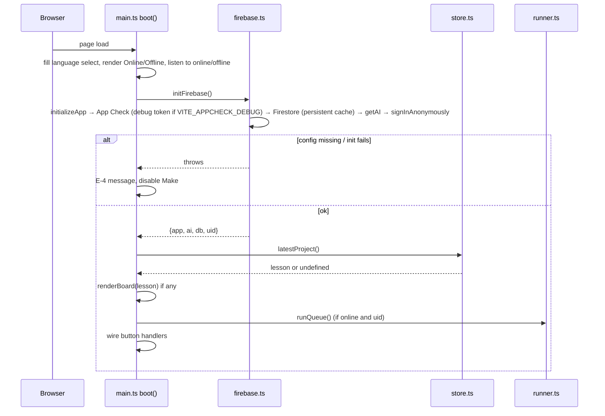

# 07 · Frontend implementation guide

|              |                                                                                                                                                                |
| ------------ | -------------------------------------------------------------------------------------------------------------------------------------------------------------- |
| Last updated | 2026-11-19                                                                                                                                                     |
| Owner        | Frontend Architect                                                                                                                                             |
| Inputs       | [02 UX](02-ux-design.md) · [03 Screen design](03-screen-design.md) · [04 Functional spec](04-functional-spec.md) · [TDD §9](../TDD.md#9-frontend-architecture) |
| Code         | `apps/web/` · Index: [docs/README](README.md)                                                                                                                  |

Lessonreel has **no custom backend**, so the frontend _is_ the application. This guide tells a developer or coding agent exactly how the web app is organised and how to change it without breaking things.

## Contents

1. [Stack and why](#1-stack-and-why)
2. [Folder and module map](#2-folder-and-module-map)
3. [Start-up sequence](#3-start-up-sequence)
4. [Views and the DOM](#4-views-and-the-dom)
5. [State](#5-state)
6. [Events](#6-events)
7. [Talking to services](#7-talking-to-services)
8. [Forms and validation](#8-forms-and-validation)
9. [Loading, empty, success and error states](#9-loading-empty-success-and-error-states)
10. [Styling and responsive rules](#10-styling-and-responsive-rules)
11. [Accessibility rules](#11-accessibility-rules)
12. [Security rules for frontend code](#12-security-rules-for-frontend-code)
13. [Environment variables](#13-environment-variables)
14. [Performance](#14-performance)
15. [Testing the frontend](#15-testing-the-frontend)
16. [How to add a new view or control (recipe)](#16-how-to-add-a-new-view-or-control-recipe)
17. [Planned frontend work](#17-planned-frontend-work)

## 1. Stack and why

| Choice                               | Why                                                                            | Decision                                             |
| ------------------------------------ | ------------------------------------------------------------------------------ | ---------------------------------------------------- |
| TypeScript (strict)                  | Catches mistakes in SDK calls before running                                   | [TDD §7](../TDD.md#7-technology-stack-and-rationale) |
| Vite                                 | Fast dev server; builds a static site for Firebase Hosting                     | TDD §7                                               |
| **No UI framework** (plain DOM)      | One page, a handful of states; less to learn, smaller bundle                   | [ADR-008](../TDD.md#adr-008-vanilla-typescript-ui)   |
| Plain CSS with custom properties     | Tokens from [03 §3](03-screen-design.md#3-visual-design-system), no build step | 03                                                   |
| `@lessonreel/core` workspace package | All rules/limits live in one place, unit-tested                                | [TDD §8](../TDD.md#8-system-components)              |

## 2. Folder and module map

```
apps/web/
├── index.html            Page skeleton: S-0 header, S-1 form, S-2…S-5 containers (fixed ids)
├── .env.example          Variable names only (copy to .env.local)
├── vite.config.ts        Dev port 5173, build target es2022
└── src/
    ├── main.ts           Conductor: grabs elements, wires events, renders views, calls services
    ├── config.ts         Reads VITE_* env vars (Firebase config, model names, App Check flags)
    ├── firebase.ts       Starts Firebase in the right order (App Check FIRST) → {app, ai, db, uid}
    ├── style.css         Design tokens + layout + components
    ├── ai/
    │   ├── storyboard.ts Hybrid model (PREFER_ON_DEVICE), Nano warm-up, generate → validate → repair
    │   └── cloud-media.ts Cloud-only: translate, TTS (WAV), scene image
    └── lib/
        ├── store.ts      IndexedDB (lessons, assets) + Firestore job records
        ├── runner.ts     Drains the job queue while online (2 at a time, stale-job recovery)
        ├── player.ts     In-page preview
        └── exporter.ts   Canvas + Web Audio + MediaRecorder → one video file
```

**Dependency direction:** `main.ts` → `ai/*`, `lib/*` → `firebase.ts`, `config.ts`, `@lessonreel/core`. Nothing imports `main.ts`. `@lessonreel/core` imports nothing from the web app.

## 3. Start-up sequence



Rule: **App Check must be initialised before any AI call.** Don't reorder `firebase.ts`.

## 4. Views and the DOM

The page is static HTML with fixed container ids; TypeScript fills them. Screen IDs match [02 §6](02-ux-design.md#6-screen-inventory).

| View              | Container / element ids                                       | Rendered by                    |
| ----------------- | ------------------------------------------------------------- | ------------------------------ |
| S-0 Status bar    | `#net`, `#nano`, `#warm`                                      | `renderNet()`, `onWarm()`      |
| S-1 Create lesson | `#notes`, `#audience`, `#scenes`, `#lang`, `#make`, `#status` | static HTML + `setStatus()`    |
| S-2 Storyboard    | `#board`                                                      | `renderBoard()`                |
| S-3 Production    | `#queue`                                                      | `runQueue()` → `onProgress`    |
| S-4 Preview       | `#play`, `#stage`                                             | `onPlay()` → `player.ts`       |
| S-5 Download      | `#download`                                                   | `onDownload()` → `exporter.ts` |

Element access goes through the typed `els` object at the top of `main.ts`. **Add new elements there**, not with ad-hoc `getElementById` calls scattered around.

## 5. State

| State                       | Where                        | Lifetime                | Notes                                                    |
| --------------------------- | ---------------------------- | ----------------------- | -------------------------------------------------------- |
| `fb` (Firebase services)    | module variable in `main.ts` | page                    | `null` until `initFirebase()` succeeds                   |
| `current` (active lesson)   | module variable in `main.ts` | page                    | Set after a storyboard or on reload                      |
| Lessons                     | IndexedDB `project:{id}`     | until site data cleared | Source of truth for storyboard                           |
| Audio / images              | IndexedDB `asset:…`          | same                    | Never in memory longer than needed                       |
| Job records                 | Firestore local cache        | same (+ server copy)    | Read with `listJobs()`; never cache a copy in `main.ts`  |
| UI flags (disabled buttons) | DOM                          | page                    | Derived from progress; re-derive, don't store separately |

Rules:

1. **Durable data lives in `store.ts` only.** UI code never touches IndexedDB or Firestore directly.
2. Don't keep a second copy of job state in memory; ask the store.
3. A new storyboard = a new lesson (`newId()`); old lessons are kept.

## 6. Events

| Event             | Handler                      | Effect                                                     |
| ----------------- | ---------------------------- | ---------------------------------------------------------- |
| `click #warm`     | `onWarm()`                   | Download Nano with % (needs a click: Chrome rule)          |
| `click #make`     | `onMake()`                   | Validate → storyboard → save → plan jobs → `runQueue()`    |
| `click #play`     | `onPlay()`                   | Preview in `#stage`                                        |
| `click #download` | `onDownload()`               | Render and save the file                                   |
| `window online`   | `renderNet()` + `runQueue()` | Resume cloud jobs                                          |
| `window offline`  | `renderNet()`                | Pill → Offline; runner stops itself after the current call |

Every async handler must: **disable its button at the start, re-enable in `finally`**, and report through `setStatus()`. This prevents double submissions.

## 7. Talking to services

There's no fetch/REST code in the app. All service calls go through Firebase SDKs, wrapped by our modules:

| Need                      | Call this                                                       | Never do this                                   |
| ------------------------- | --------------------------------------------------------------- | ----------------------------------------------- |
| Storyboard                | `generateStoryboard(fb.ai, req)`                                | Call `getGenerativeModel` from `main.ts`        |
| Nano download             | `warmUpDeviceModel(fb.ai, onProgress)`                          | Call it without a user click                    |
| Voice / image / translate | queued via `planJobs` + `enqueueJobs`, executed by `drainQueue` | Call `cloud-media.ts` directly from UI handlers |
| Save/load lesson          | `saveProject`, `latestProject`, `loadProject`                   | Use `localStorage` (size limits, no blobs)      |
| Assets                    | `saveAsset`, `loadAsset`, `assetKey(...)`                       | Build asset keys by hand                        |

Contracts and errors: [TDD §12](../TDD.md#12-api-specifications). AI behaviour: [08 AI architecture](08-ai-architecture.md).

## 8. Forms and validation

| Field           | Rule (source)                                                           | Where enforced                    | On invalid          |
| --------------- | ----------------------------------------------------------------------- | --------------------------------- | ------------------- |
| Notes           | 1–12,000 chars trimmed ([BR-1](04-functional-spec.md#2-business-rules)) | `buildStoryboardPrompt` (core)    | E-2 via `setStatus` |
| Audience        | optional, default "secondary school students"                           | `onMake`                          | default used        |
| Scenes          | 3–8, clamped                                                            | core `clamp` + `min/max` on input | clamped silently    |
| Second language | `NARRATION_LANGUAGES` only                                              | `<select>` built from core list   | n/a                 |

Rule: **validation logic belongs in `@lessonreel/core`** so it's unit-tested; the UI only displays the result.

## 9. Loading, empty, success and error states

| View      | Loading                                                         | Empty                                 | Success                            | Error                                  |
| --------- | --------------------------------------------------------------- | ------------------------------------- | ---------------------------------- | -------------------------------------- |
| S-1 / S-2 | Make disabled + "Writing storyboard…" (offline wording differs) | "Your storyboard appears here."       | Board + badge + seconds; status ok | E-1, E-2, E-3 amber status, notes kept |
| S-3       | Badge Cloud + "n/total"                                         | hidden until a lesson exists          | all done → Download enabled        | failed count; E-5 (row view planned)   |
| S-4       | Play disabled while playing                                     | Play disabled until ≥ 1 job done      | plays                              | missing asset → placeholder/duration   |
| S-5       | "Rendering video… n%"                                           | Download disabled until all jobs done | "Video ready (n s, MP4)."          | E-6                                    |
| App       | n/a                                                             | n/a                                   | n/a                                | E-4 → Make disabled                    |

Exact wording: [03 §5 copy table](03-screen-design.md#5-screen-specifications-and-states). Error map: [04 §6](04-functional-spec.md#6-error-handling).

## 10. Styling and responsive rules

- Use tokens (`var(--accent)`, etc.) from `style.css`; **no hard-coded colours** in new CSS.
- Breakpoint: `min-width: 900px` → two columns; below → stacked.
- Planned fix: form row (`.row`) must stack below 900 px (gap in [docs/README](README.md#docs--code-sync)).
- Buttons ≥ 44 px tall; primary = `button`, secondary = `button.ghost`.
- Badges always include text, not just colour.

## 11. Accessibility rules

1. Every input has a `<label>`.
2. Status messages go to `#status` (`role="status"`, `aria-live="polite"`). Don't use `alert()`.
3. Keep the dark focus outline + yellow halo (16:1). Never `outline: none`.
4. Generated images get `alt` from the scene's image prompt.
5. New controls must work with keyboard only (Tab, Enter, Space).

Details and contrast table: [03 §7](03-screen-design.md#7-accessibility).

## 12. Security rules for frontend code

1. **Escape all model text** with `escape()` before putting it into `innerHTML`. Prefer `textContent` for single values.
2. No secrets in code. Firebase web config comes from env and is public by design; **never** add service-account keys or Gemini API keys.
3. Never log the App Check debug token or env values in production code paths.
4. Don't call Gemini outside Firebase AI Logic (rules + App Check protection).
5. Treat notes as untrusted input; they only ever go into prompts, never into HTML unescaped.

## 13. Environment variables

From `apps/web/.env.example` (names only):

| Variable                             | Purpose                        | Local                   | Production    |
| ------------------------------------ | ------------------------------ | ----------------------- | ------------- |
| `VITE_FIREBASE_*` (6)                | Firebase web config            | from console            | same          |
| `VITE_RECAPTCHA_ENTERPRISE_SITE_KEY` | App Check provider             | site key                | site key      |
| `VITE_APPCHECK_DEBUG`                | Print debug token in console   | `true`                  | **`false`**   |
| `VITE_CLOUD_TEXT_MODEL`              | Cloud storyboard + translation | `gemini-3.5-flash-lite` | same (verify) |
| `VITE_TTS_MODEL`                     | Narration                      | `gemini-3.8-flash-tts`  | same          |
| `VITE_IMAGE_MODEL`                   | Scene images (empty = skip)    | pending                 | pending       |

`VITE_` variables are bundled into the browser code, so **only put public values in them.**

## 14. Performance

- Single bundle ~235 KB gzipped (mostly Firebase). Acceptable; code-split later if needed.
- Don't load assets until needed (preview/export read them on demand).
- `URL.createObjectURL` → always `revokeObjectURL` after use (player and exporter do).
- Keep the tab visible during export (background tabs throttle timers).

## 15. Testing the frontend

| What                       | How                                                                                     |
| -------------------------- | --------------------------------------------------------------------------------------- |
| Types, lint, format, build | `pnpm run ci`                                                                           |
| Rules behind the UI        | unit tests in `packages/core/test`                                                      |
| Screens and flows          | manual cases in [09 Test cases](09-test-cases.md)                                       |
| Offline                    | DevTools → Network → Offline                                                            |
| Phone                      | Firebase preview channel ([BUILD_PLAN](../BUILD_PLAN.md#testing-on-your-phone-phase-4)) |
| Accessibility              | keyboard-only run + Lighthouse                                                          |

## 16. How to add a new view or control (recipe)

1. Check the requirement exists in [04](04-functional-spec.md) and the screen in [02](02-ux-design.md)/[03](03-screen-design.md). If not, update the docs first.
2. Add the element to `index.html` with an `id` and a `<label>` if it's an input.
3. Add it to `els` in `main.ts`.
4. Put any rule/validation in `@lessonreel/core` with a unit test.
5. Write a small `render…()` or `on…()` function; disable/re-enable buttons; use `setStatus()`; escape model text.
6. Style with tokens; check 390 px and 1280 px widths.
7. `pnpm run ci`, then test in the browser (online, offline, phone).
8. Add test cases to [09](09-test-cases.md); update [FEATURE_GUIDE](../FEATURE_GUIDE.md) after Benjamin approves.

## 17. Planned frontend work

Tracked in [BUILD_PLAN](../BUILD_PLAN.md) and the [docs gap table](README.md#docs--code-sync): Nano check on load (Stage 1), character counter + sample notes + privacy line + stacked form row (Stage 2), per-scene progress + retry (Stage 8), quiz panel + copy (Stage 11), edit scene (Stage 12), slow toggle (Stage 13), E-8/E-9 messages.
