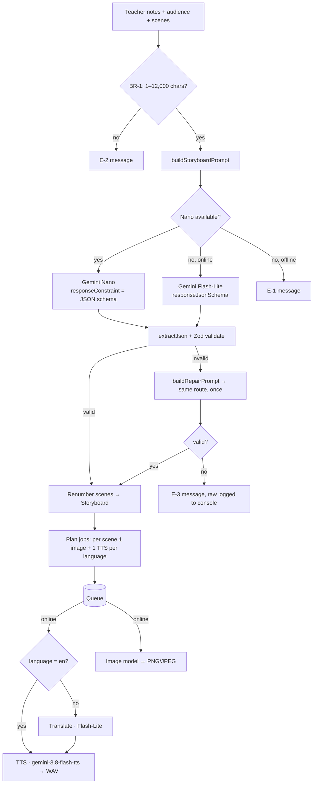

# 08 · AI architecture

|              |                                                                                                                                                                                       |
| ------------ | ------------------------------------------------------------------------------------------------------------------------------------------------------------------------------------- |
| Last updated | 2026-11-19                                                                                                                                                                            |
| Owner        | AI/ML Architect                                                                                                                                                                       |
| Inputs       | [04 Functional spec](04-functional-spec.md) (F2–F5, BR-1–BR-12) · [TDD §12–13](../TDD.md#12-api-specifications) · [HACKATHON.md §6](../HACKATHON.md#6-technologies-and-official-docs) |
| Code         | `packages/core/src/prompts.ts`, `storyboard.ts`, `languages.ts` · `apps/web/src/ai/storyboard.ts`, `cloud-media.ts` · Index: [docs/README](README.md)                                 |

AI is the core of Lessonreel and the core of the hackathon. This document is the single place that explains **which model does what, with which prompt, how we check the output, and what happens when AI fails.**

Labels: **[CONFIRMED]** verified · **[ASSUMED]** not yet verified · **[NEEDS CONFIRMATION]** open · **[RECOMMENDATION]** our choice.

## Contents

1. [AI use cases](#1-ai-use-cases)
2. [Models](#2-models)
3. [Pipeline](#3-pipeline)
4. [Prompts (v1)](#4-prompts-v1)
5. [Input and output formats](#5-input-and-output-formats)
6. [Nano limits and the token budget](#6-nano-limits-and-the-token-budget)
7. [Quality controls: staying true to the notes](#7-quality-controls-staying-true-to-the-notes)
8. [Evaluation plan](#8-evaluation-plan)
9. [Fallback and failure behaviour](#9-fallback-and-failure-behaviour)
10. [Privacy](#10-privacy)
11. [Costs, quotas and rate limits](#11-costs-quotas-and-rate-limits)
12. [Safety](#12-safety)
13. [Changing a prompt or model (procedure)](#13-changing-a-prompt-or-model-procedure)
14. [Open questions and recommendations](#14-open-questions-and-recommendations)

## 1. AI use cases

| #    | Use case                                                                                       | Why AI                                                                                  | Runs where                                        | Req    |
| ---- | ---------------------------------------------------------------------------------------------- | --------------------------------------------------------------------------------------- | ------------------------------------------------- | ------ |
| AI-1 | Notes → storyboard (title, scenes, narration, on-screen text, image prompts, durations) + quiz | Turning notes into spoken, scene-by-scene teaching is the hours-long part teachers skip | **On-device first** (Gemini Nano), cloud fallback | F2, F3 |
| AI-2 | Repair a broken storyboard                                                                     | Small models sometimes drop fields or add prose                                         | Same route as AI-1                                | F2.3   |
| AI-3 | Translate narration                                                                            | Reach learners in a second language                                                     | Cloud                                             | F4.2   |
| AI-4 | Narration audio (TTS)                                                                          | Teachers don't have time or equipment to record                                         | Cloud                                             | F4.1   |
| AI-5 | Scene illustration                                                                             | No time to find images; avoids copyright issues                                         | Cloud                                             | F5     |

Not AI: validation (Zod), job planning, preview, export.

## 2. Models

| Use                         | Model                                                   | Access                                                        | Status                                                                                |
| --------------------------- | ------------------------------------------------------- | ------------------------------------------------------------- | ------------------------------------------------------------------------------------- |
| AI-1, AI-2 (device)         | **Gemini Nano 4** via Chrome Prompt API                 | Firebase AI Logic `PREFER_ON_DEVICE`                          | **[CONFIRMED]** required for Web by rules; ⬜ not yet run on Benjamin's laptop        |
| AI-1, AI-2 (fallback), AI-3 | `gemini-3.5-flash-lite` (`VITE_CLOUD_TEXT_MODEL`)       | AI Logic cloud, Gemini Developer API backend                  | **[NEEDS CONFIRMATION]** availability in our project (named in organizer resources)   |
| AI-4                        | `gemini-3.8-flash-tts` (`VITE_TTS_MODEL`), voice `Kore` | AI Logic `ONLY_IN_CLOUD`, `responseModalities: [AUDIO]`       | **[CONFIRMED]** in Firebase docs; `gemini-3.1-flash-tts-preview` shut down 2026-11-17 |
| AI-5                        | Gemini image model (`VITE_IMAGE_MODEL`)                 | AI Logic `ONLY_IN_CLOUD`, `responseModalities: [TEXT, IMAGE]` | **[NEEDS CONFIRMATION]** model name; may need quota account                           |

**Why these:** Nano is mandatory and free/offline. Flash-Lite is the cheapest, fastest cloud text model for a short structured task. Gemini TTS covers 5 useful languages with natural voices. One SDK (AI Logic) for everything keeps App Check protection on every call.

**Model capabilities and limits that shape the design [CONFIRMED in SDK/docs]:**

- Nano: single-turn, text (and JPEG/PNG) in, **text out only**, ~9,216 tokens, no tools, no chat history.
- TTS reads text **as given**, so translation must happen first (ADR-007).
- TTS languages offered: en-US, fr-FR, es-ES, hi-IN (GA), sw-KE (preview). **Not** Yoruba/Igbo/Hausa/Pidgin.

## 3. Pipeline

**In plain words:** we check the notes, build one prompt, and send it to Nano if the laptop has it (or the cloud if not). Whatever comes back must match our JSON shape; if it doesn't, we ask once to fix it. Then each scene gets cloud jobs for voice (translated first if needed) and a picture.

## 4. Prompts (v1)

Source of truth: `packages/core/src/prompts.ts`. Version: **prompt v2 (2026-11-20)**. v2 changes one line of §4.2: "Make exactly N scenes" became "Make up to N scenes, and at least 3. Use fewer when the notes are short." Reason: v1 contradicted the system prompt ("If the notes are thin, make fewer scenes") and pushed small models to pad thin notes with invented facts (§14 #1). Evaluate per §8 before relying on it.

### 4.1 Storyboard system prompt (`STORYBOARD_SYSTEM_PROMPT`)

> You turn a teacher's lesson notes into a short explainer video plan. Write for the stated audience in plain, warm, spoken language. Each scene teaches one idea. Narration is what a narrator says aloud, not a summary. Image prompts describe a simple, clean illustration with no text in the image. Never invent facts that are not in the notes. If the notes are thin, make fewer scenes. Reply with JSON only. No markdown, no commentary.

On-device it's passed as an `initialPrompts` system message; in the cloud as `systemInstruction`.

### 4.2 Storyboard user prompt (`buildStoryboardPrompt`)

Lines: audience → "Make up to N scenes, and at least 3. Use fewer when the notes are short. Each narration is at most 400 characters." → quiz instruction (3 questions × 3 options, 0-based answer) → JSON shape hint → notes inside `"""` fences.

### 4.3 Repair prompt (`buildRepairPrompt`)

"This JSON storyboard has a problem: {validation message}. Return the corrected JSON only, same shape, no commentary." + first 6,000 chars of the bad output.

### 4.4 Translation prompt (`translateNarration`)

"Translate this classroom narration into the language with BCP-47 code {code}. Keep it simple and spoken. Reply with the translation only." Temperature 0.2.

### 4.5 TTS instruction (`buildNarrationStyle`)

"Say this as a warm, patient teacher speaking to {audience}, {at a natural teaching pace | slowly and clearly, with short pauses}: {text}". Voice `Kore`.

### 4.6 Image prompt (`generateSceneImage`)

"Simple, friendly classroom illustration, 16:9, no text or letters in the image. {scene.imagePrompt}"

### Generation settings

| Call                | Temperature    | Structured output                                                                                 |
| ------------------- | -------------- | ------------------------------------------------------------------------------------------------- |
| Storyboard (cloud)  | 0.4            | `responseMimeType: application/json` + `responseJsonSchema`                                       |
| Storyboard (device) | Chrome default | `promptOptions.responseConstraint` (JSON schema) **[NEEDS CONFIRMATION]** honoured on every build |
| Translate           | 0.2            | none                                                                                              |
| TTS / image         | default        | n/a                                                                                               |

## 5. Input and output formats

| Call       | Input                 | Output                                                       | Validated by                                                          |
| ---------- | --------------------- | ------------------------------------------------------------ | --------------------------------------------------------------------- |
| Storyboard | prompt text           | JSON `{title, audience, scenes[3–8], quiz[≤3]}`              | `StoryboardSchema` (Zod) + `extractJson` (handles fences/prose)       |
| Translate  | narration ≤ 400 chars | plain text                                                   | trimmed; non-empty assumed **[RECOMMENDATION]** add a non-empty check |
| TTS        | text                  | base64 WAV (24 kHz, 16-bit, mono) via `inlineDataParts()[0]` | throws if no audio part                                               |
| Image      | prompt                | base64 image via `inlineDataParts()` (`image/*`)             | `null` if none                                                        |

Field limits (BR-2–BR-5): scenes 3–8 · narration 1–400 · title ≤ 80 · on-screen ≤ 120 · image prompt ≤ 300 · duration 3–30 s · quiz ≤ 3 × exactly 3 options.

## 6. Nano limits and the token budget

Rough rule: **~4 characters per English token [ASSUMED]**.

| Step                       | Calculation                                                                                                | Tokens             |
| -------------------------- | ---------------------------------------------------------------------------------------------------------- | ------------------ |
| Max notes                  | 12,000 chars ÷ 4                                                                                           | ≈ 3,000            |
| System + instruction lines | ~1,000 chars ÷ 4                                                                                           | ≈ 250              |
| **Input total**            | 3,000 + 250                                                                                                | **≈ 3,250**        |
| Max output: 8 scenes       | narration 400 + title 80 + on-screen 120 + image 300 + keys ~100 = 1,000 chars/scene × 8 = 8,000 chars ÷ 4 | ≈ 2,000            |
| Quiz                       | 3 × ~300 chars = 900 ÷ 4                                                                                   | ≈ 225              |
| **Output total**           | 2,000 + 225                                                                                                | **≈ 2,225**        |
| **Grand total**            | 3,250 + 2,225                                                                                              | **≈ 5,475**        |
| Nano limit                 |                                                                                                            | ~9,216             |
| **Headroom**               | 9,216 − 5,475                                                                                              | **≈ 3,741 (~40%)** |

So the 12,000-character cap keeps even the largest lesson inside Nano's window with room to spare. Non-English notes use more tokens per character, which is another reason for the cap.

## 7. Quality controls: staying true to the notes

| Risk                  | Control                                                                        | Where                |
| --------------------- | ------------------------------------------------------------------------------ | -------------------- |
| Invented facts        | System prompt: "Never invent facts that are not in the notes"                  | prompt v1            |
| Padding thin notes    | "If the notes are thin, make fewer scenes", but see conflict in §14            | prompt v1            |
| Broken / partial JSON | Schema constraint + Zod + one repair                                           | `storyboard.ts`      |
| Wrong scene numbering | Renumbered 1..n after validation                                               | `parseStoryboard`    |
| Wrong quiz answers    | Teacher reviews quiz (answer reveal planned, F2.5); quiz drawn from notes only | prompt + UI          |
| Text inside images    | Image prompt says no text                                                      | `generateSceneImage` |
| Wrong language audio  | Translate first, then TTS; manual check AC-4.1                                 | `cloud-media.ts`     |
| Reading level         | Audience is in the prompt; teacher can edit scenes (F2.6, planned)             | prompt + UI          |

The teacher is the final reviewer: storyboards are shown **before** voice/images are generated, and editing (F2.6) lets them fix content.

## 8. Evaluation plan

Run in **Stage 3** (Nano) and **Stage 6** (TTS). Record results in `evidence/`.

**Test set:** 5 real lesson notes: (1) JSS science, (2) SS maths word problems, (3) primary English reading, (4) health/hygiene NGO session, (5) very short notes (2 lines).

| Metric                  | How measured                             | Pass                                |
| ----------------------- | ---------------------------------------- | ----------------------------------- |
| Valid JSON first try    | count / 5 per route                      | ≥ 4/5 on-device, 5/5 cloud          |
| Valid after repair      | count / 5                                | 5/5                                 |
| Time to storyboard (N1) | seconds shown in badge                   | < 60 s on-device                    |
| Faithfulness            | Benjamin marks any fact not in the notes | 0 invented facts per storyboard     |
| Scene count             | requested vs returned                    | matches (or fewer for note 5)       |
| Narration sounds spoken | read 2 scenes aloud                      | natural, audience-appropriate       |
| Quiz correctness        | answers match the notes                  | 3/3 per storyboard                  |
| TTS language check      | listen to 1 scene per language           | correct language, clear (5/5 codes) |

Log format (`evidence/ai-eval.md`): date · note # · route (`on_device`/`in_cloud`) · seconds · valid first try? · repaired? · invented facts · notes.

## 9. Fallback and failure behaviour

| Failure                     | Behaviour                                                           | User sees                  |
| --------------------------- | ------------------------------------------------------------------- | -------------------------- |
| Nano not available, online  | SDK routes to cloud                                                 | Cloud badge                |
| Nano not available, offline | Error caught                                                        | E-1                        |
| Nano still downloading      | Cloud used if online **[ASSUMED]** SDK behaviour; verify in Stage 1 | Cloud badge                |
| Invalid output twice        | Stop                                                                | E-3 (raw in console)       |
| Cloud quota / 429 / network | Job failed, retried up to 3                                         | progress shows failed; E-5 |
| TTS returns no audio        | Job failed ("No audio returned…")                                   | E-5                        |
| Image model missing         | Skip images                                                         | placeholder frames         |
| Model retired               | Change `VITE_*_MODEL`                                               | none after redeploy        |

## 10. Privacy

| Data           | Sent to cloud?                                     | When                     |
| -------------- | -------------------------------------------------- | ------------------------ |
| Lesson notes   | Only if the storyboard runs in the cloud (no Nano) | AI-1 fallback            |
| Narration text | Yes                                                | AI-3 translate, AI-4 TTS |
| Image prompts  | Yes                                                | AI-5                     |
| Personal data  | Not collected                                      | n/a                      |

Show the line "Your notes stay on this device when Gemini Nano is available." (planned, [05 §7](05-data-flow.md#7-privacy-and-retention)). Teachers shouldn't paste student names; the UI may add a hint.

## 11. Costs, quotas and rate limits

Per 5-scene video in English + 1 language:

| Call                  | Count                   | Calculation                 |
| --------------------- | ----------------------- | --------------------------- |
| Storyboard            | 0 (device) or 1 (cloud) | 1 lesson                    |
| Repair                | 0–1                     | rare                        |
| Translate             | 5                       | 5 scenes × 1 extra language |
| TTS                   | 10                      | 5 scenes × 2 languages      |
| Image                 | 5                       | 5 scenes                    |
| **Total cloud calls** | **20–22**               | 0–1 + 0–1 + 5 + 10 + 5      |

- Free-tier limits for TTS and image models: **[NEEDS CONFIRMATION]**. Check the Firebase console before Stage 6/7.
- Runner concurrency = 2 to avoid bursts.
- If limits block the demo: request a Quota Account (Sprint 3, before Nov 25, 7:00 PM Lagos).

## 12. Safety

- Gemini safety filters apply to all cloud calls; blocked responses surface as job failures.
- Notes are untrusted input: they're fenced in `"""` and the model has no tools or data access. A malicious note can only produce a bad storyboard, which the schema limits.
- No generated content is published anywhere; it stays on the teacher's device.

## 13. Changing a prompt or model (procedure)

1. Write the change here first (new version number, reason).
2. Edit `packages/core/src/prompts.ts` (or `.env.example` for model names).
3. Update/add unit tests if the prompt builder's behaviour changes.
4. Re-run the §8 evaluation on at least 3 notes; record in `evidence/ai-eval.md`.
5. Update [TDD](../TDD.md) and [HACKATHON.md §6](../HACKATHON.md#6-technologies-and-official-docs) if a model changed.
6. Benjamin approves → commit `Update storyboard prompt to v2: <reason>` → push.

## 14. Open questions and recommendations

| #   | Item                                                                                                          | Type                 | Proposal                                                                                        |
| --- | ------------------------------------------------------------------------------------------------------------- | -------------------- | ----------------------------------------------------------------------------------------------- |
| 1   | ~~System prompt says "make fewer scenes if notes are thin" but user prompt says "Make **exactly** N scenes"~~ | **Done: prompt v2**  | "Make up to N scenes, and at least 3." Validate during the Stage 3 eval (`evidence/ai-eval.md`) |
| 2   | Is `responseConstraint` honoured by Nano on Benjamin's Chrome?                                                | [NEEDS CONFIRMATION] | Measure first-try validity in §8                                                                |
| 3   | Does `PREFER_ON_DEVICE` use cloud while Nano is downloading?                                                  | [ASSUMED]            | Verify in Stage 1                                                                               |
| 4   | Translation output can be empty                                                                               | Gap                  | **[RECOMMENDATION]** reject empty translation → job fails → retry                               |
| 5   | Image model name + free limits                                                                                | [NEEDS CONFIRMATION] | Check docs/console in Stage 7                                                                   |
| 6   | Should durations come from audio length instead of the model?                                                 | Design               | Already done for export/preview (audio length wins); model duration is a fallback               |
